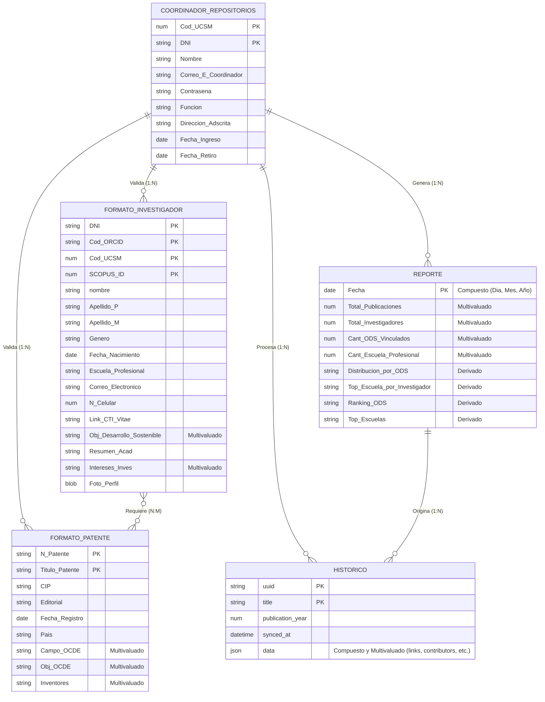
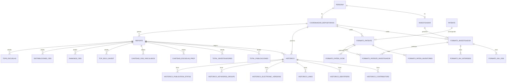

# Resumen ejecutivo

> **Guía de lectura:** este archivo conserva el documento académico de base de datos
> recibido por el equipo. Para el estado vigente del aplicativo, los módulos y la
> forma de probarlos, consulta primero [la guía de documentación de `project_context`](README.md).

El presente documento abordará el desarrollo de la base de datos para la funcionalidad “registro de investigadores y seguimiento del uso de repositorios de investigación” la cual está a cargo del coordinador de repositorios de la Universidad Católica de Santa María. Para la realización de esta, primero se describe brevemente la empresa o institución, seguido a esto se describe la funcionalidad.

La funcionalidad comprende el seguimiento del uso de los repositorios institucionales y el registro a los investigadores y su colocación en el portal del Sistema de Información para la Gestión de la Investigación (CRIS) de la Universidad Católica de Santa María (UCSM). También se describen mediante tablas, los formatos de registro de investigadores y patentes, además se describe el Reporte y el Histórico. La recopilación de esta información se realizó a partir de entrevistas proporcionadas directamente por el responsable de dicha funcionalidad.

Luego se muestra el Modelo entidad-relación para el cual se identificaron cinco entidades: `Formato-Investigador`, `Formato-Patente`, `Coordinador-Repositorios`, `Reporte` e `Historico`, con ellas se realizó las tres partes (Diagrama Entidad-Relación, Diccionario de datos y esquema textual).

Para obtener el modelo relacional se aplicó el algoritmo de mapeo, del cual solo resultaron aplicables los pasos de entidades fuertes, vínculos binarios 1:N, vínculos binarios N:M y atributos multivaluados. Después, el resultado se normalizó hasta la Tercera Forma Normal (3FN), en la que se eliminaron las dependencias transitivas mediante las nuevas relaciones `Persona`, `Investigador` y `Patente`. El modelo relacional resultante se representó con la herramienta de modelado DIA y se documentó en su diccionario de datos.

Finalmente, se desarrolló el modelo físico original en PostgreSQL 16 con 27 tablas. La ampliación CRIS agrega 15 tablas y columnas al modelo existente, para un total de 42 tablas en la instalación desde cero. El detalle de las tablas, columnas, procedimientos e índices se registra en [registro-cambios-esquema-y-flujo-csv-pure.md](registro-cambios-esquema-y-flujo-csv-pure.md); el SQL ejecutable fuente de verdad es `backend/database/base_datos_repositorio.sql`.

> 🟩 **Actualización técnica (noviembre de 2026):** el portal ya está adaptado al esquema
> CRIS. Mantiene los roles Investigador y Coordinador; el coordinador toma las
> decisiones. ORCID verifica existencia si hay credenciales; Scopus API y Pure API no
> están integradas. El CSV de Pure pasa por las tablas de candidaturas existentes;
> se consolidan automáticamente en lote las publicaciones con UUID exacto de autor,
> campos obligatorios válidos y sin DOI duplicado; las demás quedan para revisión.
>
> 🟩 **Cambio de base para CSV Pure:** no se agregaron tablas ni columnas adicionales
> para la importación. Se amplió el `CHECK` de `publicacion_candidata.fuente` para
> aceptar `pure`. El detalle está marcado en
> [registro-cambios-esquema-y-flujo-csv-pure.md](registro-cambios-esquema-y-flujo-csv-pure.md).
>
> 🟨 La base configurada aún no se ha reinstalado con el cambio final. El SQL completo
> debe probarse en una base vacía; el instalador ahora rechaza destinos con tablas.

---

# Introducción

El registro de investigadores y el seguimiento del uso de los repositorios constituyen actividades importantes dentro del área del Vicerrectorado de Investigación (VRINV) de la Universidad Católica de Santa María (UCSM). Dentro de este proceso se desarrollan dos tareas principales: el seguimiento al uso de los repositorios institucionales y el registro de los investigadores para su posterior registro y colocación en el portal del Sistema de Información para la Gestión de la Investigación (CRIS) de la UCSM. Estas actividades están a cargo del coordinador de repositorios, quien tiene entre sus responsabilidades revisar periódicamente los históricos de acceso a los repositorios por parte de los estudiantes de la universidad, así como gestionar las solicitudes de registro de investigadores (Angulo-Osorio, 2026a).

La funcionalidad actual de registro de investigadores en el Portal CRIS y seguimiento del uso de repositorios es principalmente una actividad muy segmentada, debido al uso de formularios, comunicaciones por correo electrónico, descargas de archivos y depuraciones de estos mismos. La falta de seguimiento automatizado del estado de las solicitudes y la necesidad de revisar periódicamente si existen nuevos investigadores para obtener sus identificadores Scopus ID y ORCID, ocasionan que esta tarea demore. Además, para conocer la cantidad de usos de repositorios por estudiantes de la UCSM, se tienen que descargar archivos que tienen información en formato JSON y luego depurarlo, para recién poder realizar el reporte (dashboard). Todo esto puede ocasionar demoras, así como dificultad para conocer el estado de las postulaciones y mayor carga operativa para el personal encargado (Angulo-Osorio, 2026a).

Para el desarrollo del proyecto se siguió la estructura formal establecida por Calderón-Ruiz (2026a). En esta primera parte se realizó la búsqueda de información sobre la Universidad Católica de Santa María ya que es la institución en la que trabaja nuestro contacto, el ingeniero Javier Fernando Angulo Osorio. Se describió la institución, abordando sus datos, misión e información de la unidad de Vicerrectorado de Investigación (VRINV) que es el área hacia la cual está enfocada la funcionalidad.

Asimismo, se realizó la descripción de la funcionalidad que realiza el ingeniero dentro de la UCSM; esta es registro de investigadores y seguimiento de uso de repositorios de investigación. Posteriormente, identificamos las tareas que realiza el ingeniero, los datos que se usan en estos, además de los documentos utilizados para la funcionalidad mencionada anteriormente. Luego, redactamos de manera detallada cada tarea, todo esto siguiendo la estructura del esquema. Seguido a esto colocamos las tablas de los documentos, las cuales estaban divididas en cinco partes: atributos, descripción, tipo de dato, restricciones y ejemplos; los documentos detallados en estas tablas fueron los formatos de registro de investigador y registro de patente. Finalmente colocamos las figuras correspondientes de cada formato y seccionamos estas mismas para su mejor comprensión.

Continuando con el desarrollo, realizamos el Modelo Entidad-Relación (MER), el cual está compuesto por tres partes: Diagrama ER, Diccionario de datos, Esquema de la Entidad. Para la primera parte que es el “Diagrama ER” identificamos las entidades (`Formato_Investigador`, `Formato_Patente`, `Coordinador_Repositorios`, `Reporte` e `Historico`), también identificamos los atributos de estos mismos, los cuales serían todos los datos de llenado de los formatos; para `Reporte` serían los nueve atributos que se aprecian en la Figura 3 y para lo que vendría siendo `Historico`, son todos los atributos del archivo Comma-Separated-Values (CSV) que fue compartido por el ingeniero. Luego identificamos los vínculos de estas relaciones (`Valida`, `Valida`, `Procesa`, `Genera`, `Origina` y `Requiere`), y para finalizar esta primera parte colocamos las cardinalidades y la participación de las entidades. Todo este proceso se realizó utilizando la herramienta de modelado de diagramas DIA.

Continuando con el desarrollo del Modelo Entidad-Relación pasamos a realizar el diccionario de datos de cada entidad identificada, para ello utilizamos una tabla seccionada en cinco partes, las cuales son: Atributo, Dominio, Restricciones, Descripción y Ejemplos. Posterior a esto realizamos el esquema textual del modelo entidad-relación.

Posteriormente, se transformó el MER al modelo relacional mediante el algoritmo de mapeo. En el paso uno se mapearon las cinco entidades fuertes (`Formato_Investigador`, `Formato_Patente`, `Coordinador_Repositorios`, `Historico` y `Reporte`), incluyendo los componentes de sus atributos compuestos. Los pasos dos (entidades débiles) y tres (vínculos binarios 1:1) no aplicaron, ya que el MER no tiene entidades débiles ni relaciones con esa cardinalidad. En el paso cuatro (vínculos binarios 1:N) se agregó la clave del coordinador como clave foránea (FK) en `Formato_Investigador`, `Formato_Patente`, `Historico` y `Reporte` por las relaciones `Valida`, `Procesa` y `Genera`, y la clave compuesta de `Reporte` (`Día`, `Mes` y `Año`) en `Historico` por la relación `Origina`. En el paso cinco (vínculos binarios N:M), la relación `Requiere` dio origen a la tabla `Formato_Patente_Investigador`. En el paso seis se creó una relación por cada atributo multivaluado de `Formato_Investigador`, `Formato_Patente`, `Historico` (entre ellos `links`, que además es compuesto) y `Reporte`. Los pasos siete (vínculos n-arios) y ocho (modelo E-R extendido) no aplicaron, porque todas las relaciones son binarias y no existen superclases ni subclases.

Seguido a esto, se normalizó el resultado del mapeo. La 1FN se cumple porque el paso seis eliminó todos los atributos multivaluados. La 2FN también se cumple, ya que las tablas con clave compuesta solo contienen los atributos de su clave o atributos que dependen de la clave completa, mientras que las demás tienen una clave simple. En la 3FN se detectaron dependencias transitivas: los datos personales (nombres, apellidos, género y fecha de nacimiento) dependían del DNI, los datos institucionales del investigador dependían de su código UCSM y no del formato, y los datos oficiales de la patente dependían de su número de patente. Por ello se crearon las relaciones `Persona`, `Investigador` y `Patente`. El modelo relacional resultante se representó con la herramienta de modelado DIA.

Con el modelo relacional ya normalizado, se elaboró el diccionario de datos del modelo relacional, que documenta cada una de las relaciones resultantes. A diferencia del diccionario del MER, que describe las entidades en cinco partes (Atributo, Dominio, Restricciones, Descripción y Ejemplos), este se estructuró en seis columnas: Atributo, Descripción, Tipo, Tamaño, Clave (PK/FK) y Restricciones. En esta última se indican las restricciones propias del atributo (obligatorio, único y, en las claves foráneas, la relación a la que referencian), además del formato, los valores aceptados y el valor por defecto. De este modo, el diccionario sirve como guía para la posterior implementación de la base de datos.

A continuación, se desarrolló el modelo físico original, que traduce el modelo relacional normalizado a estructuras concretas de PostgreSQL 16. 🟩 La extensión CRIS añade 15 tablas al núcleo de 27, para un total de 42 tablas en el SQL de instalación desde cero. El diagrama y diccionario original describen el núcleo; el registro de cambios enlazado arriba documenta las nuevas tablas, columnas, claves, restricciones e índices. 🟩 La importación CSV de Pure reutiliza las tablas de candidatura y solo amplía la restricción de la fuente permitida.

En la segunda parte del modelo físico se aborda la gestión del almacenamiento: se estima el tamaño de la base de datos a partir del tamaño de los registros de cada tabla, se proyecta su crecimiento según el volumen esperado de formatos, registros históricos y reportes, y se define la estrategia de respaldo para proteger la información. En la tercera parte se presentan los scripts en SQL: el de creación de la base de datos (tablas, claves, restricciones e índices), el de inserción de datos y el de consultas. Al ejecutarlos se comprobó que las restricciones rechazan datos inválidos, como un DNI de cuatro dígitos, un ODS inexistente o un correo de coordinador repetido.

El presente documento está organizado de la siguiente manera: primero, se presenta una descripción general de la institución UCSM y del área del VRINV. Luego, se describe la funcionalidad de registro de investigadores y seguimiento de repositorios de investigación, detallando sus tareas, datos y documentos, y se presentan las tablas y figuras de los documentos utilizados. Posteriormente se muestra el Modelo Entidad-Relación con su diagrama, diccionario de datos y esquema textual. Asimismo, se presenta la transformación del MER al modelo relacional mediante el algoritmo de mapeo, la normalización hasta la tercera forma normal, el modelo relacional resultante y su diccionario de datos. Después se desarrolla el modelo físico en tres partes: el diagrama y diccionario de datos físico, con los ficheros físicos e índices; la gestión del almacenamiento, con el tamaño de la base de datos, la proyección de crecimiento y el respaldo; y los scripts de creación de la base de datos, inserción de datos y consultas. Finalmente se incluyen las conclusiones, referencias y anexos correspondientes.

---

# Descripción general de la empresa/institución

La Universidad Católica de Santa María (UCSM) es una institución educativa privada sin fines de lucro que está ubicada en la región de Arequipa, fundada el 6 de diciembre de 1961 por Rvdo. P. William Daniel Morris Christy y gracias al apoyo del Arzobispado y mediante Decreto Supremo N.° 024 con la misión de formar profesionales íntegros, con fe, compromiso social y vocación de servicio (Universidad Católica de Santa María, s.f.).

Asimismo, el Vicerrectorado de Investigación (VRINV) es la unidad de la UCSM encargada de promover, coordinar y gestionar la investigación científica, la innovación y la transferencia tecnológica (Vicerrectorado de Investigación de la Universidad Católica de Santa María, s.f.).

---

# Descripción detallada de la funcionalidad

La funcionalidad de registro de investigadores y seguimiento de repositorios de investigación de la Universidad Católica de Santa María que realiza el ingeniero Javier Fernando Angulo Osorio engloba dos actividades principales las cuales son dar seguimiento al uso de los repositorios institucionales, y seguimiento a los investigadores para su posterior colocación en el portal CRIS de la UCSM (Angulo-Osorio, 2026a). Todo esto se visualiza en la Tabla 1.

**Tabla 1a y 1b.** *Descripción detallada de la funcionalidad “Registro de investigadores y seguimiento de repositorios de investigación”*

| Tarea | Datos y/o documentos utilizados | Detalle de la tarea |
| :--- | :--- | :--- |
| **Seguimiento al uso de los repositorios institucionales** | **Entidad:** Histórico, dashboard<br>**Datos:**<br>• Nombre de los repositorios<br>• Cantidad de accesos<br>• Escuela<br>• Facultad<br>• Historial de ingresos: hora y correo electrónico<br>• Repositorio al que se ingresó | El coordinador de repositorios realiza el seguimiento del uso de los repositorios institucionales mediante la revisión de los accesos registrados. Analiza información como la hora de ingreso, el correo electrónico del usuario, el repositorio consultado y la cantidad de accesos según la escuela y facultad. Esta información es registrada y organizada por el sistema para generar un dashboard histórico que facilita el análisis del uso de los repositorios. |
| **Seguimiento a los investigadores y colocación de los investigadores en el portal CRIS de la UCSM** | **Entidad:** Investigador.<br>**Datos:**<br>• Nombre del investigador<br>• Afiliación institucional<br>• Código ORCID<br>• Scopus ID<br>• Publicaciones o artículos indexados | El investigador envía su postulación en el portal. El coordinador revisa los datos y las verificaciones disponibles y toma la decisión dentro del sistema. ORCID y Scopus pueden comprobar la existencia de los identificadores; no validan por sí solos identidad, afiliación UCSM ni autoría de cada publicación. El código UCSM se valida localmente por formato y duplicados. Después de aprobar el perfil, el coordinador registra manualmente el identificador de Pure cuando corresponda. |
| **Seguimiento a los investigadores y colocación de los investigadores en el portal CRIS de la UCSM** *(Cont.)* | **Entidad:** Investigador.<br>**Datos:**<br>• Nombre del investigador<br>• Afiliación institucional<br>• Código ORCID<br>• Scopus ID<br>• Publicaciones o artículos indexados | Mediante el ORCID y Scopus ID se sincronizan sus publicaciones de las bases de datos indexadas. Los artículos obtenidos son revisados uno a uno para verificar que correspondan al investigador, estén indexados y no presenten duplicidades. Finalmente, los artículos aceptados se publican en el perfil del investigador. |

*Nota. Datos obtenidos de la entrevista técnica realizada a Angulo-Osorio (2026a).*

---

# Descripción de los documentos utilizados

Los siguientes documentos pertenecen a la segunda tarea, la cual es “Seguimiento a los investigadores y colocación en el portal CRIS”, en el cual se trabaja con cuatro documentos: formato de registro de investigadores, formato de registro de patente, dashboard y un archivo `Pure_research_outputs.csv` (Angulo-Osorio, 2026a).

## Formato de registro de investigadores V1

Este documento es un formato institucional digital utilizado por el coordinador de repositorios para recopilar datos personales y académicos de cada investigador, que se solicitan para poder llegar a ser incorporado en el portal CRIS de la UCSM (Angulo-Osorio, 2026a). Los datos de este documento se presentan en la Tabla 2.

**Tabla 2a y 2b.** *Descripción detallada del documento “Formato de registro investigador”*

| Atributo | Descripción | Tipo de dato | Restricciones | Ejemplos |
| :--- | :--- | :--- | :--- | :--- |
| Nombres | Nombres del investigador | Texto | Obligatorio | Rosa Maria |
| Apellido paterno | Apellido paterno del investigador | Texto | Obligatorio | Aguirre |
| Apellido materno | Apellido materno del investigador | Texto | Obligatorio | Quispe |
| N.º de documento de identidad | Documento de identificación | Texto | Obligatorio | 12345678 |
| Género | Género registrado del investigador | Texto | Obligatorio | Femenino |
| Fecha de nacimiento | Fecha de nacimiento | Fecha | Obligatorio, Formato de fecha | 15/04/2005 |
| Código UCSM | Código institucional del investigador | Numérico | Obligatorio, Según registro institucional | 2020123445 |
| Escuela profesional | Escuela a la que pertenece | Texto | Obligatorio, Debe corresponder a una escuela UCSM | Ingeniería de Sistemas |
| Código ORCID | Identificador académico del investigador | Alfanumérico | Obligatorio, Formato ORCID | 0000-0002-1825-0097 |
| Scopus ID | Identificador del investigador en Scopus | Numérico | Obligatorio, Según registro Scopus | 12345678900 |
| Link CTI Vitae/Renacyt | Enlace al perfil del investigador | Alfanumérico | Obligatorio, URL válida | `https://concytec.gob.pe/[DNI]/[CODIGO]` |
| Correo electrónico | Correo de contacto | Alfanumérico | Obligatorio, Formato de correo válido | `ejemplo@ucsm.edu.pe` |
| N.º de celular | Número telefónico | Numérico | Obligatorio | 987654321 |
| Objetivos de Desarrollo Sostenible | Objetivos de desarrollo sostenible relacionados con la investigación | Texto | Obligatorio, campo de texto | ODS 9: Industria, innovación e infraestructura; ODS 4: Educación de calidad |
| Resumen académico | Descripción de la trayectoria académica | Texto | Obligatorio, Campo de texto | Investigador especializado en... |
| Intereses de investigación | Áreas de interés científico | Texto | Obligatorio, Campo de texto | Inteligencia artificial |
| Foto de perfil | Fotografía de perfil del investigador | Imagen | Obligatorio | `Foto.jpg` |

*Nota. Datos obtenidos de la entrevista técnica realizada a Angulo-Osorio (2026a).*

### Figura del formato de registro de investigador

En la Figura 1 y Figuras 1a-1d se puede observar que el formato de registro de investigador está compuesto por cuatro secciones, las cuales son: Datos del investigador, Resumen académico, Intereses de investigación y Foto de perfil (Angulo-Osorio, 2026b).

**Figura 1.** *Simulación del documento “Formato de registro de investigador” (Vista completa y seccionada 1a–1d)*

```text
+-----------------------------------------------------------------------------------+
| [UCSM] VICERRECTORADO DE INVESTIGACIÓN      Formato de Registro de Perfil en      |
|                                                    Sistema CRIS-Pure              |
+-----------------------------------------------------------------------------------+
| [Fig. 1a] DATOS DEL INVESTIGADOR (Datos personales y relevantes para CRIS-Pure)   |
+-----------------------------------+-----------------------------------------------+
| Nombres                           |                                               |
| Apellido Paterno                  |                                               |
| Apellido Materno                  |                                               |
| Nº de Documento de Identidad      |                                               |
| Género                            |                                               |
| Fecha de Nacimiento               |                                               |
| Código UCSM                       |                                               |
| Escuela Profesional               |                                               |
| Código ORCID                      |                                               |
| Scopus ID                         |                                               |
| Link CTI Vitae/Renacyt            |                                               |
| Correo Electrónico                |                                               |
| Nº de Celular                     |                                               |
| Objetivos de Desarrollo Sostenible*|                                               |
+-----------------------------------+-----------------------------------------------+
*Puede utilizar como referencia: https://www.un.org/sustainabledevelopment/es/objetivos-de-desarrollo-sostenible/

+-----------------------------------------------------------------------------------+
| [Fig. 1b] Resumen académico                                                       |
+-----------------------------------------------------------------------------------+
|                                                                                   |
|                                                                                   |
+-----------------------------------------------------------------------------------+

+-----------------------------------------------------------------------------------+
| [Fig. 1c] Intereses de investigación                                              |
+-----------------------------------------------------------------------------------+
|                                                                                   |
|                                                                                   |
+-----------------------------------------------------------------------------------+

+-----------------------------------------------------------------------------------+
| [Fig. 1d] Foto de perfil                                                          |
+-----------------------------------------------------------------------------------+
|                                                                                   |
|                                                                                   |
|                                                                                   |
+-----------------------------------------------------------------------------------+
```
*Nota. Formato digital proporcionado por Angulo-Osorio (2026b).*

---

## Formato de registro de patente V1

Este documento es un formato institucional digital, utilizado para registrar los datos de cada patente obtenida por uno o más investigadores de la universidad, con el fin de incorporarla al portal CRIS de la UCSM; la descripción de este formato se realiza en la Tabla 3. Asimismo, se requiere que los inventores estén previamente registrados como investigadores mediante el formato descrito en el punto anterior (Angulo-Osorio, 2026a).

**Tabla 3.** *Descripción del “formato de registro de patente”*

| Atributo | Descripción | Tipo de dato | Restricciones | Ejemplos |
| :--- | :--- | :--- | :--- | :--- |
| Título de la patente | Nombre oficial de la patente registrada. | Texto | Obligatorio | Sistema de Riego automatizado por goteo |
| CIP | Clasificación Internacional de Patentes asignada | Alfanumérico | Obligatorio, Código de clasificación | A01G 25/02 |
| Número de patente | Número oficial otorgado por la entidad registradora | Alfanumérico | Obligatorio | PE-001234 |
| Editorial | Entidad u oficina que otorga o publica la patente. | Texto | Obligatorio | INDECOPI |
| Fecha de registro | Fecha en que se registró oficialmente la patente. | Fecha | Obligatorio, Formato de fecha | 12/08/2024 |
| País | País en el que se registró oficialmente la patente. | Texto | Obligatorio | Perú |
| Campo OCDE | Campo científico según la clasificación de la OCDE | Texto | Obligatorio, Clasificación científica | Ingeniería y tecnología |
| Objetivos OCDE | Sector socioeconómico o propósito final de la investigación y desarrollo de la patente según el estándar de la OCDE. | Texto | Obligatorio, Puede existir más de un OCDE | Producción y tecnología industrial |
| Inventores | Investigadores autores de la patente (deben estar previamente registrados) | Texto | Obligatorio, mínimo un inventor | Aguirre Quispe, Rosa María |

*Nota. Datos obtenidos del formato digital proporcionado por Angulo-Osorio (2026b).*

### Figura del formato del registro de patente V1

En la Figura 2 y las Figuras 2a-2b se puede observar el documento del formato de registro de patente utilizado por el sistema CRIS de la UCSM, donde se pueden visualizar los Datos de la Patente e inventores (Angulo-Osorio, 2026b).

**Figura 2.** *Simulación del documento “Formato de registro de Patente V1” (Secciones 2a y 2b)*

```text
+-----------------------------------------------------------------------------------+
| [UCSM] VICERRECTORADO DE INVESTIGACIÓN     Formato de Registro de Patente en      |
|                                                    Sistema CRIS-Pure              |
+-----------------------------------------------------------------------------------+
| [Fig. 2a] DATOS DE LA PATENTE (Datos de la patente relevantes para CRIS-Pure)     |
+-----------------------------------+-----------------------------------------------+
| Título de la patente              |                                               |
| CIP                               |                                               |
| Número de patente                 |                                               |
| Editorial                         |                                               |
| Fecha de registro                 |                                               |
| País                              |                                               |
| Campo OCDE*                       |                                               |
| Objetivos OCDE*                   |                                               |
+-----------------------------------+-----------------------------------------------+
*Puede utilizar como referencia: https://www.un.org/sustainabledevelopment/es/objetivos-de-desarrollo-sostenible/

+-----------------------------------------------------------------------------------+
| [Fig. 2b] Inventores (Deben estar previamente registrados con su perfil)          |
+-----------------------------------------------------------------------------------+
| Apellidos y nombres 1                                                             |
| Apellidos y nombres 2                                                             |
| Apellidos y nombres 3                                                             |
| Apellidos y nombres 4                                                             |
+-----------------------------------------------------------------------------------+
```
*Nota. Formato digital proporcionado por Angulo-Osorio (2026b).*

---

## Reporte

El Reporte (Dashboard) es la ventana del sistema donde se presenta un resumen general de los indicadores más relevantes del proceso de investigación en la UCSM (Angulo-Osorio, 2026a).

En la Tabla 4 se describen los nueve atributos que conforman esta ventana, entre los cuales se encuentran la cantidad de escuelas profesionales registradas, el total de investigadores y publicaciones, el ranking y distribución de los Objetivos de Desarrollo Sostenible (ODS) vinculados a las investigaciones, así como las escuelas, investigador con mayor número de publicaciones y la fecha (Angulo-Osorio, 2026b).

**Tabla 4a y 4b.** *Descripción detallada de la ventana "Dashboard" del resumen general del sistema de Investigación UCSM*

| Atributo | Descripción | Tipo de dato | Restricciones | Ejemplos |
| :--- | :--- | :--- | :--- | :--- |
| `Cant_Escuela_Profesional` | Cantidad de escuelas profesionales registradas en el sistema | Numérico | Obligatorio | 12 |
| `Total_Publicaciones` | Total de publicaciones registradas en el sistema | Numérico | Obligatorio | 350 |
| `Ranking_ODS` | Ranking de los Objetivos de Desarrollo Sostenible según su frecuencia | Alfanumérico | Obligatorio | ODS 9, ODS 4, ODS 3 |
| `Cant_ODS_Vinculados` | Cantidad de Objetivos de Desarrollo Sostenible vinculados a investigaciones o patentes | Numérico | Obligatorio | 8 |
| `Total_Investigadores` | Total de investigadores registrados en el sistema | Numérico | Obligatorio | 45 |
| `Distribución_por_ODS` | Distribución de investigaciones o patentes según los Objetivos de Desarrollo Sostenible | Alfanumérico | Obligatorio | ODS 9: 20%, ODS 3: 15% |
| `Top_Escuelas` | Listado de las escuelas profesionales con mayor número de investigadores o publicaciones | Texto | Obligatorio | Ingeniería de Sistemas |
| `Top_escuela_investigador` | Investigador con mayor número de publicaciones por escuela profesional | Texto | Obligatorio | Bruno Torres, Ana Paula |
| `Fecha` | Fecha del momento en que se revisa el dashboard o reporte | Fecha | Obligatorio | 22/10/2026 |

*Nota. Datos obtenidos del formato digital proporcionado por Angulo-Osorio (2026b).*

### Figura de la ventana "Dashboard" del resumen general del sistema de Investigación UCSM

En la Figura 3 se puede observar la representación visual del Dashboard, donde se muestran de manera gráfica los indicadores descritos anteriormente, facilitando su interpretación y análisis por parte del coordinador de repositorios (Angulo-Osorio, 2026b).

**Figura 3.** *Simulación de la ventana “Dashboard” del resumen general del sistema de Investigación UCSM*

```text
+------------------+--------------------------------------------------------------------------+
| [UCSM] VRINV     | Dashboard - Resumen general del sistema de investigación UCSM            |
| Dirección Inv.   | Filtros: [AÑO: Todos v] [MES: Todos v]     Usuario: Javier Angulo (Admin)|
+------------------+--------------------------------------------------------------------------+
| > Dashboard      |  +---------------+  +---------------+  +---------------+  +------------+ |
|   Investigadores |  | 134           |  | 2519          |  | 33            |  | 17         | |
|   Ranking ODS    |  | Investigadores|  | Publicaciones |  | Escuelas Prof.|  | ODS Vinc.  | |
| EVOLUCIÓN        |  +---------------+  +---------------+  +---------------+  +------------+ |
|   Por Autor      |                                                                          |
|   Por Escuela    |  [Top Escuelas por Investigadores]       [Distribución por ODS]          |
|   Por Universidad|  Ing. Biotecnológica ██████████████ 15    ( Gráfico Circular / Dona )    |
|   Por ODS        |  Farmacia y Bioquím.  ███████████ 12       - ODS 3 (Salud)   25%        |
|   Por Género     |  Medicina Humana      █████████ 10         - ODS 7 (Energía) 15%        |
| ANÁLISIS AVANZADO|  Ing. de Sistemas     ████████ 9           - ODS 4 (Educac.) 12%        |
|   Resumen General|  Derecho              ███████ 8            - ODS 9 (Industr) 11%        |
|   Por Investigad.|                                                                          |
|   Tendencias     |  [Ranking ODS]                           [Top Escuelas]                  |
|   Cobertura ODS  |  1. ODS 3 - Salud y bienestar      (70)  1. Ing. Biotecnológica    (15) |
| PRODUCCIÓN       |  2. ODS 7 - Energía asequible      (39)  2. Farmacia y Bioquímica   (12) |
|   Publicaciones  |  3. ODS 4 - Educación de calidad   (31)  3. Medicina Humana         (10) |
|   Journals       |  4. ODS 9 - Industria e innovación (30)  4. Ing. de Sistemas        (9)  |
+------------------+--------------------------------------------------------------------------+
```
*Nota. Formato digital proporcionado por Angulo-Osorio (2026b).*

---

## Histórico

En el siguiente documento Comma-Separated Values (CSV) se presenta la data sin depurar del ingreso o usos de repositorios institucionales, que hacen los alumnos de la UCSM. En la Tabla 5 se describen los cinco campos que posee el archivo CSV: `uuid`, `title`, `publication_year`, `data`, `synced_at` (Angulo-Osorio, 2026a, 2026c).

**Tabla 5.** *Descripción detallada del documento “Histórico”*

| Atributo | Descripción | Tipo de dato | Restricciones | Ejemplos |
| :--- | :--- | :--- | :--- | :--- |
| `uuid` | Identificador único universal asignado a cada registro de investigación. | Alfanumérico | Obligatorio | `123e4567-e89b-12d3-a456-426614174000` |
| `title` | Título oficial de la publicación o resultado de investigación registrado. | Texto | Obligatorio | Machine learning applications in sustainable agriculture |
| `publication_year` | Año en que se publicó oficialmente el resultado de investigación. | Numérico | Obligatorio | 2024 |
| `data` | Contenido, metadatos adicionales o información detallada asociada al resultado en formato de texto o JSON. | Alfanumérico | Opcional / Según corresponda | `{"doi": "10.1016/j.compag.2024.108922", "authors": [{"name": "Pérez, Juan", "orcid": "0000-0002-1825-0097"}], "abstract": "...", "keywords": ["AI", "Smart Farming"], "publisher": "Elsevier"}` |
| `synced_at` | Fecha y hora exacta en que el registro fue sincronizado o actualizado en el sistema. | Alfanumérico | Obligatorio | `2024-08-12 14:30:00` |

*Nota. Datos obtenidos del archivo CSV proporcionado por Angulo-Osorio (2026c).*

### Imagen del documento Histórico

En la Figura 4 se puede visualizar la mayor parte del archivo CSV, con sus campos correspondientes, así como también se pueden visualizar varios registros de estos mismos, en los que se encuentra el campo de `data`, el cual contiene metadatos en formato JSON.

**Figura 4.** *Simulación del documento `Pure_research_outputs.csv` (Vista en hoja de cálculo)*

| | A (`uuid`) | B (`title`) | C (`publication_year`) | D (`data` - JSON) | E (`synced_at`) |
| :-: | :--- | :--- | :-: | :--- | :--- |
| **1** | `uuid` | `title` | `publication_year` | `data` | `synced_at` |
| **2** | `00613c8a-a1e6...` | Biomass and sterol production... | 2015 | `{"type": {"uri": "/dk/atira/pure/..."}}` | `14/05/2026 21:20` |
| **3** | `006a89da-6bdf...` | Synthesis of [60]fullerene... | 2011 | `{"type": {"uri": "...contributiontojournal/article"}, "uuid": "006a89da...", "links": [{"url": "https://www.scopus.com/..."}], "pages": "184-190", "volume": "217", "abstract": {"en_US": "<p>The preparation..."}, "contributors": [{"name": {"lastName": "Santos", "firstName": "Leandro J."}}]}` | `14/05/2026 21:20` |
| **4** | `006cd87f-024f...` | Indicadores de... | 2017 | `{"type": {"uri": "..."}, "identifiers": [{"value": "78650679254", "idSource": "Scopus"}]}` | `14/05/2026 21:20` |

*Nota. Formato digital proporcionado por Angulo-Osorio (2026c).*

---

# Modelo Entidad Relación

El modelo entidad-relación (MER) es una representación conceptual, que permite describir cómo se organizan y cómo se relacionan los datos dentro de una base de datos. Este modelo identifica principalmente las entidades, los atributos y las relaciones que existan entre ellas; además, puede representar la cardinalidad que indica cuántas instancias de una entidad pueden relacionarse con las de otra entidad. De esta manera el modelo entidad-relación permite visualizar la estructura de los datos y establecer una base para diseño y análisis posterior de una base de datos (Belcic & Stryker, s.f.).

## Diagrama Entidad Relación

En la Figura 5 se presenta el diagrama entidad-relación del registro de investigadores y seguimiento de repositorios. Este incluye cinco entidades: `Formato_Investigador` (datos personales y académicos), `Formato_Patente` (datos de patentes), `Coordinador_Repositorios` (validador y procesador), `Histórico` (producción científica) y `Reporte` (indicadores estadísticos).

El `Coordinador_Repositorios` se vincula con `Formato_Investigador` y `Formato_Patente` mediante la relación `Valida`; con `Historico` mediante `Procesa`; y con `Reporte` mediante `Genera` (todas con cardinalidad 1:N).

Por su parte, la entidad `Reporte` resume los indicadores del sistema (totales, escuelas profesionales, ODS vinculados, distribuciones y rankings) y se relaciona con `Historico` mediante `Origina` (1:N), al construir sus métricas a partir de dichos registros.

Asimismo, la entidad `Formato_Patente` se relaciona con la entidad `Formato_Investigador` mediante `Requiere` (N:M) ya que un investigador tiene que estar previamente registrado como investigador.

**Figura 5.** *Modelo Entidad-Relación de la funcionalidad (Representación conceptual)*


*Nota. Elaboración propia.*

---

## Diccionario de Datos

El diccionario de datos es una herramienta que permite describir de manera detallada cada uno de los atributos que conforman las entidades identificadas en el modelo entidad-relación, especificando su dominio, restricciones, descripción y ejemplos representativos, con el fin de facilitar la comprensión y el posterior diseño de la base de datos (McCalla et al., 2012).

Para la funcionalidad de registro de investigadores y seguimiento de repositorios de investigación de la UCSM, se elaboró el diccionario de datos correspondiente a las entidades `Formato_Investigador`, `Formato_Patente`, `Coordinador_Repositorios`, `Historico` y `Reporte`, considerando los atributos identificados a partir de los formatos institucionales y la información proporcionada por el coordinador de repositorios (Angulo-Osorio, 2026a, 2026b, 2026c).

### Diccionario de Datos `Formato_Investigador`

La Tabla 6 presenta el diccionario de datos de la entidad `Formato_Investigador`. Esta entidad incluye datos de identificación como nombres, apellidos y documento nacional de identidad; datos institucionales, como el código UCSM y la escuela profesional; e identificadores académicos, como el código ORCID y el Scopus ID. También contempla información de contacto, el enlace al perfil CTI Vitae/Renacyt, los objetivos de desarrollo sostenible relacionados con la investigación, el resumen académico, los intereses de investigación y la foto de perfil, todos estos atributos siendo de llenado obligatorio.

**Tabla 6a, 6b y 6c.** *Diccionario de datos de la entidad "Formato_Investigador"*

| Atributo | Dominio | Restricciones | Descripción | Ejemplos |
| :--- | :--- | :--- | :--- | :--- |
| `nombre` | Texto | Obligatorio | Nombres del investigador | Rosa Maria |
| `Apellido_P` | Texto | Obligatorio | Apellido paterno del investigador | Aguirre |
| `Apellido_M` | Texto | Obligatorio | Apellido materno del investigador | Quispe |
| `DNI` | Texto | Obligatorio, único | Documento de identificación del investigador | 12345678 |
| `Genero` | Texto | Obligatorio | Género registrado del investigador | Femenino |
| `Fecha_Nacimiento` | Fecha | Obligatorio, formato de fecha | Fecha de nacimiento del investigador | 15/04/2005 |
| `Cod_UCSM` | Numérico | Obligatorio, único, según registro institucional | Código institucional del investigador | 2020123403 |
| `Escuela_Profesional` | Texto | Obligatorio, debe corresponder a una escuela UCSM | Escuela profesional a la que pertenece el investigador | Ingeniería de Sistemas |
| `Cod_ORCID` | Alfanumérico | Obligatorio, único, formato ORCID | Identificador académico del investigador | 0000-0002-1825-0097 |
| `SCOPUS_ID` | Numérico | Obligatorio, según registro Scopus | Identificador del investigador en Scopus | 12345678900 |
| `Link_CTI_Vitae` | Alfanumérico | Obligatorio, URL válida | Enlace al perfil CTI Vitae/Renacyt del investigador | `https://concytec.gob.pe/[DNI]/[CODIGO]` |
| `Correo_Electronico` | Alfanumérico | Obligatorio, formato de correo válido | Correo de contacto del investigador | `ejemplo@ucsm.edu.pe` |
| `N°_Celular` | Numérico | Obligatorio | Número telefónico del investigador | 987654321 |
| `Obj_Desarrollo_Sostenible` | Texto | Obligatorio, multivaluado | Objetivos de Desarrollo Sostenible relacionados con la investigación | ODS 9: Industria, innovación e infraestructura; ODS 4: Educación de calidad |
| `Resumen_Acad` | Texto | Obligatorio, campo de texto | Descripción de la trayectoria académica del investigador | Investigador especializado en... |
| `Intereses_Inves` | Texto | Obligatorio, campo de texto, multivaluado | Áreas de interés científico del investigador (puede registrar más de una) | Inteligencia artificial; Aprendizaje automático |
| `Foto_Perfil` | Imagen | Obligatorio | Fotografía de perfil del investigador | `foto.jpg` |

*Nota. Elaboración propia con base en Angulo-Osorio (2026a, 2026b).*

### Diccionario de Datos `Formato_Patente`

La Tabla 7 presenta el diccionario de datos de la entidad `Formato_Patente`; contiene atributos relacionados con la identificación de la patente, como el título, la clasificación internacional de patentes, el número oficial, la entidad responsable de su publicación o registro, la fecha y el país de registro. Asimismo, incorpora información sobre el campo científico de acuerdo con la clasificación de la OCDE y los objetivos OCDE. El atributo `Inventores` permite identificar a los investigadores responsables de la patente; por ello, estos deben encontrarse previamente registrados en la entidad `Formato_Investigador`.

**Tabla 7a y 7b.** *Diccionario de datos de la entidad "Formato_Patente"*

| Atributo | Dominio | Restricciones | Descripción | Ejemplos |
| :--- | :--- | :--- | :--- | :--- |
| `Titulo_Patente` | Texto | Obligatorio | Nombre oficial de la patente registrada | Sistema de Riego automatizado por goteo |
| `CIP` | Alfanumérico | Obligatorio, código de clasificación | Clasificación Internacional de Patentes asignada | A01G 25/02 |
| `N°Patente` | Alfanumérico | Obligatorio, único | Número oficial otorgado por la entidad registradora | PE-001234 |
| `Editorial` | Texto | Obligatorio | Entidad u oficina que otorga o publica la patente | INDECOPI |
| `Fecha_Registro` | Fecha | Obligatorio, formato de fecha | Fecha en que se registró oficialmente la patente | 12/08/2024 |
| `Pais` | Texto | Obligatorio | País en el que se registró oficialmente la patente | Perú |
| `Campo_OCDE` | Texto | Obligatorio, clasificación científica, multivaluado | Campos científicos según la clasificación de la OCDE | Ingeniería y tecnología |
| `Obj_OCDE` | Texto | Obligatorio, puede existir más de uno, multivaluado | Sector socioeconómico o propósito final de la I+D de la patente según estándar OCDE | Producción y tecnología industrial |
| `Inventores` | Texto | Obligatorio, multivaluado, mínimo un inventor | Investigadores autores de la patente (deben estar previamente registrados) | Aguirre Quispe, Rosa María |

*Nota. Elaboración propia con base en Angulo-Osorio (2026a, 2026b).*

### Diccionario de Datos `Coordinador_Repositorios`

La Tabla 8 presenta el diccionario de datos de la entidad `Coordinador_Repositorios`. Esta entidad contiene los datos de identificación del coordinador (nombre, DNI y código UCSM), sus datos laborales (función, dirección adscrita, fecha de ingreso y fecha de retiro) y las credenciales necesarias para acceder al sistema. El `Cod_UCSM` actúa como identificador del coordinador. Debido a que la contraseña constituye información sensible, en una implementación real no debería almacenarse directamente, sino mediante un mecanismo de cifrado o mediante funciones de hash.

**Tabla 8a y 8b.** *Diccionario de datos de la entidad "Coordinador_Repositorios"*

| Atributo | Dominio | Restricciones | Descripción | Ejemplos |
| :--- | :--- | :--- | :--- | :--- |
| `Nombre` | Texto | Obligatorio | Nombre completo del coordinador de repositorios | Javier Fernando Angulo Osorio |
| `DNI` | Texto | Obligatorio, único | Documento de identidad del coordinador | 87654321 |
| `Cod-UCSM` | Numérico | Obligatorio, según registro institucional | Código institucional del coordinador | 1000123498 |
| `Funcion` | Texto | Obligatorio | Función que desempeña el coordinador en el seguimiento de repositorios y portal CRIS | Coordinador de repositorios |
| `Dirección-Adscrita` | Texto | Obligatorio | Dirección y oficina institucional a la que está adscrito el coordinador | Dirección de investigación |
| `Fecha-Ingreso` | Fecha | Obligatorio, formato de fecha | Fecha en que el coordinador asumió el cargo | 01/03/2023 |
| `Fecha-Retiro` | Fecha | Opcional, formato de fecha (vacío mientras siga en funciones) | Fecha en que el coordinador dejó el cargo | 31/12/2026 |
| `Correo_E_Cordinador` | Alfanumérico | Obligatorio, único, formato de correo válido | Correo electrónico institucional del coordinador de repositorios | `jangulo@ucsm.edu.pe` |
| `Contraseña` | Alfanumérico | Obligatorio | Contraseña de acceso del coordinador al sistema | `8c6976e5b5410415bde908bd4dee15dfb167a9c873fc4bb8a81f6f2ab448a918` |

*Nota. Elaboración propia con base en Angulo-Osorio (2026a, 2026b).*

### Diccionario de Datos `Historico`

La Tabla 9 presenta el diccionario de datos de la entidad `Historico`; este contiene un identificador propio (`uuid`), `title`, `publication_year`, `synced_at`, y un atributo compuesto llamado `data`, que agrupa los metadatos bibliográficos y administrativos que devuelve el sistema externo para cada registro.

**Tabla 9a, 9b y 9c.** *Diccionario de datos de la entidad "Historico"*

| Atributo | Dominio | Restricciones | Descripción | Ejemplos |
| :--- | :--- | :--- | :--- | :--- |
| `uuid` | Alfanumérico | Obligatorio, único | Identificador único del registro sincronizado | `00613c8a-a1e6-4080-91db-3bf9b426114f` |
| `title` | Texto | Obligatorio | Título de la publicación o registro | Biomass and sterol production from vegetal substrate fermentation using agaricus brasiliensis |
| `publication_year` | Numérico | Obligatorio | Año de publicación del registro | 2015 |
| `synced_at` | Alfanumérico | Obligatorio, formato de fecha y hora | Fecha y hora en que el registro fue sincronizado desde CRIS-Pure | `11/09/2026 09:00` |
| `data.type` | Texto | Obligatorio | Tipo de publicación o documento | Article |
| `data.SubTitle` | Texto | Opcional | Subtítulo de la publicación | A comparative study |
| `data.links` | Alfanumérico | Obligatorio, multivaluado, mínimo un enlace | Enlaces asociados al registro en el sistema; se detalla en `PureId`, `Url`, `Description` y `linkType` | Scopus: `https://www.scopus.com/pages/publications/84930270945` |
| `data.links.PureId` | Numérico | Obligatorio, único | Identificador interno del enlace en el sistema Pure | 14465427 |
| `data.links.URL` | Alfanumérico | Obligatorio, URL válida | Dirección URL del enlace asociado al registro | `https://www.scopus.com/pages/publications/84930270945` |
| `data.links.Description` | Texto | Opcional | Descripción o nombre del enlace | Scopus |
| `data.links.linkType` | Texto | Obligatorio | Tipo de enlace asociado al registro | Enlace externo |
| `data.volume` | Numérico | Opcional | Volumen de la revista o publicación | 38 |
| `data.CreateDate` | Fecha | Opcional | Fecha de creación del registro en el sistema | 22/09/2026 |
| `data.publicationStatuses` | Texto | Obligatorio, multivaluado | Estado de la publicación (puede tener más de un estado) | Published |
| `data.journalNumber` | Numérico | Opcional | Número de la revista donde se publicó | 3 |
| `data.CreateBy` | Alfanumérico | Obligatorio | Usuario o sistema que creó el registro | `Sync_user` |
| `data.version` | Alfanumérico | Obligatorio | Identificador hash de la versión del registro | `821268686ef8dd839853ccf148f0ba91f65c0330` |
| `data.numberOfPages` | Numérico | Opcional | Número de páginas del documento | 9 |
| `data.ModifiedBy` | Texto | Obligatorio | Usuario que realizó la última modificación | Root |
| `data.abstract` | Texto | Opcional | Resumen del contenido de la publicación | Estudio sobre producción de biomasa y esteroles... |
| `data.totalNumberOfContributors` | Numérico | Obligatorio | Número total de autores o colaboradores | 9 |
| `data.peerReview` | Texto | Obligatorio | Indica si la publicación pasó por revisión por pares | `true` |
| `data.pages` | Alfanumérico | Opcional | Rango de páginas del documento | 222-279 |
| `data.language` | Texto | Obligatorio | Idioma de la publicación | English |
| `data.category` | Texto | Obligatorio | Categoría temática del registro | Research |
| `data.type_discriminator` | Texto | Obligatorio | Subtipo o clasificación técnica del registro en el sistema | ContributionToJournal |
| `data.identifiers` | Alfanumérico | Obligatorio, multivaluado | Identificadores adicionales asociados al registro (DOI, Scopus ID, etc.) | `84930270945 (Scopus); 10.1111/jfq.12137 (DOI)` |
| `data.visibility` | Texto | Obligatorio | Nivel de visibilidad del registro en el portal | FREE - Público, sin restricción |
| `data.ModifiedDate` | Fecha | Obligatorio | Fecha de la última modificación del registro | 06/01/2026 |
| `data.bibliographicalNote` | Alfanumérico | Opcional | Nota bibliográfica adicional del registro | Publisher Copyright: © 2015 Wiley Periodicals, Inc. |
| `data.contributors` | Texto | Obligatorio, multivaluado, mínimo un contribuyente | Autores o colaboradores del registro | Mokochinski, João Benhur |
| `data.SubmissionYear` | Numérico | Obligatorio | Año en que se envió o presentó la publicación | 2015 |
| `data.keywordGroups` | Texto | Obligatorio, multivaluado | Grupos de palabras clave asociadas al registro | Food Science; Safety, Risk, Reliability and Quality |
| `data.system_name` | Texto | Obligatorio | Nombre del sistema u objeto de origen del registro | ResearchOutput |
| `data.portalURL` | Alfanumérico | Obligatorio, URL válida | Enlace de la publicación en el portal público | `https://ucsm.elsevierpure.com/en/publications/00613c8a...` |
| `data.electronicVersions` | Alfanumérico | Opcional, multivaluado | Enlaces o DOI de versiones electrónicas del documento | `10.1111/jfq.12137` |

*Nota. Elaboración propia con base en Angulo-Osorio (2026c).*

### Diccionario de Datos de `Reporte`

La Tabla 10 presenta el diccionario de datos de la entidad `Reporte`.

**Tabla 10a y 10b.** *Diccionario de datos de la entidad "Reporte"*

| Atributo | Dominio | Restricciones | Descripción | Ejemplos |
| :--- | :--- | :--- | :--- | :--- |
| `Fecha` | Fecha | Obligatorio, identificador del dashboard | Periodo al que corresponde el corte de indicadores, compuesto por Día, Mes y Año | 22/07/2026 |
| `Fecha.Dia` | Numérico | Obligatorio | Día del periodo del dashboard | 22 |
| `Fecha.Mes` | Numérico | Obligatorio | Mes del periodo del dashboard | 7 |
| `Fecha.Año` | Numérico | Obligatorio | Año del periodo del dashboard | 2026 |
| `cant_Escuela_Profesional` | Numérico | Obligatorio, multivaluado | Cantidad de escuelas profesionales registradas en el sistema | 12 |
| `Total_Publicaciones` | Numérico | Obligatorio, multivaluado | Total de publicaciones registradas en el sistema | 350 |
| `Ranking_ODS` | Alfanumérico | Obligatorio, derivado | Ranking de los Objetivos de Desarrollo Sostenible según su frecuencia | ODS 9, ODS 4, ODS 3 |
| `Cant_ODS_Vinculados` | Numérico | Obligatorio, multivaluado | Cantidad de Objetivos de Desarrollo Sostenible vinculados a investigaciones o patentes | 8 |
| `Total_Investigadores` | Numérico | Obligatorio, multivaluado | Total de investigadores registrados en el sistema | 45 |
| `Distribución_por_ODS` | Alfanumérico | Obligatorio, derivado | Distribución de investigaciones o patentes según los Objetivos de Desarrollo Sostenible | ODS 9: 20%, ODS 3: 15% |
| `Top_Escuelas` | Texto | Obligatorio, derivado | Listado de las escuelas profesionales con mayor número de investigadores o publicaciones | Ingeniería de Sistemas |
| `Top_Escuela_por_investigador` | Texto | Obligatorio, derivado | Investigador con mayor número de publicaciones por escuela profesional | Bruno Torres, Ana Paula |

*Nota. Elaboración propia con base en Angulo-Osorio (2026a, 2026b).*

---

## Esquema Textual

* **Formato_Investigador** (<ins>DNI</ins>, <ins>Cod_ORCID</ins>, <ins>Cod_UCSM</ins>, <ins>SCOPUS_ID</ins>, nombre, Apellido_P, Apellido_M, Genero, Fecha_Nacimiento, Escuela_Profesional, Correo_Electronico, N°_Celular, Link_CTI_Vitae, {Obj_Desarrollo_Sostenible}, Resumen_Acad, {Intereses_Inves}, Foto_Perfil)
* **Formato_Patente** (<ins>N°Patente</ins>, <ins>Titulo_Patente</ins>, CIP, Editorial, Fecha_Registro, Pais, {Campo_OCDE}, {Obj_OCDE}, {inventores})
* **Coordinador_Repositorios** (<ins>DNI</ins>, <ins>Cod-UCSM</ins>, Nombre, Contraseña, Correo_E_Coordinador, Funcion, Dirección-Adscrita, Fecha-Ingreso, Fecha-Retiro)
* **Historico** (<ins>uuid</ins>, <ins>title</ins>, publication_year, synced_at, data (ModifiedBy, ModifiedDate, CreateBy, CreateDate, portalURL, system_name, totalNumberOfContributors, type_discriminator, type, SubmissionYear, SubTitle, peerReview, volume, journalNumber, numberOfPages, pages, visibility, bibliographicalNote, category, language, version, abstract, {contributors}, {identifiers}, {electronicVersions}, {keywordGroups}, {publicationStatuses}, {links (<ins>PureId</ins>, Url, Description, linkType)}))
* **Reporte** (<ins>Fecha (Dia, Mes, Año)</ins>, {Total_Publicaciones}, {Total_Investigadores}, {Cant_ODS_Vinculados}, {Cant_Escuela_Profesional}, Distribución_por_ODS, Top_Escuela_por_Investigador, Ranking_ODS, Top_Escuelas)

---

# Algoritmo de Mapeo de 7 pasos

El algoritmo de mapeo de 7 pasos de Elmasri y Navathe es un procedimiento sistemático que permite transformar un esquema conceptual de base de datos (MER/EER) en un conjunto de relaciones o tablas del modelo relacional. Este proceso traduce ordenadamente componentes como entidades regulares y débiles, atributos multivaluados, relaciones binarias en sus diferentes cardinalidades (1:1, 1:N, M:N) y relaciones n-arias, mediante la creación de tablas, la asignación de claves primarias y la propagación de claves foráneas (Elmasri y Navathe, 2016).

## Mapeo de Entidades Fuertes

Para cada entidad fuerte se crea una relación, y en esta se colocan todos sus atributos simples; además se deben incluir los atributos simples de sus atributos compuestos, y se excluyen los atributos multivaluados debido a que estos se trabajan en el paso 6. Se elige como Primary Key (PK) uno de los atributos clave; se prioriza el atributo con longitud fija (Calderón Ruiz, 2026b).

Al aplicar este primer paso se crearon 5 relaciones: `Formato_Investigador`, `Formato_Patente`, `Coordinador_Repositorios`, `Historico` y `Reporte`. En cada una se incluyeron sus atributos simples y los componentes de sus atributos compuestos (los de `data` en `Historico` y `Año`, `Mes` y `Día` de `Fecha` en `Reporte`), y se excluyeron los multivaluados. Como PK se eligió el atributo clave de longitud fija: `Codigo_UCSM`, `N°_Formato_Paten`, `N°_Formato_Inv`, `uuid` y `Dia, Mes, Año`.

**Figura 6.** *Simulación del primer paso del mapeo para identificar entidades fuertes*

```text
+--------------------------------------+   +--------------------------------------+
|       Coordinador-Repositorios       |   |               Reporte                |
+--------------------------------------+   +--------------------------------------+
| PK Codigo-UCSM            Numerico   |   | PK Dia_Fecha              Numerico   |
|    DNI                    Texto      |   | PK Mes_Fecha              Numerico   |
|    Nombre                 Texto      |   | PK Años_Fecha             Numerico   |
|    Fecha-Ocupación-Puesto Fecha      |   +--------------------------------------+
|    Correo Electronico     Alfanum.   |
|    Contraseña             Alfanum.   |   +--------------------------------------+
|    Fecha-Retiro           Fecha      |   |           Formato-Patente            |
|    Función                Texto      |   +--------------------------------------+
|    Direccion adscrita     Texto      |   | PK N° Formato_Paten       Numerico   |
+--------------------------------------+   |    N°Patente              Alfanum.   |
                                           |    Titulo de la Patente   Texto      |
+--------------------------------------+   |    Editorial              Texto      |
|              Historico               |   |    Fecha Registro         Fecha      |
+--------------------------------------+   |    CIP                    Alfanum.   |
| PK uuid                   Alfanum.   |   |    Pais                   Texto      |
|    title                  Texto      |   +--------------------------------------+
|    Publication_year       Numerico   |
|    synced_at              Alfanum.   |   +--------------------------------------+
|    type, Volumen, CreateDate,        |   |         Formato-Investigador         |
|    JournalNumber, CreateBy, Versión, |   +--------------------------------------+
|    NumberOfPages, ModifiedBy,        |   | PK N°Formato_Inv          Numerico   |
|    Abstract, totalContributors,      |   |    Codigo UCSM, DNI, Nombres,        |
|    peerReview, Pages, visibility,    |   |    Apellido P/M, Genero, Fecha Nac., |
|    ModifiedDate, SubmissionYear,     |   |    Escuela Prof., N°Celular, Correo, |
|    system_name, portalURL, subTitle, |   |    Codigo ORCID, Scopus ID, Link,    |
|    Language, Category                |   |    Resumen Academico, Foto de Perfil |
+--------------------------------------+   +--------------------------------------+
```
*Nota. Elaboración propia.*

* `FORMATO_INVESTIGADOR` (<ins>N°_Formato_Inv</ins>, DNI, nombre, Apellido_P, Apellido_M, Genero, Fecha_Nacimiento, Cod_UCSM, Escuela_Profesional, Cod_ORCID, SCOPUS_ID, Link_CTI_Vitae, Correo_Electronico, Resumen_Acad, Foto_Perfil, N_Celular)
* `COORDINADOR_REPOSITORIOS` (<ins>Cod_UCSM</ins>, DNI, Nombre, Contraseña, Correo_E_Coordinador, Direccion_Adscrita, Funcion, Fecha_Ingreso, Fecha_Retiro)
* `FORMATO_PATENTE` (<ins>N°_Formato_Paten</ins>, N°_Patente, Titulo_Patente, CIP, Editorial, Fecha_Registro, Pais)
* `HISTORICO` (<ins>uuid</ins>, title, publication_year, synced_at, ModifiedBy, ModifiedDate, CreateBy, CreateDate, portalURL, system_name, totalNumberOfContributors, type_discriminator, type, SubmissionYear, SubTitle, peerReview, volume, journalNumber, numberOfPages, pages, visibility, bibliographicalNote, category, language, version, abstract)
* `REPORTE` (<ins>Dia, Mes, Año</ins>)

## Mapeo de Entidades Débiles

Para cada entidad débil se crea una relación, en esta se colocan todos sus atributos simples, y además se debe incluir los atributos simples de sus atributos compuestos; se excluyen los atributos multivaluados debido a que estos se trabajan en el paso 6. Se trae la PK de la relación de la cual depende, y dentro de esta se convierte en una Foreign Key (FK); esta se junta con su clave parcial y juntas forman su PK compuesta (Calderón Ruiz, 2026b).

**No aplica.** En nuestro modelo las cinco entidades tienen su propia clave (los atributos subrayados en el MER), por lo que ninguna es débil.

## Mapeo de Relaciones binarias con cardinalidad de 1 a 1

Por cada relación binaria con cardinalidad de 1 a 1 se escoge una relación entre R1 y R2; a R1 se le coloca como clave externa la clave primaria de R2, se recomienda que R1 sea una entidad con participación total. Se incluyen los atributos de los vínculos en caso de existir. Si ambas participaciones son totales, se puede crear una tabla (Calderón Ruiz, 2026b).

**No aplica.** Ninguna de las relaciones del MER (`Valida`, `Valida`, `Procesa`, `Genera` y `Origina`) tiene cardinalidad 1:1. La relación `Origina`, entre `Reporte` (Dashboard) e `Historico`, es de 1 a N y se mapea en el paso siguiente.

## Mapeo de Relaciones binarias con cardinalidad de 1 a N

Por cada relación binaria con cardinalidad de 1 a N se escoge una relación entre R1 y R2; a R1 se le coloca como clave externa la clave primaria de R2, se escoge R1 a la entidad que tenga cardinalidad N. Se incluyen los atributos de los vínculos en caso de existir (Calderón Ruiz, 2026b).

Se identificaron cinco relaciones 1:N en el mapeo:
* En las relaciones `Valida`, se agregó `Cod_UCSM_Coordinador` como FK en `Formato_Investigador` y `Formato_Patente`, ambas con participación total.
* En `Procesa`, se incorporó `Codigo_UCSM_Coordinador` en `Historico`.
* En la relación `Genera` se incorporó `Codigo_UCSM_Coordinador` en `Reporte`.
* Finalmente, en `Origina`, se añadieron `Año_Reporte`, `Mes_Reporte` y `Dia_Reporte` como FK en `Historico`, con participación total.

En total, se modificaron cuatro tablas: `Formato_Investigador`, `Formato_Patente`, `Historico` y `Reporte`. La tabla `COORDINADOR_REPOSITORIOS` no se modificó porque se encuentra en el lado 1 de las relaciones.

**Figura 7.** *Simulación del paso cuatro: relaciones binarias con cardinalidad de 1 a N*

```text
  [Reporte] (1) ---------------------------------------------------+
  | PK Dia, Mes, Año                                               |
  | FK Codigo_UCSM_Coordinador                                     |
  +----------------------------------------------------------------+
       ^ (n)                                                       |
       |                                                           v (n)
  [Coordinador-Repositorios] (1) -----> (n) [Historico] <----------+
  | PK Codigo-UCSM           |              | PK uuid
  +--------------------------+              | FK Codigo_UCSM_Coordinador
       |                     |              | FK Dia_Reporte, Mes_Reporte, Año_Reporte
       | (1)                 | (1)          +-----------------------------------------
       v (n)                 v (n)
  [Formato-Patente]     [Formato-Investigador]
  | PK N°_Formato_Paten | PK N°Formato_Inv
  | FK Cod_UCSM_Coord.  | FK Cod_UCSM_Coord.
  +---------------------+---------------------+
```
*Nota. Elaboración propia.*

* `FORMATO_INVESTIGADOR` (<ins>N°_Formato_Inv</ins>, DNI, nombre, Apellido_P, Apellido_M, Genero, Fecha_Nacimiento, Cod_UCSM, Escuela_Profesional, Cod_ORCID, SCOPUS_ID, Link_CTI_Vitae, Correo_Electronico, Resumen_Acad, Foto_Perfil, N_Celular, *Cod_UCSM_Coordinador*)
* `FORMATO_PATENTE` (<ins>N°_Formato_Paten</ins>, N°_Patente, Titulo_Patente, CIP, Editorial, Fecha_Registro, Pais, *Cod_UCSM_Coordinador*)
* `HISTORICO` (<ins>uuid</ins>, title, publication_year, synced_at, ModifiedBy, ModifiedDate, CreateBy, CreateDate, portalURL, system_name, totalNumberOfContributors, type_discriminator, type, SubmissionYear, SubTitle, peerReview, volume, journalNumber, numberOfPages, pages, visibility, bibliographicalNote, category, language, version, abstract, *Cod_UCSM_Coordinador*, *Dia_Reporte*, *Mes_Reporte*, *Año_Reporte*)
* `REPORTE` (<ins>Año, Mes, Dia</ins>, *Codigo_UCSM_Coordinador*)

## Mapeo de Relaciones binarias con cardinalidad de N a M

Por cada relación binaria de N a M se crea una nueva relación, se incluyen como clave externa las PKs de las dos relaciones participantes. Su clave primaria está compuesta en base de las dos FK (Calderón Ruiz, 2026b).

La relación `Requiere` se transforma en la tabla `Formato-Patente-Investigador` y trae ambas PK de las tablas que relaciona; estas PK pasan a ser FK en la nueva tabla y ambas conforman su clave compuesta.

**Figura 8.** *Simulación del paso cinco: relaciones binarias con cardinalidad de N a M*

```text
  +---------------------+         +---------------------------------+         +------------------------+
  |   Formato-Patente   | 1     n |   Formato-Patente-Investigador  | n     1 |  Formato-Investigador  |
  +---------------------+-------->+---------------------------------+<--------+------------------------+
  | PK N°_Formato_Paten |         | PK,FK N°Formato_Paten Numerico  |         | PK N°Formato_Inv       |
  +---------------------+         | PK,FK N°Formato_Inv   Numerico  |         +------------------------+
                                  +---------------------------------+
```
*Nota. Elaboración propia.*

* `FORMATO_PATENTE_INVESTIGADOR` (<ins>N°_Formato_Paten</ins>, <ins>N°_Formato_Inv</ins>)

## Mapeo de Atributos multivaluados

Por cada conjunto de atributos multivaluados se crea una relación. Sus atributos son: el conjunto de atributos multivaluados pertenecientes al mismo dominio y el atributo clave de la relación a la cual pertenece. La clave primaria es compuesta, por la clave primaria de la relación a la cual pertenece más alguno(s) atributos de los multivaluados (Calderón Ruiz, 2026b).

Para este paso del algoritmo de mapeo se identificaron quince conjuntos de atributos multivaluados (doble elipse en el MER): dos en `Formato_Investigador`, tres en `Formato_Patente`, seis en `Historico` (uno de ellos, `links`, es además compuesto) y cuatro (desglosados en ocho tablas de métricas) en `Reporte`. Se creó una relación por cada uno.

**Figura 9.** *Simulación del sexto paso del mapeo para identificar atributos multivaluados*

```text
  [Reporte] (Dia, Mes, Año)
   ├── (1:n) ──> [Total_Publicaciones]      (Dia, Mes, Año, Publicacion)
   ├── (1:n) ──> [Total_Investigadores]     (Dia, Mes, Año, Investigador)
   ├── (1:n) ──> [Cantidad_ODS_Vinculados]  (Dia, Mes, Año, ODS_Vinc)
   ├── (1:n) ──> [Cantidad_Escuelas_Prof]   (Dia, Mes, Año, Escuelas_Prof)
   ├── (1:n) ──> [Distribuciones_ODS]       (Dia, Mes, Año, Distribucion_ODS)
   ├── (1:n) ──> [Rankings_ODS]             (Dia, Mes, Año, Ranking_ODS)
   ├── (1:n) ──> [Top_Escu_Invest]          (Dia, Mes, Año, Top_Escu_Invest)
   └── (1:n) ──> [Tops_Escuelas]            (Dia, Mes, Año, Top_Escuelas)

  [Historico] (uuid)
   ├── (1:n) ──> [Historico-Contributors]       (uuid, Contributors)
   ├── (1:n) ──> [Historico-Identifiers]        (uuid, Identifiers)
   ├── (1:n) ──> [Historico-Publication_Status] (uuid, PublicationStatus)
   ├── (1:n) ──> [Historico-KeyWordsGroups]     (uuid, KeyWordsGroups)
   ├── (1:n) ──> [Historico-ElectronicVersions] (uuid, ElectronicVersions)
   └── (1:n) ──> [Historico-Links]              (uuid, PureID, linkType, Url, Description)

  [Formato-Investigador] (N°Formato_Inv)
   ├── (1:n) ──> [Formato_Inves-ODS]        (N°Formato_Inv, ODS)
   └── (1:n) ──> [Formato_Inves-Intereses]  (N°Formato_Inv, Intereses_Invest)

  [Formato-Patente] (N°Formato_Pat)
   ├── (1:n) ──> [Formato_Paten-OCDE]       (N°Formato_Pat, Campo_OCDE, Objetivos_OCDE)
   └── (1:n) ──> [Formato_Paten-Inventores] (N°Formato_Pat, Inventores)
```
*Nota. Elaboración propia.*

* `FORMATO_INVES_ODS` (<ins>N°_Formato_Inv</ins>, <ins>ODS</ins>)
* `FORMATO_INVES_INTERESES` (<ins>N°_Formato_Inv</ins>, <ins>Intereses_Invest</ins>)
* `FORMATO_PATEN_OCDE` (<ins>N°_Formato_Paten</ins>, <ins>Campo_OCDE</ins>, Objetivos_OCDE)
* `FORMATO_PATEN_INVENTORES` (<ins>N°_Formato_Paten</ins>, <ins>Inventores</ins>)
* `HISTORICO_CONTRIBUTORS` (<ins>uuid</ins>, <ins>Contributors</ins>)
* `HISTORICO_IDENTIFIERS` (<ins>uuid</ins>, <ins>Identifiers</ins>)
* `HISTORICO_ELECTRONIC_VERSIONS` (<ins>uuid</ins>, <ins>ElectronicVersions</ins>)
* `HISTORICO_KEYWORD_GROUPS` (<ins>uuid</ins>, <ins>KeywordGroups</ins>)
* `HISTORICO_PUBLICATION_STATUS` (<ins>uuid</ins>, <ins>PublicationStatus</ins>)
* `HISTORICO_LINKS` (<ins>uuid</ins>, <ins>PureID</ins>, LinkType, Url, Description)
* `TOTAL_PUBLICACIONES` (<ins>Dia</ins>, <ins>Mes</ins>, <ins>Año</ins>, <ins>Publicacion</ins>)
* `TOTAL_INVESTIGADORES` (<ins>Dia</ins>, <ins>Mes</ins>, <ins>Año</ins>, <ins>Investigador</ins>)
* `CANTIDAD_ODS_VINCULADOS` (<ins>Dia</ins>, <ins>Mes</ins>, <ins>Año</ins>, <ins>ODS_Vinc</ins>)
* `CANTIDAD_ESCUELAS_PROF` (<ins>Dia</ins>, <ins>Mes</ins>, <ins>Año</ins>, <ins>Escuelas_Prof</ins>)
* `DISTRIBUCIONES_ODS` (<ins>Dia</ins>, <ins>Mes</ins>, <ins>Año</ins>, <ins>Distribucion_ODS</ins>)
* `RANKINGS_ODS` (<ins>Dia</ins>, <ins>Mes</ins>, <ins>Año</ins>, <ins>Ranking_ODS</ins>)
* `TOP_ESCU_INVEST` (<ins>Dia</ins>, <ins>Mes</ins>, <ins>Año</ins>, <ins>Top_Escu_Invest</ins>)
* `TOPS_ESCUELAS` (<ins>Dia</ins>, <ins>Mes</ins>, <ins>Año</ins>, <ins>Top_Escuelas</ins>)

## Mapeo de Vínculos N-Arias

Por cada vínculo n-ario se crea una nueva relación, se incluyen como clave externa las PKs de las relaciones participantes. Su clave primaria está compuesta por todas las FK que contiene (Calderón Ruiz, 2026b).

**No aplica.** Las relaciones del MER (`Valida`, `Valida`, `Procesa`, `Genera` y `Origina`) son todas binarias; no se identificaron relaciones de grado mayor a dos.

## Mapeo Modelo E-R Extendido

Para el mapeo del modelo E-R extendido existen cuatro opciones (8A, 8B, 8C y 8D) según la especialización/generalización (Calderón Ruiz, 2026b).

**No aplica.** Nuestro MER no es un modelo extendido, ya que no tiene superclases, subclases, especialización ni generalización.

---

# Normalización

La normalización es un proceso, una secuencia de pasos de conversión (descomposición) de una relación (tabla) en una forma estándar con el fin de eliminar redundancia para asegurar la integridad de los datos. En palabras simples, la normalización es convertir en tabla a la entidad. El proceso se realiza mediante diferentes formas normales. Para este trabajo se consideran principalmente la Primera Forma Normal (1FN), Segunda Forma Normal (2FN) y Tercera Forma Normal (3FN) (Calderón-Ruiz, 2026c).

## Primera Forma Normal (1FN)

Una relación se encuentra en 1FN si no contiene grupos repetidos, es decir, que no contenga atributos multivaluados; en caso de tenerlos se crea una relación por cada uno de estos grupos. Para su clave compuesta se trae la primary key (PK) de la relación de la cual salió este grupo de atributos multivaluados más un atributo o atributos de esta relación (Calderón-Ruiz, 2026c).

Debido a la realización del sexto paso del algoritmo de mapeo no se cuenta con ningún conjunto de atributos multivaluados en las relaciones. Por ende, estas relaciones ya se encuentran en primera forma normal (ver Figura 10, equivalente estructuralmente al esquema resultante de la Figura 9).

## Segunda Forma Normal (2FN)

Una relación está en 2FN si cumple con la 1FN y si ningún atributo no clave depende de manera parcial de la clave primaria. Es decir, todos los atributos no clave deben tener una dependencia funcional completa de la clave primaria (Calderón-Ruiz, 2026c).

Se encuentra en segunda forma normal debido a que los atributos de las tablas sí dependen de la clave completa en el caso de `Reporte`. Para las tablas resultantes de la primera forma normal, al ser relaciones que solo contienen de atributos a sus claves compuestas, ya no necesitan ser analizadas; en el caso de la relación `Formato_Investigador` y `Formato_Patente`, poseen una clave no compuesta, así que no se analiza, y sucede lo mismo con `Historico` y `Coordinador_Repositorios`.

## Tercera Forma Normal (3FN)

Una relación se encuentra en 3FN si está en 2FN y además todos sus atributos no clave son mutuamente independientes entre sí. Luego en esta forma, se toma en cuenta si es óptimo tener los atributos derivados o quitarlos. También se tiene en cuenta que en la 3FN se deben sacar a entidades independientes todos aquellos atributos que puedan generar inconsistencias de datos y reemplazarlos por un atributo identificador.

En nuestro caso sí aplica, debido a que en la relación `Formato-Investigador`, sus atributos `DNI`, `Nombres`, `Apellido_P`, `Apellido_M`, `Género`, `Fecha_Nacimiento` y `Escuela_Profesional` describen a la persona dentro de la universidad y quedan determinados por el `Cod_UCSM`, no por el formato de registro. Esto genera la dependencia transitiva:

$$\text{N°Formato\_Inv} \rightarrow \text{Cod\_UCSM} \rightarrow \{\text{DNI, Nombres, Apellido\_P, Apellido\_M, Género, Fecha\_Nacimiento, Escuela\_Profesional}\}$$

De mantenerse así, los datos personales del investigador se repetirían en cada formato que presente, lo que podría producir anomalías de actualización e inconsistencias (por ejemplo, si cambia su escuela profesional y solo se modifica uno de los registros). Para eliminar estas dependencias transitivas se crearon las relaciones `Persona`, `Investigador` y `Patente`.

### 3FN Formato-Investigador (Figura 11), Formato-Patente (Figura 12) y Coordinador-Repositorios (Figura 13)

**Figuras 11, 12 y 13.** *Simulación de la descomposición en Tercera Forma Normal (3FN)*

```text
  [3FN: Investigador y Persona]                 [3FN: Patente]
  +------------------------------+              +------------------------------------+
  |     Formato-Investigador     |              |          Formato-Patente           |
  +------------------------------+              +------------------------------------+
  | PK N°Formato_Inv  Texto      |              | PK N°_Formato_Paten     Numerico   |
  | FK Codigo UCSM    Numerico   |              | FK N°Patente            Alfanum.   |
  |    Codigo ORCID   Alfanum.   |              | FK Codigo UCSM Coord.   Numerico   |
  |    Scopus ID      Numerico   |              +------------------------------------+
  |    Link CTI Vitae Alfanum.   |                                 | (1:1)
  |    Resumen Acad.  Texto      |                                 v
  |    Foto de Perfil Texto      |              +------------------------------------+
  | FK Cod_UCSM_Coord Numerico   |              |              Patente               |
  +------------------------------+              +------------------------------------+
                 | (1:1)                        | PK N°Patente            Alfanum.   |
                 v                              |    Titulo de la Patente Texto      |
  +------------------------------+              |    Editorial            Texto      |
  |         Investigador         |              |    Fecha Registro       Fecha      |
  +------------------------------+              |    CIP                  Alfanum.   |
  | PK Codigo UCSM    Numerico   |              |    Pais                 Texto      |
  | FK DNI            Texto      |              +------------------------------------+
  |    Escuela Prof.  Texto      |
  |    N°Celular      Numerico   |              [3FN: Coordinador-Repositorios]
  |    Correo elec    Alfanum.   |              +------------------------------------+
  +------------------------------+              |      Coordinador-Repositorios      |
                 | (1:1)                        +------------------------------------+
                 v                              | PK Codigo-UCSM          Numerico   |
  +------------------------------+              | FK DNI                  Texto      |
  |           Persona            |<--- (1:1) ---|    Fecha_Ocupacion      Fecha      |
  +------------------------------+              |    Correo Electronico   Alfanum.   |
  | PK DNI            Texto      |              |    Contraseña           Alfanum.   |
  |    Nombres        Texto      |              |    Fecha_Retiro         Fecha      |
  |    Apellido Pat.  Texto      |              |    Función              Texto      |
  |    Apellido Mat.  Texto      |              |    Direccion adscrita   Texto      |
  |    Genero         Texto      |              +------------------------------------+
  |    Fecha Nac.     Fecha      |
  +------------------------------+
```
*Nota. Elaboración propia.*

---

## Modelo Relacional Resultante

A continuación, se presenta el esquema lógico del Modelo Relacional resultado de la transformación del Modelo Entidad-Relación y la aplicación de reglas de normalización hasta la Tercera Forma Normal (3FN), realizado con la herramienta de modelado DIA.

**Figura 14.** *Modelo relacional resultante en tercera forma normal (3FN) (27 tablas)*


*Nota. Elaboración propia.*

---

## Diccionario de Datos (Modelo Relacional 3FN)

En las tablas 11 a 37 se presenta el diccionario de datos del modelo relacional resultante del mapeo del MER y de su normalización hasta la Tercera Forma Normal (3FN), según la Figura 14.

### Tabla 11. Diccionario de datos de la tabla “Persona”
| Atributo | Descripción | Tipo | Tamaño | Clave | Restricciones |
| :--- | :--- | :--- | :---: | :---: | :--- |
| `DNI` | Documento Nacional de Identidad de la persona (investigador o coordinador) | Texto | 8 | PK | Obligatorio, único. Formato: 8 dígitos (puede iniciar en 0). Valores aceptados: DNI válido (ej. 74943952). Valor por defecto: Ninguno |
| `Nombres` | Nombres de la persona | Texto | 60 | — | Obligatorio. Formato: Letras y espacios. Valores aceptados: Nombres (ej. Rosa María). Valor por defecto: Ninguno |
| `Apellido_Paterno` | Apellido paterno de la persona | Texto | 40 | — | Obligatorio. Formato: Letras y espacios. Valores aceptados: Apellido (ej. Aguirre). Valor por defecto: Ninguno |
| `Apellido_Materno` | Apellido materno de la persona | Texto | 40 | — | Obligatorio. Formato: Letras y espacios. Valores aceptados: Apellido (ej. Quispe). Valor por defecto: Ninguno |
| `Genero` | Género registrado de la persona | Texto | 10 | — | Obligatorio. Formato: Texto. Valores aceptados: Femenino, Masculino. Valor por defecto: Ninguno |
| `Fecha_Nacimiento` | Fecha de nacimiento de la persona | Fecha | — | — | Obligatorio, no mayor a la fecha actual. Formato: DD/MM/AAAA. Valores aceptados: Fecha válida (ej. 15/04/2005). Valor por defecto: Ninguno |

### Tabla 12. Diccionario de datos de la tabla “Investigador”
| Atributo | Descripción | Tipo | Tamaño | Clave | Restricciones |
| :--- | :--- | :--- | :---: | :---: | :--- |
| `Codigo_UCSM` | Código institucional del investigador | Numérico | 10 | PK | Obligatorio, único. Formato: 10 dígitos. Valores aceptados: Código registrado en la UCSM (ej. 2020123434). Valor por defecto: Ninguno |
| `DNI` | DNI del investigador; enlaza con sus datos personales | Texto | 8 | FK | Obligatorio, único (relación 1:1). `FK → Persona(DNI)`. Formato: 8 dígitos. Valores aceptados: DNI existente en Persona. Valor por defecto: Ninguno |
| `Escuela_Profesional` | Escuela profesional a la que pertenece el investigador | Texto | 60 | — | Obligatorio. Debe ser una escuela de la UCSM. Formato: Texto. Valores aceptados: Escuela (ej. Ingeniería de Sistemas). Valor por defecto: Ninguno |
| `N_Celular` | Número de celular del investigador | Numérico | 9 | — | Obligatorio. Formato: 9 dígitos, inicia en 9. Valores aceptados: Celular válido (ej. 987654321). Valor por defecto: Ninguno |
| `Correo_Elec` | Correo electrónico de contacto del investigador | Alfanumérico | 100 | — | Obligatorio. Formato: `usuario@dominio`. Valores aceptados: Correo válido (ej. `ejemplo@ucsm.edu.pe`). Valor por defecto: Ninguno |

### Tabla 13. Diccionario de datos de la tabla “Coordinador_Repositorios”
| Atributo | Descripción | Tipo | Tamaño | Clave | Restricciones |
| :--- | :--- | :--- | :---: | :---: | :--- |
| `Codigo_UCSM` | Código institucional del coordinador de repositorios | Numérico | 10 | PK | Obligatorio, único. Formato: 10 dígitos. Valores aceptados: Código registrado en la UCSM (ej. 1000123434). Valor por defecto: Ninguno |
| `DNI` | DNI del coordinador; enlaza con sus datos personales | Texto | 8 | FK | Obligatorio, único (relación 1:1). `FK → Persona(DNI)`. Formato: 8 dígitos. Valores aceptados: DNI existente en Persona. Valor por defecto: Ninguno |
| `Fecha_Ocupacion_Puesto` | Fecha en que el coordinador asumió el puesto | Fecha | — | — | Obligatorio, no mayor a la fecha actual. Formato: DD/MM/AAAA. Valores aceptados: Fecha válida (ej. 01/12/2025). Valor por defecto: Ninguno |
| `Correo_Electronico` | Correo institucional del coordinador (usuario de acceso) | Alfanumérico | 100 | — | Obligatorio, único. Formato: `usuario@ucsm.edu.pe`. Valores aceptados: Correo con dominio institucional. Valor por defecto: Ninguno |
| `Contraseña` | Contraseña de acceso al sistema, almacenada como hash | Alfanumérico | 255 | — | Obligatorio. No se guarda en texto plano. Formato: Cadena hash. Valores aceptados: Hash de la contraseña. Valor por defecto: Ninguno |
| `Fecha_Retiro` | Fecha en que el coordinador dejó el puesto | Fecha | — | — | Opcional (`NULL` mientras siga en funciones). Mayor o igual a `Fecha_Ocupacion_Puesto`. Formato: DD/MM/AAAA. Valor por defecto: `NULL` |
| `Funcion` | Función que desempeña en la gestión de repositorios | Texto | 60 | — | Obligatorio. Formato: Texto. Valores aceptados: Función (ej. Coordinador de Repositorios). Valor por defecto: Ninguno |
| `Direccion_Adscrita` | Dirección u oficina a la que está adscrito | Texto | 100 | — | Obligatorio. Formato: Texto. Valores aceptados: Dirección de la UCSM (ej. Dirección de Investigación). Valor por defecto: Ninguno |

### Tabla 14. Diccionario de datos de la relación “Formato_Investigador”
| Atributo | Descripción | Tipo | Tamaño | Clave | Restricciones |
| :--- | :--- | :--- | :---: | :---: | :--- |
| `N_Formato_Inv` | Número identificador del formato de registro del investigador | Numérico | 10 | PK | Obligatorio, único. Formato: Entero positivo. Valores aceptados: Entero mayor a 0. Valor por defecto: autoincremental |
| `Codigo_UCSM` | Investigador al que pertenece el formato | Numérico | 10 | FK | Obligatorio, único (un formato por investigador). `FK → Investigador(Codigo_UCSM)`. Formato: 10 dígitos. Valor por defecto: Ninguno |
| `Codigo_ORCID` | Identificador ORCID del investigador | Alfanumérico | 19 | — | Obligatorio, único. Formato: `XXXX-XXXX-XXXX-XXXX` (15 dígitos y un último carácter dígito o «X», con 3 guiones). Valor por defecto: Ninguno |
| `Scopus_ID` | Identificador del investigador en Scopus | Numérico | 11 | — | Obligatorio, único. Formato: Dígitos. Valores aceptados: Scopus ID registrado (ej. 57193456789). Valor por defecto: Ninguno |
| `Link_CTI_Vitae` | Enlace al perfil CTI Vitae/Renacyt del investigador | Alfanumérico | 255 | — | Obligatorio, único. Formato URL (`https://...`). Valores aceptados: URL válida. Valor por defecto: Ninguno |
| `Resumen_Academico` | Descripción de la trayectoria académica del investigador | Texto | 2000 | — | Obligatorio. Formato: Texto libre. Valores aceptados: Texto. Valor por defecto: Ninguno |
| `Foto_Perfil` | Ruta o nombre del archivo de la fotografía de perfil | — | 255 | — | Obligatorio. Formato: `archivo.jpg` / `archivo.png`. Valores aceptados: Imagen jpg o png. Valor por defecto: Ninguno |
| `Codigo_UCSM_Coordinador` | Coordinador que valida el formato | Numérico | 10 | FK | Obligatorio. `FK → Coordinador_Repositorios(Codigo_UCSM)`. Formato: 10 dígitos. Valor por defecto: Ninguno |

### Tabla 15. Diccionario de datos de la tabla “Formato_Inv_ODS”
| Atributo | Descripción | Tipo | Tamaño | Clave | Restricciones |
| :--- | :--- | :--- | :---: | :---: | :--- |
| `N_Formato_Inv` | Formato del investigador al que se asocia el ODS | Numérico | 10 | PK, FK | Obligatorio. `FK → Formato_Investigador(N_Formato_Inv)`. Formato: Entero positivo. Valor por defecto: Ninguno |
| `ODS` | Objetivo de Desarrollo Sostenible relacionado con la investigación | Texto | 100 | PK | Obligatorio. PK compuesta con `N_Formato_Inv`. Formato: `ODS n: nombre`. Valores aceptados: ODS 1 a ODS 17. Valor por defecto: Ninguno |

### Tabla 16. Diccionario de datos de la relación “Formato_Inv_Intereses”
| Atributo | Descripción | Tipo | Tamaño | Clave | Restricciones |
| :--- | :--- | :--- | :---: | :---: | :--- |
| `N_Formato_Inv` | Formato del investigador al que se asocia el interés | Numérico | 10 | PK, FK | Obligatorio. `FK → Formato_Investigador(N_Formato_Inv)`. Formato: Entero positivo. Valor por defecto: Ninguno |
| `Intereses_Invest` | Área de interés científico del investigador | Texto | 100 | PK | Obligatorio. PK compuesta con `N_Formato_Inv`. Formato: Texto. Valores aceptados: Área de interés (ej. Inteligencia artificial). Valor por defecto: Ninguno |

### Tabla 17. Diccionario de datos de la relación “Patente”
| Atributo | Descripción | Tipo | Tamaño | Clave | Restricciones |
| :--- | :--- | :--- | :---: | :---: | :--- |
| `N_Patente` | Número oficial otorgado por la entidad registradora | Alfanumérico | 20 | PK | Obligatorio, único. Formato: `PE-001234`. Valores aceptados: N° oficial de patente. Valor por defecto: Ninguno |
| `Titulo_Patente` | Nombre oficial de la patente registrada | Texto | 200 | — | Obligatorio. Formato: Texto. Valores aceptados: Título (ej. Sistema de riego automatizado por goteo). Valor por defecto: Ninguno |
| `Editorial` | Entidad u oficina que otorga o publica la patente | Texto | 100 | — | Obligatorio. Formato: Texto. Valores aceptados: Entidad (ej. INDECOPI). Valor por defecto: Ninguno |
| `Fecha_Registro` | Fecha en que se registró oficialmente la patente | Fecha | — | — | Obligatorio, no mayor a la fecha actual. Formato: DD/MM/AAAA. Valor por defecto: Ninguno |
| `CIP` | Clasificación Internacional de Patentes asignada | Alfanumérico | 20 | — | Obligatorio. Formato: `A01G 25/02`. Valores aceptados: Código CIP válido. Valor por defecto: Ninguno |
| `Pais` | País en el que se registró la patente | Texto | 50 | — | Obligatorio. Formato: Texto. Valores aceptados: País (ej. Perú). Valor por defecto: Ninguno |

### Tabla 18. Diccionario de datos de la relación “Formato_Patente”
| Atributo | Descripción | Tipo | Tamaño | Clave | Restricciones |
| :--- | :--- | :--- | :---: | :---: | :--- |
| `N_Formato_Paten` | Número identificador del formato de registro de la patente | Numérico | 10 | PK | Obligatorio, único. Formato: Entero positivo. Valor por defecto: Autoincremental |
| `N_Patente` | Patente a la que corresponde el formato | Alfanumérico | 20 | FK | Obligatorio, único (relación 1:1). `FK → Patente(N_Patente)`. Formato: `PE-001234`. Valor por defecto: Ninguno |
| `Codigo_UCSM_Coordinador` | Coordinador que valida el formato (relación Valida) | Numérico | 10 | FK | Obligatorio. `FK → Coordinador_Repositorios(Codigo_UCSM)`. Formato: 10 dígitos. Valor por defecto: Ninguno |

### Tabla 19. Diccionario de datos de la relación “Formato_Pat_Inventores”
| Atributo | Descripción | Tipo | Tamaño | Clave | Restricciones |
| :--- | :--- | :--- | :---: | :---: | :--- |
| `N_Formato_Pat` | Formato de patente al que pertenece el inventor | Numérico | 10 | PK, FK | Obligatorio. `FK → Formato_Patente(N_Formato_Pat)`. Formato: Entero positivo. Valor por defecto: Ninguno |
| `Inventores` | Nombre de un inventor de la patente | Texto | 120 | PK | Obligatorio. PK compuesta con `N_Formato_Pat`. Mínimo un inventor por patente. Formato: Apellidos, Nombres. Valor por defecto: Ninguno |

### Tabla 20. Diccionario de datos de la relación “Formato_Paten_OCDE”
| Atributo | Descripción | Tipo | Tamaño | Clave | Restricciones |
| :--- | :--- | :--- | :---: | :---: | :--- |
| `N_Formato_Pat` | Formato de patente al que se asocia el campo OCDE | Numérico | 10 | PK, FK | Obligatorio. `FK → Formato_Patente(N_Formato_Pat)`. Formato: Entero positivo. Valor por defecto: Ninguno |
| `Campo_OCDE` | Campo científico según la clasificación de la OCDE | Texto | 100 | PK | Obligatorio. PK compuesta con `N_Formato_Pat`. Formato: Texto. Valor por defecto: Ninguno |
| `Objetivos_OCDE` | Objetivo socioeconómico de la I+D de la patente según la OCDE | Texto | 100 | — | Obligatorio. Formato: Texto. Valor por defecto: Ninguno |

### Tabla 21. Diccionario de datos de la relación “Formato_Patente_Investigador”
| Atributo | Descripción | Tipo | Tamaño | Clave | Restricciones |
| :--- | :--- | :--- | :---: | :---: | :--- |
| `N_Formato_Pat` | Formato de patente en el que participa el investigador | Numérico | 10 | PK, FK | Obligatorio. `FK → Formato_Patente(N_Formato_Pat)`. Formato: Entero positivo. Valor por defecto: Ninguno |
| `N_Formato_Inv` | Formato del investigador registrado que participa en la patente | Numérico | 10 | PK, FK | Obligatorio. `FK → Formato_Investigador(N_Formato_Inv)`. PK compuesta con `N_Formato_Pat`. Valor por defecto: Ninguno |

### Tabla 22. Diccionario de datos de la relación “Historico”
| Atributo | Descripción | Tipo | Tamaño | Clave | Restricciones |
| :--- | :--- | :--- | :---: | :---: | :--- |
| `uuid` | Identificador único del registro sincronizado desde CRIS-Pure | Alfanumérico | 36 | PK | Obligatorio, único. Formato: `8-4-4-4-12`. Valor por defecto: Ninguno |
| `title` | Título de la publicación | Texto | 500 | — | Obligatorio. Formato: Texto. Valor por defecto: Ninguno |
| `Publication_Year` | Año de publicación | Numérico | 4 | — | Obligatorio. Formato: AAAA. Valor por defecto: Ninguno |
| `synced_at` | Fecha y hora de sincronización desde CRIS-Pure | Alfanumérico | — | — | Obligatorio. Formato: DD/MM/AAAA HH:MM. Valor por defecto: Fecha y hora actual del sistema |
| `type` | Tipo de publicación o documento | Texto | 50 | — | Obligatorio. Formato: Texto (Article, Book, Conference paper, etc.). Valor por defecto: Ninguno |
| `Volumen` | Volumen de la revista o publicación | Numérico | 10 | — | Opcional (`NULL` si no aplica). Formato: Entero positivo. Valor por defecto: `NULL` |
| `CreateDate` | Fecha de creación del registro en Pure | Fecha | — | — | Obligatorio. Formato: DD/MM/AAAA. Valor por defecto: Ninguno |
| `JournalNumber` | Número de la revista donde se publicó | Numérico | 10 | — | Opcional (`NULL`). Formato: Texto. Valor por defecto: `NULL` |
| `CreateBy` | Usuario o sistema que creó el registro | Alfanumérico | 50 | — | Obligatorio. Formato: Texto. Valor por defecto: Ninguno |
| `Version` | Identificador hash de la versión del registro | Alfanumérico | 40 | — | Obligatorio. Formato: Hash hexadecimal de 40 caracteres. Valor por defecto: Ninguno |
| `NumberOfPages` | Número de páginas del documento | Numérico | 5 | — | Opcional (`NULL`). Mayor a 0. Valor por defecto: `NULL` |
| `ModifiedBy` | Usuario que realizó la última modificación | Texto | 50 | — | Obligatorio. Formato: Texto. Valor por defecto: Ninguno |
| `Abstract` | Resumen del contenido de la publicación | Texto | 4000 | — | Obligatorio. Formato: Texto libre. Valor por defecto: Ninguno |
| `TotalNumberOfContributors` | Número total de autores o colaboradores | Numérico | 4 | — | Obligatorio. Mayor o igual a 1. Valor por defecto: Ninguno |
| `PeerReview` | Indica si la publicación pasó por revisión por pares | Texto | 1 | — | Obligatorio. Formato: Verdadero / Falso. Valor por defecto: Ninguno |
| `Pages` | Rango de páginas del documento | Alfanumérico | 15 | — | Opcional (`NULL`). Formato: `inicio-fin`. Valor por defecto: `NULL` |
| `Type_Discriminator` | Subtipo técnico del registro en el sistema | Texto | 50 | — | Obligatorio. Formato: Texto. Valor por defecto: Ninguno |
| `BibliographicalNote` | Nota bibliográfica adicional del registro | Alfanumérico | 500 | — | Opcional (`NULL`). Formato: Texto libre. Valor por defecto: `NULL` |
| `Visibility` | Nivel de visibilidad del registro en el portal | Texto | 50 | — | Obligatorio. Formato: Texto (`FREE`, etc.). Valor por defecto: Ninguno |
| `ModifiedDate` | Fecha de la última modificación del registro | Fecha | — | — | Obligatorio. Formato: DD/MM/AAAA. Valor por defecto: Ninguno |
| `SubmissionYear` | Año en que se envió o presentó la publicación | Numérico | 4 | — | Obligatorio. Formato: AAAA. Valor por defecto: Ninguno |
| `System_Name` | Nombre del objeto de origen del registro | Texto | 50 | — | Obligatorio. Formato: Texto (`ResearchOutput`). Valor por defecto: Ninguno |
| `PortalURL` | Enlace de la publicación en el portal público | Alfanumérico | 255 | — | Obligatorio. Formato: URL (`https://...`). Valor por defecto: Ninguno |
| `SubTitle` | Subtítulo de la publicación | Texto | 500 | — | Opcional (`NULL`). Formato: Texto. Valor por defecto: `NULL` |
| `Language` | Idioma de la publicación | Texto | 30 | — | Obligatorio. Formato: Texto. Valor por defecto: Ninguno |
| `Category` | Categoría temática del registro | Texto | 50 | — | Obligatorio. Formato: Texto. Valor por defecto: Ninguno |
| `Dia_Reporte` | Día del reporte que origina el registro (relación Origina) | Numérico | 2 | FK | Obligatorio. `FK → Reporte(Dia, Mes, Anio)`. Valores aceptados: 1 a 31. Valor por defecto: Ninguno |
| `Mes_Reporte` | Mes del reporte que origina el registro | Numérico | 2 | FK | Obligatorio. `FK → Reporte(Dia, Mes, Anio)`. Valores aceptados: 1 a 12. Valor por defecto: Ninguno |
| `Anio_Reporte` | Año del reporte que origina el registro | Numérico | 4 | FK | Obligatorio. `FK → Reporte(Dia, Mes, Anio)`. Formato: AAAA. Valor por defecto: Ninguno |
| `Codigo_UCSM_Coordinador` | Coordinador que procesa el registro (relación Procesa) | Numérico | 10 | FK | Obligatorio. `FK → Coordinador_Repositorios(Codigo_UCSM)`. Formato: 10 dígitos. Valor por defecto: Ninguno |

### Tablas 23 a 28. Diccionario de datos de las tablas hijas de “Historico”
| Tabla | Atributo | Descripción | Tipo | Tamaño | Clave | Restricciones |
| :--- | :--- | :--- | :--- | :---: | :---: | :--- |
| **Historico_Contributors** *(Tabla 23)* | `uuid`<br>`Contributors` | Registro de Historico al que pertenece<br>Autor o colaborador del registro | Alfanumérico<br>Texto | 36<br>120 | PK, FK<br>PK | Obligatorio. `FK → Historico(uuid)`<br>Obligatorio. PK compuesta con `uuid`. Mínimo un autor |
| **Historico_Identifiers** *(Tabla 24)* | `uuid`<br>`Identifiers` | Registro de Historico al que pertenece<br>Identificador adicional (DOI, Scopus ID) | Alfanumérico<br>Alfanumérico | 36<br>100 | PK, FK<br>PK | Obligatorio. `FK → Historico(uuid)`<br>Obligatorio. PK compuesta con `uuid` |
| **Historico_Links** *(Tabla 25)* | `uuid`<br>`PureID`<br>`LinkType`<br>`Url`<br>`Description` | Registro de Historico al que pertenece<br>Identificador interno del enlace en Pure<br>Tipo de enlace asociado al registro<br>Dirección URL del enlace<br>Descripción o nombre del enlace | Alfanumérico<br>Numérico<br>Texto<br>Alfanumérico<br>Texto | 36<br>10<br>50<br>255<br>100 | PK, FK<br>PK<br>—<br>—<br>— | Obligatorio. `FK → Historico(uuid)`<br>Obligatorio. PK compuesta con `uuid`<br>Obligatorio<br>Obligatorio. Formato URL (`https://...`)<br>Opcional (`NULL`) |
| **Historico_ElectronicVersions** *(Tabla 26)* | `uuid`<br>`ElectronicVersions` | Registro de Historico al que pertenece<br>Enlace o DOI de versión electrónica | Alfanumérico<br>Alfanumérico | 36<br>255 | PK, FK<br>PK | Obligatorio. `FK → Historico(uuid)`<br>Obligatorio. PK compuesta con `uuid` |
| **Historico_KeyWordsGroups** *(Tabla 27)* | `uuid`<br>`KeyWordsGroups` | Registro de Historico al que pertenece<br>Grupo de palabras clave asociado | Alfanumérico<br>Texto | 36<br>100 | PK, FK<br>PK | Obligatorio. `FK → Historico(uuid)`<br>Obligatorio. PK compuesta con `uuid` |
| **Historico_PublicationStatus** *(Tabla 28)* | `uuid`<br>`PublicationStatus` | Registro de Historico al que pertenece<br>Estado de la publicación (ej. Published) | Alfanumérico<br>Texto | 36<br>30 | PK, FK<br>PK | Obligatorio. `FK → Historico(uuid)`<br>Obligatorio. PK compuesta con `uuid` |

### Tablas 29 a 37. Diccionario de datos de “Reporte” y sus tablas de indicadores
| Tabla | Atributo | Descripción | Tipo | Tamaño | Clave | Restricciones |
| :--- | :--- | :--- | :--- | :---: | :---: | :--- |
| **Reporte** *(Tabla 29)* | `Dia`, `Mes`, `Anio`<br>`Codigo_UCSM_Coordinador` | Fecha de corte del reporte<br>Coordinador que genera el reporte | Numérico<br>Numérico | 2, 2, 4<br>10 | PK<br>FK | Obligatorio. PK compuesta `(Dia, Mes, Anio)`<br>Obligatorio. `FK → Coordinador_Repositorios` |
| **Total_Publicaciones** *(Tabla 30)* | `Dia`, `Mes`, `Anio`<br>`Publicacion` | Fecha del reporte<br>Publicación contabilizada | Numérico<br>Texto | 2, 2, 4<br>500 | PK, FK<br>PK | Obligatorio. `FK → Reporte(Dia, Mes, Anio)`<br>Obligatorio. PK compuesta |
| **Total_Investigadores** *(Tabla 31)* | `Dia`, `Mes`, `Anio`<br>`Investigador` | Fecha del reporte<br>Código UCSM del investigador | Numérico<br>Numérico | 2, 2, 4<br>10 | PK, FK<br>PK | Obligatorio. `FK → Reporte(Dia, Mes, Anio)`<br>Obligatorio. PK compuesta |
| **Cantidad_Escuelas_Prof** *(Tabla 32)* | `Dia`, `Mes`, `Anio`<br>`Escuelas_Prof` | Fecha del reporte<br>Escuela profesional contabilizada | Numérico<br>Texto | 2, 2, 4<br>60 | PK, FK<br>PK | Obligatorio. `FK → Reporte(Dia, Mes, Anio)`<br>Obligatorio. PK compuesta |
| **Cantidad_ODS_Vinculados** *(Tabla 33)* | `Dia`, `Mes`, `Anio`<br>`ODS_Vinc` | Fecha del reporte<br>ODS vinculado (1 a 17) | Numérico<br>Numérico | 2, 2, 4<br>2 | PK, FK<br>PK | Obligatorio. `FK → Reporte(Dia, Mes, Anio)`<br>Obligatorio. PK compuesta |
| **Top_Escu_Invest** *(Tabla 34)* | `Dia`, `Mes`, `Anio`<br>`Top_Escu_Invest` | Fecha del reporte<br>Investigador top por escuela | Numérico<br>Alfanumérico | 2, 2, 4<br>120 | PK, FK<br>PK | Obligatorio. `FK → Reporte(Dia, Mes, Anio)`<br>Obligatorio. PK compuesta |
| **Rankings_ODS** *(Tabla 35)* | `Dia`, `Mes`, `Anio`<br>`Ranking_ODS` | Fecha del reporte<br>Posición del ODS por frecuencia | Numérico<br>Alfanumérico | 2, 2, 4<br>100 | PK, FK<br>PK | Obligatorio. `FK → Reporte(Dia, Mes, Anio)`<br>Obligatorio. PK compuesta |
| **Distribuciones_ODS** *(Tabla 36)* | `Dia`, `Mes`, `Anio`<br>`Distribucion_ODS` | Fecha del reporte<br>Distribución porcentual por ODS | Numérico<br>Alfanumérico | 2, 2, 4<br>100 | PK, FK<br>PK | Obligatorio. `FK → Reporte(Dia, Mes, Anio)`<br>Obligatorio. PK compuesta |
| **Tops_Escuelas** *(Tabla 37)* | `Dia`, `Mes`, `Anio`<br>`Top_Escuelas` | Fecha del reporte<br>Escuela con más investigadores/pub. | Numérico<br>Alfanumérico | 2, 2, 4<br>60 | PK, FK<br>PK | Obligatorio. `FK → Reporte(Dia, Mes, Anio)`<br>Obligatorio. PK compuesta |

*Nota. Elaboración propia.*

---

# Modelo Físico

El modelo físico traduce el modelo relacional normalizado a las estructuras concretas de un sistema gestor de base de datos: tipos de datos, restricciones, ficheros de almacenamiento e índices. Elmasri y Navathe (2016) señalan que en esta etapa se eligen estructuras y caminos de acceso que permitan responder de forma eficiente a las consultas y actualizaciones. El núcleo original de 27 tablas fue implementado y probado previamente en PostgreSQL 16.4. El script vigente, `backend/database/base_datos_repositorio.sql`, conserva ese núcleo y agrega el esquema objetivo CRIS de 15 tablas; la ampliación aún requiere instalarse y validarse en una base descartable. El detalle se encuentra en [registro-cambios-esquema-y-flujo-csv-pure.md](registro-cambios-esquema-y-flujo-csv-pure.md).

## Diagrama del Modelo Físico

El diagrama físico se generó a partir del catálogo de la base de datos creada, por lo que refleja exactamente las tablas, columnas y tipos implementados. En cada tabla se indica si la columna es clave primaria (PK), clave foránea (FK) o tiene restricción de unicidad (UQ), su tipo de dato en PostgreSQL y la palabra `NULL` cuando admite valores nulos. Las relaciones usan notación de pata de gallo: la pata de gallo marca el lado “muchos” y la barra el lado “uno”; cuando ambos extremos tienen barra, la relación es 1:1, implementada con una clave foránea con restricción `UNIQUE`. La Figura 15 presenta la vista general por módulos.

**Figura 15.** *Diagrama Físico en PostgreSQL (pgAdmin ERD)*

```mermaid
erDiagram
    persona {
        char(8) dni PK
        varchar(60) nombres
        varchar(40) apellido_paterno
        varchar(40) apellido_materno
        varchar(10) genero
        date fecha_nacimiento
    }
    investigador {
        bigint codigo_ucsm PK
        char(8) dni FK,UQ
        varchar(60) escuela_profesional
        integer n_celular
        varchar(100) correo_elec
    }
    coordinador_repositorios {
        bigint codigo_ucsm PK
        char(8) dni FK,UQ
        date fecha_ocupacion_puesto
        varchar(100) correo_electronico UQ
        varchar(255) contrasenia
        date fecha_retiro "NULL"
        varchar(60) funcion
        varchar(100) direccion_adscrita
    }
    formato_investigador {
        integer n_formato_inv PK
        bigint codigo_ucsm FK,UQ
        char(19) codigo_orcid UQ
        bigint scopus_id UQ
        varchar(255) link_cti_vitae UQ
        varchar(2000) resumen_academico
        varchar(255) foto_perfil
        bigint codigo_ucsm_coordinador FK
    }
    patente {
        varchar(20) n_patente PK
        varchar(200) titulo_patente
        varchar(100) editorial
        date fecha_registro
        varchar(20) cip
        varchar(50) pais
    }
    formato_patente {
        integer n_formato_pat PK
        varchar(20) n_patente FK,UQ
        bigint codigo_ucsm_coordinador FK
    }
    reporte {
        smallint dia PK
        smallint mes PK
        smallint anio PK
        bigint codigo_ucsm_coordinador FK
    }
    historico {
        uuid uuid PK
        varchar(500) title
        smallint publication_year
        timestamp synced_at
        varchar(50) type
        smallint dia_reporte FK
        smallint mes_reporte FK
        smallint anio_reporte FK
        bigint codigo_ucsm_coordinador FK
    }

    persona ||--o| investigador : ""
    persona ||--o| coordinador_repositorios : ""
    investigador ||--o| formato_investigador : ""
    coordinador_repositorios ||--o{ formato_investigador : ""
    coordinador_repositorios ||--o{ formato_patente : ""
    coordinador_repositorios ||--o{ reporte : ""
    coordinador_repositorios ||--o{ historico : ""
    patente ||--o| formato_patente : ""
    reporte ||--o{ historico : ""
```
*Nota. Elaboración propia en el gestor PostgreSQL.*

---

## Diccionario de datos del Modelo Físico

En esta sección se muestran los tipos de datos implementados en PostgreSQL (Tablas 38 a 64). `PK` significa clave primaria, `FK` clave foránea y `UQ` restricción de unicidad.

### Tabla 38. Diccionario de datos físico de la tabla “persona”
| Columna | Descripción | Tipo | Tamaño | Clave | Restricciones |
| :--- | :--- | :--- | :---: | :---: | :--- |
| `dni` | Documento Nacional de Identidad de la persona | `CHAR` | 8 | PK | Obligatorio, único. `CHECK ck_persona_dni: dni ~ '^[0-9]{8}$'`. |
| `nombres` | Nombres de la persona | `VARCHAR` | 60 | — | Obligatorio. Formato: letras y espacios (regla de aplicación). |
| `apellido_paterno` | Apellido paterno de la persona | `VARCHAR` | 40 | — | Obligatorio. |
| `apellido_materno` | Apellido materno de la persona | `VARCHAR` | 40 | — | Obligatorio. |
| `genero` | Género registrado de la persona | `VARCHAR` | 10 | — | Obligatorio. `CHECK: genero IN ('Femenino', 'Masculino')`. |
| `fecha_nacimiento` | Fecha de nacimiento de la persona | `DATE` | — | — | Obligatorio. `CHECK: fecha_nacimiento < CURRENT_DATE`. |

### Tabla 39. Diccionario de datos físico de la tabla “investigador”
| Columna | Descripción | Tipo | Tamaño | Clave | Restricciones |
| :--- | :--- | :--- | :---: | :---: | :--- |
| `codigo_ucsm` | Código institucional del investigador | `BIGINT` | 10 | PK | Obligatorio, único. `CHECK ck_investigador_codigo: BETWEEN 1000000000 AND 9999999999`. |
| `dni` | DNI del investigador; enlaza con sus datos personales | `CHAR` | 8 | FK, UQ | Obligatorio, único (1:1). `FK → persona(dni) ON UPDATE CASCADE ON DELETE RESTRICT`. |
| `escuela_profesional` | Escuela profesional a la que pertenece | `VARCHAR` | 60 | — | Obligatorio. |
| `n_celular` | Número de celular del investigador | `INTEGER` | 9 | — | Obligatorio. `CHECK ck_investigador_celular: BETWEEN 900000000 AND 999999999`. |
| `correo_elec` | Correo electrónico de contacto | `VARCHAR` | 100 | — | Obligatorio. `CHECK ck_investigador_correo: correo_elec LIKE '%_@_%._%'`. |

### Tabla 40. Diccionario de datos físico de la tabla “coordinador_repositorios”
| Columna | Descripción | Tipo | Tamaño | Clave | Restricciones |
| :--- | :--- | :--- | :---: | :---: | :--- |
| `codigo_ucsm` | Código institucional del coordinador | `BIGINT` | 10 | PK | Obligatorio, único. `CHECK ck_coordinador_codigo: BETWEEN 1000000000 AND 9999999999`. |
| `dni` | DNI del coordinador | `CHAR` | 8 | FK, UQ | Obligatorio, único (1:1). `FK → persona(dni) ON UPDATE CASCADE ON DELETE RESTRICT`. |
| `fecha_ocupacion_puesto` | Fecha en que el coordinador asumió el puesto | `DATE` | — | — | Obligatorio. `CHECK: fecha_ocupacion_puesto <= CURRENT_DATE`. |
| `correo_electronico` | Correo institucional (usuario de acceso) | `VARCHAR` | 100 | UQ | Obligatorio, único sin distinguir mayúsculas (`ux_coordinador_correo`). `CHECK: lower(correo_electronico) LIKE '%_@ucsm.edu.pe'`. |
| `contrasenia` | Contraseña almacenada como hash | `VARCHAR` | 255 | — | Obligatorio. Cadena hash (ej. bcrypt / pbkdf2). |
| `fecha_retiro` | Fecha en que dejó el puesto | `DATE` | — | — | Opcional (`NULL`). `CHECK: fecha_retiro IS NULL OR fecha_retiro >= fecha_ocupacion_puesto`. |
| `funcion` | Función que desempeña | `VARCHAR` | 60 | — | Obligatorio. |
| `direccion_adscrita` | Dirección u oficina adscrita | `VARCHAR` | 100 | — | Obligatorio. |

### Tabla 41. Diccionario de datos físico de la tabla “formato_investigador”
| Columna | Descripción | Tipo | Tamaño | Clave | Restricciones |
| :--- | :--- | :--- | :---: | :---: | :--- |
| `n_formato_inv` | Número identificador del formato | `INTEGER` | 10 | PK | Obligatorio, único. `GENERATED BY DEFAULT AS IDENTITY`. |
| `codigo_ucsm` | Investigador al que pertenece el formato | `BIGINT` | 10 | FK, UQ | Obligatorio, único (1:1). `FK → investigador(codigo_ucsm)`. |
| `codigo_orcid` | Identificador ORCID del investigador | `CHAR` | 19 | UQ | Obligatorio, único. `CHECK: codigo_orcid ~ '^[0-9]{4}-[0-9]{4}-[0-9]{4}-[0-9]{3}[0-9X]$'`. |
| `scopus_id` | Identificador en Scopus | `BIGINT` | 11 | UQ | Obligatorio, único. `CHECK: scopus_id > 0`. |
| `link_cti_vitae` | Enlace al perfil CTI Vitae/Renacyt | `VARCHAR` | 255 | UQ | Obligatorio, único. `CHECK: link_cti_vitae LIKE 'https://%'`. |
| `resumen_academico` | Descripción de la trayectoria académica | `VARCHAR` | 2000 | — | Obligatorio. |
| `foto_perfil` | Ruta o nombre de fotografía de perfil | `VARCHAR` | 255 | — | Obligatorio. `CHECK: foto_perfil ~* '\.(jpg\|jpeg\|png)$'`. |
| `codigo_ucsm_coordinador` | Coordinador que valida el formato | `BIGINT` | 10 | FK | Obligatorio. `FK → coordinador_repositorios(codigo_ucsm)`. |

### Tablas 42 y 43. Diccionario físico de “formato_inv_ods” y “formato_inv_intereses”
| Tabla | Columna | Tipo | Tamaño | Clave | Restricciones |
| :--- | :--- | :--- | :---: | :---: | :--- |
| **formato_inv_ods** *(Tabla 42)* | `n_formato_inv`<br>`ods` | `INTEGER`<br>`VARCHAR` | 10<br>100 | PK, FK<br>PK | Obligatorio. `FK → formato_investigador(n_formato_inv) ON DELETE CASCADE`<br>Obligatorio. PK compuesta. `CHECK: ods ~ '^ODS ([1-9]\|1[0-7]):'` |
| **formato_inv_intereses** *(Tabla 43)* | `n_formato_inv`<br>`intereses_invest` | `INTEGER`<br>`VARCHAR` | 10<br>100 | PK, FK<br>PK | Obligatorio. `FK → formato_investigador(n_formato_inv) ON DELETE CASCADE`<br>Obligatorio. PK compuesta. |

### Tabla 44. Diccionario de datos físico de la tabla “historico”
| Columna | Descripción | Tipo | Tamaño | Clave | Restricciones |
| :--- | :--- | :--- | :---: | :---: | :--- |
| `uuid` | Identificador único del registro | `UUID` | 36 | PK | Obligatorio, único. |
| `title` | Título de la publicación | `VARCHAR` | 500 | — | Obligatorio. |
| `publication_year` | Año de publicación | `SMALLINT` | 4 | — | Obligatorio. `CHECK: BETWEEN 1900 AND 2100`. |
| `synced_at` | Fecha y hora de sincronización | `TIMESTAMP` | — | — | Obligatorio. Default: `CURRENT_TIMESTAMP`. |
| `type` | Tipo de publicación | `VARCHAR` | 50 | — | Obligatorio. |
| `volumen` | Volumen de la revista | `INTEGER` | 10 | — | Opcional (`NULL`). `CHECK: volumen > 0`. |
| `create_date` | Fecha de creación en Pure | `DATE` | — | — | Opcional (`NULL`). |
| `journal_number` | Número de la revista | `VARCHAR` | 10 | — | Opcional (`NULL`). |
| `create_by` | Usuario o sistema creador | `VARCHAR` | 50 | — | Obligatorio. |
| `version` | Hash de la versión | `CHAR` | 40 | — | Obligatorio. `CHECK: version ~ '^[0-9a-f]{40}$'`. |
| `number_of_pages` | Número de páginas | `INTEGER` | 10 | — | Opcional (`NULL`). `CHECK: number_of_pages > 0`. |
| `modified_by` | Usuario última modificación | `VARCHAR` | 50 | — | Obligatorio. |
| `abstract` | Resumen de la publicación | `VARCHAR` | 4000 | — | Opcional (`NULL`). |
| `total_number_of_contributors` | Total de autores | `SMALLINT` | 5 | — | Obligatorio. `CHECK: total_number_of_contributors >= 1`. |
| `peer_review` | Revisión por pares | `BOOLEAN` | — | — | Obligatorio (`TRUE` / `FALSE`). |
| `pages` | Rango de páginas | `VARCHAR` | 15 | — | Opcional (`NULL`). |
| `type_discriminator` | Subtipo técnico | `VARCHAR` | 50 | — | Obligatorio. |
| `bibliographical_note` | Nota bibliográfica | `VARCHAR` | 500 | — | Opcional (`NULL`). |
| `visibility` | Nivel de visibilidad | `VARCHAR` | 50 | — | Obligatorio. |
| `modified_date` | Fecha de última modificación | `DATE` | — | — | Obligatorio. |
| `submission_year` | Año de envío | `SMALLINT` | 4 | — | Obligatorio. `CHECK: BETWEEN 1900 AND 2100`. |
| `system_name` | Objeto de origen | `VARCHAR` | 50 | — | Obligatorio. |
| `portal_url` | Enlace en el portal público | `VARCHAR` | 255 | — | Obligatorio. `CHECK: portal_url LIKE 'http%'`. |
| `sub_title` | Subtítulo | `VARCHAR` | 500 | — | Opcional (`NULL`). |
| `language` | Idioma | `VARCHAR` | 30 | — | Obligatorio. |
| `category` | Categoría temática | `VARCHAR` | 50 | — | Obligatorio. |
| `dia_reporte`, `mes_reporte`, `anio_reporte` | Fecha del reporte que origina el registro | `SMALLINT` | 2, 2, 4 | FK | Obligatorio. `FK → reporte(dia, mes, anio) ON DELETE RESTRICT`. |
| `codigo_ucsm_coordinador` | Coordinador que procesa | `BIGINT` | 10 | FK | Obligatorio. `FK → coordinador_repositorios(codigo_ucsm)`. |

### Tablas 45 a 49. Diccionario físico de Patentes
| Tabla | Columna | Tipo | Tamaño | Clave | Restricciones |
| :--- | :--- | :--- | :---: | :---: | :--- |
| **patente** *(Tabla 45)* | `n_patente`<br>`titulo_patente`<br>`editorial`<br>`fecha_registro`<br>`cip`<br>`pais` | `VARCHAR`<br>`VARCHAR`<br>`VARCHAR`<br>`DATE`<br>`VARCHAR`<br>`VARCHAR` | 20<br>200<br>100<br>—<br>20<br>50 | PK<br>—<br>—<br>—<br>—<br>— | Obligatorio. `CHECK: n_patente ~ '^[A-Z]{2}-[0-9]{4,10}$'`<br>Obligatorio<br>Obligatorio<br>Obligatorio. `CHECK: fecha_registro <= CURRENT_DATE`<br>Obligatorio<br>Obligatorio |
| **formato_patente** *(Tabla 46)* | `n_formato_pat`<br>`n_patente`<br>`codigo_ucsm_coordinador` | `INTEGER`<br>`VARCHAR`<br>`BIGINT` | 10<br>20<br>10 | PK<br>FK, UQ<br>FK | `GENERATED BY DEFAULT AS IDENTITY`<br>Obligatorio, único. `FK → patente(n_patente)`<br>Obligatorio. `FK → coordinador_repositorios(codigo_ucsm)` |
| **formato_paten_inventores** *(Tabla 47)* | `n_formato_pat`<br>`inventores` | `INTEGER`<br>`VARCHAR` | 10<br>120 | PK, FK<br>PK | Obligatorio. `FK → formato_patente(n_formato_pat) ON DELETE CASCADE`<br>Obligatorio. PK compuesta |
| **formato_paten_ocde** *(Tabla 48)* | `n_formato_pat`<br>`campo_ocde`<br>`objetivos_ocde` | `INTEGER`<br>`VARCHAR`<br>`VARCHAR` | 10<br>100<br>100 | PK, FK<br>PK<br>— | Obligatorio. `FK → formato_patente(n_formato_pat) ON DELETE CASCADE`<br>Obligatorio. PK compuesta<br>Obligatorio |
| **formato_patente_investigador** *(Tabla 49)* | `n_formato_pat`<br>`n_formato_inv` | `INTEGER`<br>`INTEGER` | 10<br>10 | PK, FK<br>PK, FK | Obligatorio. `FK → formato_patente(n_formato_pat) ON DELETE CASCADE`<br>Obligatorio. `FK → formato_investigador(n_formato_inv) ON DELETE CASCADE` |

### Tablas 50 a 55. Diccionario físico de las tablas hijas de “historico”
| Tabla | Columna | Tipo | Tamaño | Clave | Restricciones |
| :--- | :--- | :--- | :---: | :---: | :--- |
| **historico_contributors** *(Tabla 50)* | `uuid`, `contributors` | `UUID`, `VARCHAR(120)` | 36, 120 | PK (FK) | `FK → historico(uuid) ON DELETE CASCADE` |
| **historico_identifiers** *(Tabla 51)* | `uuid`, `identifiers` | `UUID`, `VARCHAR(100)` | 36, 100 | PK (FK) | `FK → historico(uuid) ON DELETE CASCADE` |
| **historico_links** *(Tabla 52)* | `uuid`, `pure_id`, `link_type`, `url`, `description` | `UUID`, `BIGINT`, `VARCHAR` | 36, 10, 50/255/100 | PK (FK) | `PK(uuid, pure_id)`, `pure_id > 0`, `url LIKE 'http%'`, `description NULL` |
| **historico_electronic_versions** *(Tabla 53)* | `uuid`, `electronic_versions` | `UUID`, `VARCHAR(255)` | 36, 255 | PK (FK) | `FK → historico(uuid) ON DELETE CASCADE` |
| **historico_keywords_groups** *(Tabla 54)* | `uuid`, `keywords_groups` | `UUID`, `VARCHAR(100)` | 36, 100 | PK (FK) | `FK → historico(uuid) ON DELETE CASCADE` |
| **historico_publication_status** *(Tabla 55)* | `uuid`, `publication_status` | `UUID`, `VARCHAR(30)` | 36, 30 | PK (FK) | `FK → historico(uuid) ON DELETE CASCADE` |

### Tablas 56 a 64. Diccionario físico de “reporte” y sus tablas de métricas
| Tabla | Columnas | Tipos | Clave | Restricciones |
| :--- | :--- | :--- | :---: | :--- |
| **reporte** *(Tabla 56)* | `dia`, `mes`, `anio`, `codigo_ucsm_coordinador` | `SMALLINT`, `BIGINT` | PK, FK | `CHECK ck_reporte_fecha_valida` (valida días por mes y bisiestos), `anio >= 2000` |
| **total_publicaciones** *(Tabla 57)* | `dia`, `mes`, `anio`, `publicacion` | `SMALLINT`, `VARCHAR(500)` | PK, FK | `FK → reporte(dia, mes, anio) ON DELETE CASCADE` |
| **total_investigadores** *(Tabla 58)* | `dia`, `mes`, `anio`, `investigador` | `SMALLINT`, `BIGINT` | PK, FK | `FK → reporte`, `FK → investigador(codigo_ucsm)` |
| **cantidad_escuelas_prof** *(Tabla 59)* | `dia`, `mes`, `anio`, `escuelas_prof` | `SMALLINT`, `VARCHAR(60)` | PK, FK | `FK → reporte(dia, mes, anio) ON DELETE CASCADE` |
| **cantidad_ods_vinculados** *(Tabla 60)* | `dia`, `mes`, `anio`, `ods_vinc` | `SMALLINT`, `SMALLINT` | PK, FK | `CHECK ck_cantidad_ods_vinc: BETWEEN 1 AND 17` |
| **top_escu_invest** *(Tabla 61)* | `dia`, `mes`, `anio`, `top_escu_invest` | `SMALLINT`, `VARCHAR(120)` | PK, FK | `FK → reporte(dia, mes, anio) ON DELETE CASCADE` |
| **rankings_ods** *(Tabla 62)* | `dia`, `mes`, `anio`, `ranking_ods` | `SMALLINT`, `VARCHAR(100)` | PK, FK | `FK → reporte(dia, mes, anio) ON DELETE CASCADE` |
| **distribuciones_ods** *(Tabla 63)* | `dia`, `mes`, `anio`, `distribucion_ods` | `SMALLINT`, `VARCHAR(100)` | PK, FK | `FK → reporte(dia, mes, anio) ON DELETE CASCADE` |
| **tops_escuelas** *(Tabla 64)* | `dia`, `mes`, `anio`, `top_escuelas` | `SMALLINT`, `VARCHAR(60)` | PK, FK | `FK → reporte(dia, mes, anio) ON DELETE CASCADE` |

*Nota. Elaboración propia.*

---

## 9.2.1 Índices

### Justificación de Índices en el Modelo Físico e Implementación

Con el propósito de mejorar el rendimiento de las consultas del sistema, especialmente ante el incremento del volumen de datos provenientes del repositorio institucional y de las sincronizaciones con CRIS-Pure, se implementó una estrategia de indexación en PostgreSQL que contempla cuatro grupos principales:

1. **Índices sobre claves foráneas y relaciones entre tablas:** Sobre columnas como `codigo_ucsm_coordinador`, `n_formato_inv` e `investigador`, además de un índice compuesto sobre `(dia_reporte, mes_reporte, anio_reporte)` en `historico` para agilizar operaciones `JOIN` e integridad referencial.
2. **Índices para búsquedas por texto:** Sobre nombres, apellidos (`persona`), autores (`historico_contributors`) e inventores (`formato_paten_inventores`).
3. **Índices en títulos y atributos de clasificación:** Sobre `titulo_patente` (`patente`), `title` (`historico`) y `escuela_profesional` (`investigador`).
4. **Índices en fechas y criterios de filtrado:** Sobre `fecha_nacimiento`, `fecha_ocupacion_puesto`, `fecha_registro`, `publication_year`, `synced_at` y `modified_date`. Adicionalmente, se creó un índice único funcional sobre `lower(correo_electronico)` en `coordinador_repositorios`.

### Implementación de índices en PostgreSQL

```sql
-- Índices sobre claves foráneas
CREATE INDEX idx_formato_inv_coord        ON formato_investigador (codigo_ucsm_coordinador);
CREATE INDEX idx_formato_pat_coord        ON formato_patente (codigo_ucsm_coordinador);
CREATE INDEX idx_fpi_formato_inv          ON formato_patente_investigador (n_formato_inv);
CREATE INDEX idx_reporte_coord            ON reporte (codigo_ucsm_coordinador);
CREATE INDEX idx_historico_reporte        ON historico (dia_reporte, mes_reporte, anio_reporte);
CREATE INDEX idx_historico_coord          ON historico (codigo_ucsm_coordinador);
CREATE INDEX idx_total_investigadores_inv ON total_investigadores (investigador);

-- Índices de búsqueda por texto
CREATE INDEX idx_persona_nombres          ON persona (nombres);
CREATE INDEX idx_persona_ape_paterno      ON persona (apellido_paterno);
CREATE INDEX idx_persona_ape_materno      ON persona (apellido_materno);
CREATE INDEX idx_historico_contributors   ON historico_contributors (contributors);
CREATE INDEX idx_formato_pat_inventores   ON formato_paten_inventores (inventores);
CREATE INDEX idx_patente_titulo           ON patente (titulo_patente);
CREATE INDEX idx_historico_title          ON historico (title);

-- Índices de filtro y orden (agrupaciones y rangos de fechas)
CREATE INDEX idx_investigador_escuela     ON investigador (escuela_profesional);
CREATE INDEX idx_persona_fech_nac         ON persona (fecha_nacimiento);
CREATE INDEX idx_coordinador_fech_ocupa   ON coordinador_repositorios (fecha_ocupacion_puesto);
CREATE INDEX idx_patente_fech_reg         ON patente (fecha_registro);
CREATE INDEX idx_historico_pub_year       ON historico (publication_year);
CREATE INDEX idx_historico_synced         ON historico (synced_at);
CREATE INDEX idx_historico_mod_date       ON historico (modified_date);

-- Unicidad del correo del coordinador sin distinguir mayúsculas (login)
CREATE UNIQUE INDEX ux_coordinador_correo ON coordinador_repositorios (lower(correo_electronico));
```

---

## 9.3 Almacenamiento

Esta sección aborda el dimensionamiento actual de la base de datos, la proyección analítica de su crecimiento a mediano plazo, así como las políticas de respaldo y la estrategia de retención histórica para garantizar la disponibilidad y persistencia de la información institucional.

### Tamaño Actual de la Base de Datos

La estimación que sigue corresponde al núcleo original de 27 tablas. No cuantifica el almacenamiento adicional de cuentas, postulaciones, historial de revisiones, verificaciones, candidatos bibliográficos ni solicitudes de patente; recalcularla cuando se mida el esquema ampliado de 42 tablas.

**Tabla 66.** *Estimación del tamaño actual de la base de datos*

| Categoría de Tabla | Cantidad de Tablas | Tamaño Promedio por Registro (Estimado) | Volumen Inicial Estimado (1,000 registros) | Espacio Fijo / Índices (Estimado) |
| :--- | :---: | :---: | :---: | :---: |
| Entidades Principales y Personales (`persona`, `investigador`, `coordinador_repositorios`) | 3 | ~250 Bytes | ~250 KB | ~1.5 MB |
| Formatos y Relaciones (`formato_investigador`, `patente`, tablas intermedias ODS/Intereses) | 8 | ~500 Bytes | ~500 KB | ~2.5 MB |
| Registros Históricos y Metadatos (`historico` y tablas hijas de `contributors`, `links`, etc.) | 9 | ~2.5 KB (por sincronización CRIS-Pure) | ~2.5 MB | ~8.0 MB |
| Tablas de Reportes e Indicadores (`reporte`, `total_publicaciones`, rankings, distribuciones) | 7 | ~1.5 KB | ~1.5 MB | ~3.0 MB |
| **TOTAL GENERAL** | **27 Tablas** | — | **~4.75 MB** | **~15.0 MB** |

*Nota. Elaboración propia.*

### Proyección de Crecimiento de la Base de Datos

Considerando el flujo operativo de la Universidad Católica de Santa María (UCSM), el crecimiento del almacenamiento se proyecta bajo los siguientes escenarios de carga anual:
* **Ingreso de nuevos investigadores y actualización de formatos:** ~15% anual.
* **Producción científica y patentes registradas (Sincronización con CRIS-Pure):** ~2,500 a 3,000 nuevos registros bibliográficos por año.
* **Generación de reportes estadísticos mensuales y diarios:** ~365 registros de corte por año y sus respectivas tablas asociadas.

**Tabla 67.** *Proyección de crecimiento de la base de datos*

| Periodo de Proyección | Registros Históricos Acumulados | Espacio Estimado en Datos (Tablas) | Espacio Estimado en Índices (B-Tree) | Espacio Total Requerido |
| :--- | :---: | :---: | :---: | :---: |
| Año 0 (Implementación) | 1,000 registros | 4.75 MB | 15.0 MB | **19.75 MB** |
| Año 1 | 4,000 registros | 18.50 MB | 25.0 MB | **43.50 MB** |
| Año 3 | 10,000 registros | 52.00 MB | 55.0 MB | **107.00 MB** |
| Año 5 | 18,000 registros | 95.00 MB | 90.0 MB | **185.00 MB** |

*Nota. Elaboración propia.*

### Gestión del Almacenamiento a Través de Respaldos (Backups)

Para salvaguardar la integridad de la información institucional ante fallos de hardware o corrupción de datos, se establece una política de respaldos utilizando las herramientas nativas de PostgreSQL (`pg_dump` y `pg_restore`):
* **Respaldos Completos (Full Backups):** Se programarán de forma semanal (preferiblemente los fines de semana en horario de menor tráfico) para capturar el estado íntegro de las 42 tablas objetivo y sus índices.
* **Respaldos Incrementales / Diferenciales:** Se realizarán de forma diaria para respaldar los cambios transaccionales ocurridos en el día (especialmente la nueva información sincronizada desde CRIS-Pure).
* **Retención y Depuración:** Los respaldos se mantendrán en un servidor secundario o almacenamiento en la nube por un periodo mínimo de 30 días para los diarios y de 6 meses para los respaldos semanales.

### 9.3.4 Gestión de Historiales

Los historiales cumplen un rol fundamental para la auditoría, la trazabilidad y el análisis evolutivo de los indicadores universitarios bajo tres enfoques clave:
1. **Historial de Producción Científica y Metadatos (`historico` y tablas asociadas):** Réplica de los metadatos extraídos del sistema CRIS-Pure en momentos específicos de sincronización (`synced_at`), protegiendo el sistema ante modificaciones o eliminaciones en la fuente externa.
2. **Historial de Reportes Periódicos de Indicadores (`reporte` y tablas de totales/rankings):** Fotografías estáticas o cortes de caja del rendimiento institucional al cierre de cada periodo para comparar el avance de la universidad año tras año de forma inmediata.
3. **Historial de Cambios Operativos (Auditoría de Coordinadores):** Registro de qué coordinador (`codigo_ucsm_coordinador`) validó, actualizó o generó formatos de investigadores y patentes, asegurando la rendición de cuentas.

---

## 9.4 Comportamiento

El comportamiento de la base de datos reúne las reglas de negocio que no se pueden expresar solo con tipos de datos, claves y restricciones `CHECK`, porque involucran varias tablas o dependen del momento en que ocurre un cambio. Siguiendo a Elmasri y Navathe (2016), estas reglas se implementaron en PL/pgSQL (PostgreSQL 16) mediante **nueve procedimientos almacenados** (`CALL`) y **cinco triggers**.

### 9.4.1 Procedimientos

Los procedimientos se crearon con la instrucción `CREATE OR REPLACE PROCEDURE`. Los de registro, carga y generación reciben el código del coordinador que realiza la operación y comprueban que exista y siga en funciones (`fecha_retiro IS NULL`).

**Tabla 68a y 68b.** *Procedimientos almacenados de la base de datos*

| Procedimiento | Operación | Tablas que afecta | Reglas que valida |
| :--- | :--- | :--- | :--- |
| `sp_registrar_investigador` | Registrar | `persona`, `investigador`, `formato_investigador`, `formato_inv_ods`, `formato_inv_intereses` | Coordinador en funciones; al menos un ODS y un interés de investigación; código, DNI, ORCID, Scopus ID y enlace de CTI Vitae no repetidos. |
| `sp_modificar_investigador` | Modificar | `investigador`, `persona`, `formato_investigador`, `formato_inv_ods`, `formato_inv_intereses` | El investigador existe; ODS e intereses se reemplazan solo si se envían y no pueden quedar vacíos; ORCID, Scopus ID y CTI Vitae no pertenecen a otro investigador. |
| `sp_eliminar_investigador` | Eliminar | `investigador` y `persona` (y su formato, ODS e intereses mediante trigger) | El investigador existe; no es inventor; no figura en reportes generados. |
| `sp_registrar_patente` | Registrar | `patente`, `formato_patente`, `formato_paten_inventores`, `formato_paten_ocde`, `formato_patente_investigador` | Coordinador en funciones; al menos un inventor ya registrado como investigador; cada campo OCDE con su objetivo; número de patente no repetido. |
| `sp_modificar_patente` | Modificar | `patente`, `formato_patente_investigador`, `formato_paten_inventores`, `formato_paten_ocde` | La patente existe; inventores y clasificación OCDE se reemplazan solo si se envían. |
| `sp_eliminar_patente` | Eliminar | `patente` (y su formato mediante trigger) | La patente existe. |
| `sp_cargar_historico` | Insertar o actualizar | `reporte`, `historico` y sus seis tablas hijas | Coordinador en funciones; el reporte de la fecha existe (se crea si no); carga repetible por `uuid`. |
| `sp_eliminar_historico` | Eliminar | `historico` y sus seis tablas hijas | El registro existe. |
| `sp_generar_reporte` | Generar | `reporte` y las ocho tablas de indicadores | Coordinador en funciones; reemplaza el reporte de la misma fecha. |

*Nota. Elaboración propia.*

### 9.4.2 Triggers

Los triggers garantizan reglas puntuales que deben cumplirse siempre, incluso si alguien modifica los datos directamente en la base sin pasar por el aplicativo.

**Tabla 69.** *Triggers de la base de datos*

| Trigger | Tabla | Momento y evento | Función asociada | Propósito |
| :--- | :--- | :--- | :--- | :--- |
| `trg_investigador_normalizar` | `investigador` | `BEFORE INSERT OR UPDATE`, por fila | `fn_investigador_normalizar` | Convierte el correo a minúsculas y elimina espacios sobrantes del correo y de la escuela profesional. |
| `trg_investigador_antes_borrar` | `investigador` | `BEFORE DELETE`, por fila | `fn_investigador_antes_borrar` | Impide eliminar a un investigador que es inventor y elimina su formato antes de borrarlo. |
| `trg_patente_requiere_inventor` | `formato_patente` | `AFTER INSERT`, diferido hasta la confirmación | `fn_patente_requiere_inventor` | Exige que toda patente tenga al menos un inventor vinculado. |
| `trg_patente_antes_borrar` | `patente` | `BEFORE DELETE`, por fila | `fn_patente_antes_borrar` | Elimina el formato de la patente antes de borrarla. |
| `trg_historico_synced_at` | `historico` | `BEFORE UPDATE`, por fila | `fn_historico_synced_at` | Actualiza `synced_at` con la fecha y hora de la modificación. |

**Tabla 70.** *Casos de prueba de procedimientos y triggers*

| N.º | Caso de prueba | Elemento probado | Resultado esperado |
| :-: | :--- | :--- | :--- |
| 1 | Registrar un investigador con el correo `TEST.Prueba@UCSM.EDU.PE` | `trg_investigador_normalizar` | El correo se guarda en minúsculas. |
| 2 | Actualizar la escuela y el correo con espacios sobrantes | `trg_investigador_normalizar` | Ambos se guardan sin espacios. |
| 3 | Eliminar un investigador que es inventor de una patente | `trg_investigador_antes_borrar` | La operación se rechaza y el investigador se conserva. |
| 4 | Eliminar un investigador sin patentes | `sp_eliminar_investigador` | Se eliminan el investigador, su formato, ODS, intereses y su registro de persona. |
| 5 | Insertar una patente con su formato, sin inventores, y confirmar | `trg_patente_requiere_inventor` | La confirmación se rechaza y no queda ningún dato. |
| 6 | Registrar una patente con un inventor no registrado | `sp_registrar_patente` | Se rechaza con el mensaje de inventores no registrados. |
| 7 | Eliminar una patente | `trg_patente_antes_borrar` | Se eliminan su formato, inventores, clasificación OCDE y vínculos. |
| 8 | Modificar una publicación del histórico | `trg_historico_synced_at` | `synced_at` se actualiza automáticamente. |
| 9 | Registrar un investigador sin ODS o sin intereses | `sp_registrar_investigador` | Se rechaza y no se guarda ningún dato. |
| 10 | Registrar dos veces el mismo investigador | `sp_registrar_investigador` | Se rechaza con un único mensaje de duplicado. |

---

# Scripts de la Base de Datos

> [!WARNING]
> 🟨 El bloque SQL original que sigue documenta el modelo de 27 tablas y se conserva
> como parte del informe; no es el instalador vigente. Para instalar las 42 tablas,
> crear primero una base vacía y ejecutar `python backend/database/instalar_bd.py`.
> El preflight se detiene si encuentra tablas en `public`. El SQL fuente contiene
> `DROP TABLE ... CASCADE`; no ejecutarlo manualmente en una base que se quiera conservar.
>
> 🟩 Para Pure no se añadió otra tabla ni campo: el CHECK de fuente acepta `pure`.
> El registro detallado se encuentra en
> [registro-cambios-esquema-y-flujo-csv-pure.md](registro-cambios-esquema-y-flujo-csv-pure.md).

## 1. Creación de la Base de Datos, Tablas e Índices

```sql
SELECT 'CREATE DATABASE repositorios_ucsm WITH ENCODING ''UTF-8'' TEMPLATE template0'
WHERE NOT EXISTS (SELECT FROM pg_database WHERE datname = 'repositorios_ucsm')\gexec

-- Conectarse automáticamente a la base de datos destino
\c repositorios_ucsm

BEGIN;

DROP TABLE IF EXISTS tops_escuelas, distribuciones_ods, rankings_ods, top_escu_invest,
  cantidad_ods_vinculados, cantidad_escuelas_prof, total_investigadores, total_publicaciones,
  historico_publication_status, historico_keywords_groups, historico_electronic_versions,
  historico_links, historico_identifiers, historico_contributors, historico, reporte,
  formato_patente_investigador, formato_paten_ocde, formato_paten_inventores, formato_patente,
  patente, formato_inv_intereses, formato_inv_ods, formato_investigador,
  coordinador_repositorios, investigador, persona CASCADE;

-- 1.2 Tablas -------------------------------------------------------------------
CREATE TABLE persona (
  dni CHAR(8) PRIMARY KEY,
  nombres VARCHAR(60) NOT NULL,
  apellido_paterno VARCHAR(40) NOT NULL,
  apellido_materno VARCHAR(40) NOT NULL,
  genero VARCHAR(10) NOT NULL
    CHECK (genero IN ('Femenino', 'Masculino')),
  fecha_nacimiento DATE NOT NULL
    CHECK (fecha_nacimiento < CURRENT_DATE),
  CONSTRAINT ck_persona_dni
    CHECK (dni ~ '^[0-9]{8}$')
);

CREATE TABLE investigador (
  codigo_ucsm BIGINT PRIMARY KEY,
  dni CHAR(8) NOT NULL UNIQUE,
  escuela_profesional VARCHAR(60) NOT NULL,
  n_celular INTEGER NOT NULL,
  correo_elec VARCHAR(100) NOT NULL,
  CONSTRAINT fk_investigador_persona
    FOREIGN KEY (dni) REFERENCES persona(dni)
    ON UPDATE CASCADE ON DELETE RESTRICT,
  CONSTRAINT ck_investigador_codigo
    CHECK (codigo_ucsm BETWEEN 1000000000 AND 9999999999),
  CONSTRAINT ck_investigador_celular
    CHECK (n_celular BETWEEN 900000000 AND 999999999),
  CONSTRAINT ck_investigador_correo
    CHECK (correo_elec LIKE '%_@_%._%')
);

CREATE TABLE coordinador_repositorios (
  codigo_ucsm BIGINT PRIMARY KEY,
  dni CHAR(8) NOT NULL UNIQUE,
  fecha_ocupacion_puesto DATE NOT NULL
    CHECK (fecha_ocupacion_puesto <= CURRENT_DATE),
  correo_electronico VARCHAR(100) NOT NULL,
  contrasenia VARCHAR(255) NOT NULL,
  fecha_retiro DATE DEFAULT NULL,
  funcion VARCHAR(60) NOT NULL,
  direccion_adscrita VARCHAR(100) NOT NULL,
  CONSTRAINT fk_coordinador_persona
    FOREIGN KEY (dni) REFERENCES persona(dni)
    ON UPDATE CASCADE ON DELETE RESTRICT,
  CONSTRAINT ck_coordinador_codigo
    CHECK (codigo_ucsm BETWEEN 1000000000 AND 9999999999),
  CONSTRAINT ck_coordinador_correo
    CHECK (lower(correo_electronico) LIKE '%_@ucsm.edu.pe'),
  CONSTRAINT ck_coordinador_fechas
    CHECK (fecha_retiro IS NULL OR fecha_retiro >= fecha_ocupacion_puesto)
);

CREATE TABLE formato_investigador (
  n_formato_inv INTEGER GENERATED BY DEFAULT AS IDENTITY PRIMARY KEY,
  codigo_ucsm BIGINT NOT NULL UNIQUE,
  codigo_orcid CHAR(19) NOT NULL UNIQUE,
  scopus_id BIGINT NOT NULL UNIQUE,
  link_cti_vitae VARCHAR(255) NOT NULL UNIQUE,
  resumen_academico VARCHAR(2000) NOT NULL,
  foto_perfil VARCHAR(255) NOT NULL,
  codigo_ucsm_coordinador BIGINT NOT NULL,
  CONSTRAINT fk_formato_inv_investigador
    FOREIGN KEY (codigo_ucsm) REFERENCES investigador(codigo_ucsm)
    ON UPDATE CASCADE ON DELETE RESTRICT,
  CONSTRAINT fk_formato_inv_coordinador
    FOREIGN KEY (codigo_ucsm_coordinador)
    REFERENCES coordinador_repositorios(codigo_ucsm)
    ON UPDATE CASCADE ON DELETE RESTRICT,
  CONSTRAINT ck_formato_inv_orcid
    CHECK (codigo_orcid ~ '^[0-9]{4}-[0-9]{4}-[0-9]{4}-[0-9]{3}[0-9X]$'),
  CONSTRAINT ck_formato_inv_scopus
    CHECK (scopus_id > 0),
  CONSTRAINT ck_formato_inv_link
    CHECK (link_cti_vitae LIKE 'https://%'),
  CONSTRAINT ck_formato_inv_foto
    CHECK (foto_perfil ~* '\.(jpg|jpeg|png)$')
);

CREATE TABLE formato_inv_ods (
  n_formato_inv INTEGER NOT NULL,
  ods VARCHAR(100) NOT NULL,
  PRIMARY KEY (n_formato_inv, ods),
  CONSTRAINT fk_formato_inv_ods_formato
    FOREIGN KEY (n_formato_inv)
    REFERENCES formato_investigador(n_formato_inv)
    ON DELETE CASCADE,
  CONSTRAINT ck_formato_inv_ods_ods
    CHECK (ods ~ '^ODS ([1-9]|1[0-7]):')
);

CREATE TABLE formato_inv_intereses (
  n_formato_inv INTEGER NOT NULL,
  intereses_invest VARCHAR(100) NOT NULL,
  PRIMARY KEY (n_formato_inv, intereses_invest),
  CONSTRAINT fk_formato_inv_intereses_formato
    FOREIGN KEY (n_formato_inv)
    REFERENCES formato_investigador(n_formato_inv)
    ON DELETE CASCADE
);

CREATE TABLE patente (
  n_patente VARCHAR(20) PRIMARY KEY,
  titulo_patente VARCHAR(200) NOT NULL,
  editorial VARCHAR(100) NOT NULL,
  fecha_registro DATE NOT NULL
    CHECK (fecha_registro <= CURRENT_DATE),
  cip VARCHAR(20) NOT NULL,
  pais VARCHAR(50) NOT NULL,
  CONSTRAINT ck_patente_id
    CHECK (n_patente ~ '^[A-Z]{2}-[0-9]{4,10}$')
);

CREATE TABLE formato_patente (
  n_formato_pat INTEGER GENERATED BY DEFAULT AS IDENTITY PRIMARY KEY,
  n_patente VARCHAR(20) NOT NULL UNIQUE,
  codigo_ucsm_coordinador BIGINT NOT NULL,
  CONSTRAINT fk_formato_patente_patente
    FOREIGN KEY (n_patente) REFERENCES patente(n_patente)
    ON UPDATE CASCADE ON DELETE RESTRICT,
  CONSTRAINT fk_formato_patente_coordinador
    FOREIGN KEY (codigo_ucsm_coordinador)
    REFERENCES coordinador_repositorios(codigo_ucsm)
    ON UPDATE CASCADE ON DELETE RESTRICT
);

CREATE TABLE formato_paten_inventores (
  n_formato_pat INTEGER NOT NULL,
  inventores VARCHAR(120) NOT NULL,
  PRIMARY KEY (n_formato_pat, inventores),
  CONSTRAINT fk_formato_pat_inventores_formato
    FOREIGN KEY (n_formato_pat)
    REFERENCES formato_patente(n_formato_pat)
    ON DELETE CASCADE
);

CREATE TABLE formato_paten_ocde (
  n_formato_pat INTEGER NOT NULL,
  campo_ocde VARCHAR(100) NOT NULL,
  objetivos_ocde VARCHAR(100) NOT NULL,
  PRIMARY KEY (n_formato_pat, campo_ocde),
  CONSTRAINT fk_formato_pat_ocde_formato
    FOREIGN KEY (n_formato_pat)
    REFERENCES formato_patente(n_formato_pat)
    ON DELETE CASCADE
);

CREATE TABLE formato_patente_investigador (
  n_formato_pat INTEGER NOT NULL,
  n_formato_inv INTEGER NOT NULL,
  PRIMARY KEY (n_formato_pat, n_formato_inv),
  CONSTRAINT fk_formato_pat_inv_patente
    FOREIGN KEY (n_formato_pat) REFERENCES formato_patente(n_formato_pat)
    ON DELETE CASCADE,
  CONSTRAINT fk_formato_pat_inv_investigador
    FOREIGN KEY (n_formato_inv) REFERENCES formato_investigador(n_formato_inv)
    ON DELETE CASCADE
);

CREATE TABLE reporte (
  dia SMALLINT NOT NULL,
  mes SMALLINT NOT NULL,
  anio SMALLINT NOT NULL,
  codigo_ucsm_coordinador BIGINT NOT NULL,
  PRIMARY KEY (dia, mes, anio),
  CONSTRAINT fk_reporte_coordinador
    FOREIGN KEY (codigo_ucsm_coordinador)
    REFERENCES coordinador_repositorios(codigo_ucsm)
    ON UPDATE CASCADE ON DELETE RESTRICT,
  CONSTRAINT ck_reporte_dia CHECK (dia BETWEEN 1 AND 31),
  CONSTRAINT ck_reporte_mes CHECK (mes BETWEEN 1 AND 12),
  CONSTRAINT ck_reporte_anio CHECK (anio >= 2000),
  CONSTRAINT ck_reporte_fecha_valida
    CHECK (dia <= CASE
                    WHEN mes IN (4, 6, 9, 11) THEN 30
                    WHEN mes = 2 THEN CASE
                         WHEN (anio % 4 = 0 AND anio % 100 <> 0) OR anio % 400 = 0 THEN 29
                         ELSE 28 END
                    ELSE 31
                  END)
);

CREATE TABLE historico (
  uuid UUID PRIMARY KEY,
  title VARCHAR(500) NOT NULL,
  publication_year SMALLINT NOT NULL CHECK (publication_year BETWEEN 1900 AND 2100),
  synced_at TIMESTAMP NOT NULL DEFAULT CURRENT_TIMESTAMP,
  type VARCHAR(50) NOT NULL,
  volumen INTEGER DEFAULT NULL CHECK (volumen > 0),
  create_date DATE DEFAULT NULL,
  journal_number VARCHAR(10) DEFAULT NULL,
  create_by VARCHAR(50) NOT NULL,
  version CHAR(40) NOT NULL CHECK (version ~ '^[0-9a-f]{40}$'),
  number_of_pages INTEGER DEFAULT NULL CHECK (number_of_pages > 0),
  modified_by VARCHAR(50) NOT NULL,
  abstract VARCHAR(4000) DEFAULT NULL,
  total_number_of_contributors SMALLINT NOT NULL CHECK (total_number_of_contributors >= 1),
  peer_review BOOLEAN NOT NULL,
  pages VARCHAR(15) DEFAULT NULL,
  type_discriminator VARCHAR(50) NOT NULL,
  bibliographical_note VARCHAR(500) DEFAULT NULL,
  visibility VARCHAR(50) NOT NULL,
  modified_date DATE NOT NULL,
  submission_year SMALLINT NOT NULL CHECK (submission_year BETWEEN 1900 AND 2100),
  system_name VARCHAR(50) NOT NULL,
  portal_url VARCHAR(255) NOT NULL CHECK (portal_url LIKE 'http%'),
  sub_title VARCHAR(500) DEFAULT NULL,
  language VARCHAR(30) NOT NULL,
  category VARCHAR(50) NOT NULL,
  dia_reporte SMALLINT NOT NULL,
  mes_reporte SMALLINT NOT NULL,
  anio_reporte SMALLINT NOT NULL,
  codigo_ucsm_coordinador BIGINT NOT NULL,
  CONSTRAINT fk_historico_reporte
    FOREIGN KEY (dia_reporte, mes_reporte, anio_reporte)
    REFERENCES reporte(dia, mes, anio) ON DELETE RESTRICT,
  CONSTRAINT fk_historico_coordinador
    FOREIGN KEY (codigo_ucsm_coordinador)
    REFERENCES coordinador_repositorios(codigo_ucsm)
    ON UPDATE CASCADE ON DELETE RESTRICT
);

CREATE TABLE historico_contributors (
  uuid UUID NOT NULL,
  contributors VARCHAR(120) NOT NULL,
  PRIMARY KEY (uuid, contributors),
  CONSTRAINT fk_historico_contributors_historico
    FOREIGN KEY (uuid) REFERENCES historico(uuid) ON DELETE CASCADE
);

CREATE TABLE historico_identifiers (
  uuid UUID NOT NULL,
  identifiers VARCHAR(100) NOT NULL,
  PRIMARY KEY (uuid, identifiers),
  CONSTRAINT fk_historico_identifiers_historico
    FOREIGN KEY (uuid) REFERENCES historico(uuid) ON DELETE CASCADE
);

CREATE TABLE historico_links (
  uuid UUID NOT NULL,
  pure_id BIGINT NOT NULL,
  link_type VARCHAR(50) NOT NULL,
  url VARCHAR(255) NOT NULL,
  description VARCHAR(100) DEFAULT NULL,
  PRIMARY KEY (uuid, pure_id),
  CONSTRAINT fk_historico_links_historico
    FOREIGN KEY (uuid) REFERENCES historico(uuid) ON DELETE CASCADE,
  CONSTRAINT ck_historico_links_pure_id CHECK (pure_id > 0),
  CONSTRAINT ck_historico_links_url CHECK (url LIKE 'http%')
);

CREATE TABLE historico_electronic_versions (
  uuid UUID NOT NULL,
  electronic_versions VARCHAR(255) NOT NULL,
  PRIMARY KEY (uuid, electronic_versions),
  CONSTRAINT fk_historico_electronic_versions_historico
    FOREIGN KEY (uuid) REFERENCES historico(uuid) ON DELETE CASCADE
);

CREATE TABLE historico_keywords_groups (
  uuid UUID NOT NULL,
  keywords_groups VARCHAR(100) NOT NULL,
  PRIMARY KEY (uuid, keywords_groups),
  CONSTRAINT fk_historico_keywords_groups_historico
    FOREIGN KEY (uuid) REFERENCES historico(uuid) ON DELETE CASCADE
);

CREATE TABLE historico_publication_status (
  uuid UUID NOT NULL,
  publication_status VARCHAR(30) NOT NULL,
  PRIMARY KEY (uuid, publication_status),
  CONSTRAINT fk_historico_publication_status_historico
    FOREIGN KEY (uuid) REFERENCES historico(uuid) ON DELETE CASCADE
);

CREATE TABLE total_publicaciones (
  dia SMALLINT NOT NULL,
  mes SMALLINT NOT NULL,
  anio SMALLINT NOT NULL,
  publicacion VARCHAR(500) NOT NULL,
  PRIMARY KEY (dia, mes, anio, publicacion),
  CONSTRAINT fk_total_publicaciones_reporte
    FOREIGN KEY (dia, mes, anio) REFERENCES reporte(dia, mes, anio) ON DELETE CASCADE
);

CREATE TABLE total_investigadores (
  dia SMALLINT NOT NULL,
  mes SMALLINT NOT NULL,
  anio SMALLINT NOT NULL,
  investigador BIGINT NOT NULL,
  PRIMARY KEY (dia, mes, anio, investigador),
  CONSTRAINT fk_total_investigadores_reporte
    FOREIGN KEY (dia, mes, anio) REFERENCES reporte(dia, mes, anio) ON DELETE CASCADE,
  CONSTRAINT fk_total_investigadores_investigador
    FOREIGN KEY (investigador) REFERENCES investigador(codigo_ucsm)
    ON UPDATE CASCADE ON DELETE RESTRICT,
  CONSTRAINT ck_total_investigadores_codigo
    CHECK (investigador BETWEEN 1000000000 AND 9999999999)
);

CREATE TABLE cantidad_escuelas_prof (
  dia SMALLINT NOT NULL,
  mes SMALLINT NOT NULL,
  anio SMALLINT NOT NULL,
  escuelas_prof VARCHAR(60) NOT NULL,
  PRIMARY KEY (dia, mes, anio, escuelas_prof),
  CONSTRAINT fk_cantidad_escuelas_reporte
    FOREIGN KEY (dia, mes, anio) REFERENCES reporte(dia, mes, anio) ON DELETE CASCADE
);

CREATE TABLE cantidad_ods_vinculados (
  dia SMALLINT NOT NULL,
  mes SMALLINT NOT NULL,
  anio SMALLINT NOT NULL,
  ods_vinc SMALLINT NOT NULL,
  PRIMARY KEY (dia, mes, anio, ods_vinc),
  CONSTRAINT fk_cantidad_ods_reporte
    FOREIGN KEY (dia, mes, anio) REFERENCES reporte(dia, mes, anio) ON DELETE CASCADE,
  CONSTRAINT ck_cantidad_ods_vinc CHECK (ods_vinc BETWEEN 1 AND 17)
);

CREATE TABLE top_escu_invest (
  dia SMALLINT NOT NULL,
  mes SMALLINT NOT NULL,
  anio SMALLINT NOT NULL,
  top_escu_invest VARCHAR(120) NOT NULL,
  PRIMARY KEY (dia, mes, anio, top_escu_invest),
  CONSTRAINT fk_top_escu_invest_reporte
    FOREIGN KEY (dia, mes, anio) REFERENCES reporte(dia, mes, anio) ON DELETE CASCADE
);

CREATE TABLE rankings_ods (
  dia SMALLINT NOT NULL,
  mes SMALLINT NOT NULL,
  anio SMALLINT NOT NULL,
  ranking_ods VARCHAR(100) NOT NULL,
  PRIMARY KEY (dia, mes, anio, ranking_ods),
  CONSTRAINT fk_rankings_ods_reporte
    FOREIGN KEY (dia, mes, anio) REFERENCES reporte(dia, mes, anio) ON DELETE CASCADE
);

CREATE TABLE distribuciones_ods (
  dia SMALLINT NOT NULL,
  mes SMALLINT NOT NULL,
  anio SMALLINT NOT NULL,
  distribucion_ods VARCHAR(100) NOT NULL,
  PRIMARY KEY (dia, mes, anio, distribucion_ods),
  CONSTRAINT fk_distribuciones_ods_reporte
    FOREIGN KEY (dia, mes, anio) REFERENCES reporte(dia, mes, anio) ON DELETE CASCADE
);

CREATE TABLE tops_escuelas (
  dia SMALLINT NOT NULL,
  mes SMALLINT NOT NULL,
  anio SMALLINT NOT NULL,
  top_escuelas VARCHAR(60) NOT NULL,
  PRIMARY KEY (dia, mes, anio, top_escuelas),
  CONSTRAINT fk_tops_escuelas_reporte
    FOREIGN KEY (dia, mes, anio) REFERENCES reporte(dia, mes, anio) ON DELETE CASCADE
);

-- 1.3 Índices secundarios (21) -----------------------------------------------
CREATE INDEX idx_formato_inv_coord        ON formato_investigador (codigo_ucsm_coordinador);
CREATE INDEX idx_formato_pat_coord        ON formato_patente (codigo_ucsm_coordinador);
CREATE INDEX idx_fpi_formato_inv          ON formato_patente_investigador (n_formato_inv);
CREATE INDEX idx_reporte_coord            ON reporte (codigo_ucsm_coordinador);
CREATE INDEX idx_historico_reporte        ON historico (dia_reporte, mes_reporte, anio_reporte);
CREATE INDEX idx_historico_coord          ON historico (codigo_ucsm_coordinador);
CREATE INDEX idx_total_investigadores_inv ON total_investigadores (investigador);
CREATE INDEX idx_persona_nombres          ON persona (nombres);
CREATE INDEX idx_persona_ape_paterno      ON persona (apellido_paterno);
CREATE INDEX idx_persona_ape_materno      ON persona (apellido_materno);
CREATE INDEX idx_historico_contributors   ON historico_contributors (contributors);
CREATE INDEX idx_formato_pat_inventores   ON formato_paten_inventores (inventores);
CREATE INDEX idx_patente_titulo           ON patente (titulo_patente);
CREATE INDEX idx_historico_title          ON historico (title);
CREATE INDEX idx_investigador_escuela     ON investigador (escuela_profesional);
CREATE INDEX idx_persona_fech_nac         ON persona (fecha_nacimiento);
CREATE INDEX idx_coordinador_fech_ocupa   ON coordinador_repositorios (fecha_ocupacion_puesto);
CREATE INDEX idx_patente_fech_reg         ON patente (fecha_registro);
CREATE INDEX idx_historico_pub_year       ON historico (publication_year);
CREATE INDEX idx_historico_synced         ON historico (synced_at);
CREATE INDEX idx_historico_mod_date       ON historico (modified_date);
CREATE UNIQUE INDEX ux_coordinador_correo ON coordinador_repositorios (lower(correo_electronico));

COMMIT;
```

## 2. Triggers y Procedimientos Almacenados (PL/pgSQL)

```sql
BEGIN;

-- Bloque A: Triggers ----------------------------------------------------------
-- A.1 Investigador: normaliza correo y escuela (INSERT/UPDATE)
CREATE OR REPLACE FUNCTION fn_investigador_normalizar() RETURNS trigger
LANGUAGE plpgsql AS $$
BEGIN
  NEW.correo_elec := lower(btrim(NEW.correo_elec));
  NEW.escuela_profesional := btrim(NEW.escuela_profesional);
  RETURN NEW;
END; $$;

CREATE TRIGGER trg_investigador_normalizar
BEFORE INSERT OR UPDATE ON investigador
FOR EACH ROW EXECUTE FUNCTION fn_investigador_normalizar();

-- A.2 Investigador: no se borra si es inventor; limpia su formato (DELETE)
CREATE OR REPLACE FUNCTION fn_investigador_antes_borrar() RETURNS trigger
LANGUAGE plpgsql AS $$
BEGIN
  IF EXISTS (SELECT 1
             FROM formato_investigador fi
             JOIN formato_patente_investigador fpi ON fpi.n_formato_inv = fi.n_formato_inv
             WHERE fi.codigo_ucsm = OLD.codigo_ucsm) THEN
    RAISE EXCEPTION 'No se puede eliminar al investigador %: figura como inventor en una patente',
      OLD.codigo_ucsm USING ERRCODE = 'restrict_violation';
  END IF;
  DELETE FROM formato_investigador WHERE codigo_ucsm = OLD.codigo_ucsm;
  RETURN OLD;
END; $$;

CREATE TRIGGER trg_investigador_antes_borrar
BEFORE DELETE ON investigador
FOR EACH ROW EXECUTE FUNCTION fn_investigador_antes_borrar();

-- A.3 Patente: toda patente debe tener al menos un inventor (diferido)
CREATE OR REPLACE FUNCTION fn_patente_requiere_inventor() RETURNS trigger
LANGUAGE plpgsql AS $$
BEGIN
  IF NOT EXISTS (SELECT 1 FROM formato_patente_investigador
                 WHERE n_formato_pat = NEW.n_formato_pat) THEN
    RAISE EXCEPTION 'La patente % debe tener al menos un inventor registrado', NEW.n_patente;
  END IF;
  RETURN NULL;
END; $$;

CREATE CONSTRAINT TRIGGER trg_patente_requiere_inventor
AFTER INSERT ON formato_patente
DEFERRABLE INITIALLY DEFERRED
FOR EACH ROW EXECUTE FUNCTION fn_patente_requiere_inventor();

-- A.4 Patente: al borrarla se elimina su formato
CREATE OR REPLACE FUNCTION fn_patente_antes_borrar() RETURNS trigger
LANGUAGE plpgsql AS $$
BEGIN
  DELETE FROM formato_patente WHERE n_patente = OLD.n_patente;
  RETURN OLD;
END; $$;

CREATE TRIGGER trg_patente_antes_borrar
BEFORE DELETE ON patente
FOR EACH ROW EXECUTE FUNCTION fn_patente_antes_borrar();

-- A.5 Historico: cada actualización es una re-sincronización
CREATE OR REPLACE FUNCTION fn_historico_synced_at() RETURNS trigger
LANGUAGE plpgsql AS $$
BEGIN
  NEW.synced_at := CURRENT_TIMESTAMP;
  RETURN NEW;
END; $$;

CREATE TRIGGER trg_historico_synced_at
BEFORE UPDATE ON historico
FOR EACH ROW EXECUTE FUNCTION fn_historico_synced_at();

-- Bloque B: Procedimientos de Investigador ------------------------------------
CREATE OR REPLACE PROCEDURE sp_registrar_investigador(
  p_dni VARCHAR, p_nombres VARCHAR, p_apellido_paterno VARCHAR, p_apellido_materno VARCHAR,
  p_genero VARCHAR, p_fecha_nacimiento DATE,
  p_codigo_ucsm BIGINT, p_escuela VARCHAR, p_celular INTEGER, p_correo VARCHAR,
  p_orcid VARCHAR, p_scopus_id BIGINT, p_link_cti VARCHAR, p_resumen VARCHAR, p_foto VARCHAR,
  p_coordinador BIGINT, p_ods VARCHAR[], p_intereses VARCHAR[])
LANGUAGE plpgsql AS $$
DECLARE
  v_formato INTEGER;
BEGIN
  IF NOT EXISTS (SELECT 1 FROM coordinador_repositorios
                 WHERE codigo_ucsm = p_coordinador AND fecha_retiro IS NULL) THEN
    RAISE EXCEPTION 'El coordinador % no existe o ya fue retirado', p_coordinador;
  END IF;
  IF COALESCE(cardinality(p_ods), 0) = 0 THEN
    RAISE EXCEPTION 'Debe indicar al menos un ODS';
  END IF;
  IF COALESCE(cardinality(p_intereses), 0) = 0 THEN
    RAISE EXCEPTION 'Debe indicar al menos un interes de investigacion';
  END IF;

  INSERT INTO persona (dni, nombres, apellido_paterno, apellido_materno, genero, fecha_nacimiento)
  VALUES (p_dni, p_nombres, p_apellido_paterno, p_apellido_materno, p_genero, p_fecha_nacimiento)
  ON CONFLICT (dni) DO NOTHING;

  INSERT INTO investigador (codigo_ucsm, dni, escuela_profesional, n_celular, correo_elec)
  VALUES (p_codigo_ucsm, p_dni, p_escuela, p_celular, p_correo);

  INSERT INTO formato_investigador (codigo_ucsm, codigo_orcid, scopus_id, link_cti_vitae,
                                    resumen_academico, foto_perfil, codigo_ucsm_coordinador)
  VALUES (p_codigo_ucsm, p_orcid, p_scopus_id, p_link_cti, p_resumen, p_foto, p_coordinador)
  RETURNING n_formato_inv INTO v_formato;

  INSERT INTO formato_inv_ods (n_formato_inv, ods)
    SELECT DISTINCT v_formato, x FROM unnest(p_ods) AS x;

  INSERT INTO formato_inv_intereses (n_formato_inv, intereses_invest)
    SELECT DISTINCT v_formato, x FROM unnest(p_intereses) AS x;
EXCEPTION
  WHEN unique_violation THEN
    RAISE EXCEPTION 'El investigador ya esta registrado (codigo, DNI, ORCID, Scopus ID o CTI Vitae repetido)';
END; $$;

CREATE OR REPLACE PROCEDURE sp_modificar_investigador(
  p_codigo_ucsm BIGINT,
  p_nombres VARCHAR, p_apellido_paterno VARCHAR, p_apellido_materno VARCHAR,
  p_genero VARCHAR, p_fecha_nacimiento DATE,
  p_escuela VARCHAR, p_celular INTEGER, p_correo VARCHAR,
  p_orcid VARCHAR, p_scopus_id BIGINT, p_link_cti VARCHAR, p_resumen VARCHAR, p_foto VARCHAR,
  p_ods VARCHAR[], p_intereses VARCHAR[])
LANGUAGE plpgsql AS $$
DECLARE
  v_dni VARCHAR;
  v_formato INTEGER;
BEGIN
  UPDATE investigador
     SET escuela_profesional = p_escuela, n_celular = p_celular, correo_elec = p_correo
   WHERE codigo_ucsm = p_codigo_ucsm
  RETURNING dni INTO v_dni;

  IF v_dni IS NULL THEN
    RAISE EXCEPTION 'No existe el investigador %', p_codigo_ucsm;
  END IF;

  UPDATE persona
     SET nombres = p_nombres, apellido_paterno = p_apellido_paterno,
         apellido_materno = p_apellido_materno, genero = p_genero,
         fecha_nacimiento = p_fecha_nacimiento
   WHERE dni = v_dni;

  UPDATE formato_investigador
     SET codigo_orcid = p_orcid, scopus_id = p_scopus_id, link_cti_vitae = p_link_cti,
         resumen_academico = p_resumen, foto_perfil = p_foto
   WHERE codigo_ucsm = p_codigo_ucsm
  RETURNING n_formato_inv INTO v_formato;

  IF p_ods IS NOT NULL THEN
    IF cardinality(p_ods) = 0 THEN
      RAISE EXCEPTION 'Debe indicar al menos un ODS';
    END IF;
    DELETE FROM formato_inv_ods WHERE n_formato_inv = v_formato;
    INSERT INTO formato_inv_ods (n_formato_inv, ods)
      SELECT DISTINCT v_formato, x FROM unnest(p_ods) AS x;
  END IF;

  IF p_intereses IS NOT NULL THEN
    IF cardinality(p_intereses) = 0 THEN
      RAISE EXCEPTION 'Debe indicar al menos un interes de investigacion';
    END IF;
    DELETE FROM formato_inv_intereses WHERE n_formato_inv = v_formato;
    INSERT INTO formato_inv_intereses (n_formato_inv, intereses_invest)
      SELECT DISTINCT v_formato, x FROM unnest(p_intereses) AS x;
  END IF;
EXCEPTION
  WHEN unique_violation THEN
    RAISE EXCEPTION 'ORCID, Scopus ID o CTI Vitae ya pertenece a otro investigador';
END; $$;

CREATE OR REPLACE PROCEDURE sp_eliminar_investigador(p_codigo_ucsm BIGINT)
LANGUAGE plpgsql AS $$
DECLARE
  v_dni VARCHAR;
BEGIN
  SELECT dni INTO v_dni FROM investigador WHERE codigo_ucsm = p_codigo_ucsm;
  IF v_dni IS NULL THEN
    RAISE EXCEPTION 'No existe el investigador %', p_codigo_ucsm;
  END IF;

  DELETE FROM investigador WHERE codigo_ucsm = p_codigo_ucsm;

  DELETE FROM persona p
   WHERE p.dni = v_dni
     AND NOT EXISTS (SELECT 1 FROM coordinador_repositorios c WHERE c.dni = p.dni);
EXCEPTION
  WHEN foreign_key_violation THEN
    RAISE EXCEPTION 'No se puede eliminar al investigador %: aparece en reportes generados', p_codigo_ucsm;
END; $$;

-- Bloque C: Procedimientos de Patente -----------------------------------------
CREATE OR REPLACE PROCEDURE sp_registrar_patente(
  p_n_patente VARCHAR, p_titulo VARCHAR, p_editorial VARCHAR, p_fecha_registro DATE,
  p_cip VARCHAR, p_pais VARCHAR, p_coordinador BIGINT,
  p_inventores BIGINT[], p_campos_ocde VARCHAR[], p_objetivos_ocde VARCHAR[])
LANGUAGE plpgsql AS $$
DECLARE
  v_formato   INTEGER;
  v_filas     BIGINT;
  v_esperados BIGINT;
BEGIN
  IF NOT EXISTS (SELECT 1 FROM coordinador_repositorios
                 WHERE codigo_ucsm = p_coordinador AND fecha_retiro IS NULL) THEN
    RAISE EXCEPTION 'El coordinador % no existe o ya fue retirado', p_coordinador;
  END IF;
  IF COALESCE(cardinality(p_inventores), 0) = 0 THEN
    RAISE EXCEPTION 'La patente debe tener al menos un inventor';
  END IF;
  IF COALESCE(cardinality(p_campos_ocde), 0) <> COALESCE(cardinality(p_objetivos_ocde), 0) THEN
    RAISE EXCEPTION 'Cada campo OCDE debe tener su objetivo OCDE';
  END IF;

  INSERT INTO patente (n_patente, titulo_patente, editorial, fecha_registro, cip, pais)
  VALUES (p_n_patente, p_titulo, p_editorial, p_fecha_registro, p_cip, p_pais);

  INSERT INTO formato_patente (n_patente, codigo_ucsm_coordinador)
  VALUES (p_n_patente, p_coordinador)
  RETURNING n_formato_pat INTO v_formato;

  INSERT INTO formato_patente_investigador (n_formato_pat, n_formato_inv)
    SELECT v_formato, fi.n_formato_inv
    FROM formato_investigador fi
    WHERE fi.codigo_ucsm = ANY (p_inventores);

  GET DIAGNOSTICS v_filas = ROW_COUNT;
  SELECT COUNT(DISTINCT x) INTO v_esperados FROM unnest(p_inventores) AS x;
  IF v_filas <> v_esperados THEN
    RAISE EXCEPTION 'Uno o mas inventores no estan registrados como investigadores';
  END IF;

  INSERT INTO formato_paten_inventores (n_formato_pat, inventores)
    SELECT v_formato, pe.apellido_paterno || ' ' || pe.apellido_materno || ', ' || pe.nombres
    FROM formato_investigador fi
    JOIN investigador i ON i.codigo_ucsm = fi.codigo_ucsm
    JOIN persona pe     ON pe.dni = i.dni
    WHERE fi.codigo_ucsm = ANY (p_inventores);

  INSERT INTO formato_paten_ocde (n_formato_pat, campo_ocde, objetivos_ocde)
    SELECT v_formato, t.campo, t.objetivo
    FROM unnest(p_campos_ocde, p_objetivos_ocde) AS t(campo, objetivo);
EXCEPTION
  WHEN unique_violation THEN
    RAISE EXCEPTION 'La patente % ya esta registrada o repite un campo OCDE', p_n_patente;
END; $$;

CREATE OR REPLACE PROCEDURE sp_eliminar_patente(p_n_patente VARCHAR)
LANGUAGE plpgsql AS $$
BEGIN
  DELETE FROM patente WHERE n_patente = p_n_patente;
  IF NOT FOUND THEN
    RAISE EXCEPTION 'No existe la patente %', p_n_patente;
  END IF;
END; $$;

CREATE OR REPLACE PROCEDURE sp_modificar_patente(
    p_n_patente      VARCHAR,
    p_titulo         VARCHAR,
    p_editorial      VARCHAR,
    p_fecha_registro DATE,
    p_cip            VARCHAR,
    p_pais           VARCHAR,
    p_inventores     BIGINT[],
    p_campos_ocde    VARCHAR[],
    p_objetivos_ocde VARCHAR[])
LANGUAGE plpgsql AS $$
DECLARE
    v_formato   INTEGER;
    v_filas     BIGINT;
    v_esperados BIGINT;
BEGIN
    UPDATE patente
       SET titulo_patente = p_titulo, editorial = p_editorial,
           fecha_registro = p_fecha_registro, cip = p_cip, pais = p_pais
     WHERE n_patente = p_n_patente;

    IF NOT FOUND THEN
        RAISE EXCEPTION 'No existe la patente %', p_n_patente;
    END IF;

    SELECT n_formato_pat INTO v_formato FROM formato_patente WHERE n_patente = p_n_patente;

    IF p_inventores IS NOT NULL THEN
        IF COALESCE(cardinality(p_inventores), 0) = 0 THEN
            RAISE EXCEPTION 'La patente debe tener al menos un inventor';
        END IF;

        DELETE FROM formato_patente_investigador WHERE n_formato_pat = v_formato;
        INSERT INTO formato_patente_investigador (n_formato_pat, n_formato_inv)
        SELECT v_formato, fi.n_formato_inv
          FROM formato_investigador fi
         WHERE fi.codigo_ucsm = ANY (p_inventores);

        GET DIAGNOSTICS v_filas = ROW_COUNT;
        SELECT COUNT(DISTINCT x) INTO v_esperados FROM unnest(p_inventores) AS x;
        IF v_filas <> v_esperados THEN
            RAISE EXCEPTION 'Uno o mas inventores no estan registrados como investigadores';
        END IF;

        DELETE FROM formato_paten_inventores WHERE n_formato_pat = v_formato;
        INSERT INTO formato_paten_inventores (n_formato_pat, inventores)
        SELECT DISTINCT v_formato,
               pe.apellido_paterno || ' ' || pe.apellido_materno || ', ' || pe.nombres
          FROM formato_investigador fi
          JOIN investigador i ON i.codigo_ucsm = fi.codigo_ucsm
          JOIN persona pe     ON pe.dni = i.dni
         WHERE fi.codigo_ucsm = ANY (p_inventores);
    END IF;

    IF p_campos_ocde IS NOT NULL THEN
        IF COALESCE(cardinality(p_campos_ocde), 0) <> COALESCE(cardinality(p_objetivos_ocde), 0) THEN
            RAISE EXCEPTION 'Cada campo OCDE debe tener su objetivo';
        END IF;

        DELETE FROM formato_paten_ocde WHERE n_formato_pat = v_formato;
        INSERT INTO formato_paten_ocde (n_formato_pat, campo_ocde, objetivos_ocde)
        SELECT v_formato, t.campo, t.objetivo
          FROM unnest(p_campos_ocde, p_objetivos_ocde) AS t(campo, objetivo);
    END IF;
EXCEPTION
    WHEN unique_violation THEN
        RAISE EXCEPTION 'La patente repite un campo OCDE';
END; $$;

-- Bloque D: Procedimientos de Histórico ---------------------------------------
CREATE OR REPLACE PROCEDURE sp_cargar_historico(
  p_uuid UUID, p_title VARCHAR, p_publication_year INTEGER, p_type VARCHAR,
  p_volumen INTEGER, p_create_date DATE, p_journal_number VARCHAR, p_create_by VARCHAR,
  p_version VARCHAR, p_number_of_pages INTEGER, p_modified_by VARCHAR, p_abstract VARCHAR,
  p_total_contributors INTEGER, p_peer_review BOOLEAN, p_pages VARCHAR,
  p_type_discriminator VARCHAR, p_bibliographical_note VARCHAR, p_visibility VARCHAR,
  p_modified_date DATE, p_submission_year INTEGER, p_system_name VARCHAR, p_portal_url VARCHAR,
  p_sub_title VARCHAR, p_language VARCHAR, p_category VARCHAR,
  p_coordinador BIGINT, p_fecha_reporte DATE,
  p_contributors VARCHAR[], p_identifiers VARCHAR[], p_electronic_versions VARCHAR[],
  p_keywords_groups VARCHAR[], p_publication_status VARCHAR[], p_links JSONB)
LANGUAGE plpgsql AS $$
DECLARE
  v_dia  SMALLINT := EXTRACT(DAY   FROM p_fecha_reporte);
  v_mes  SMALLINT := EXTRACT(MONTH FROM p_fecha_reporte);
  v_anio SMALLINT := EXTRACT(YEAR  FROM p_fecha_reporte);
BEGIN
  IF NOT EXISTS (SELECT 1 FROM coordinador_repositorios
                 WHERE codigo_ucsm = p_coordinador AND fecha_retiro IS NULL) THEN
    RAISE EXCEPTION 'El coordinador % no existe o ya fue retirado', p_coordinador;
  END IF;

  INSERT INTO reporte (dia, mes, anio, codigo_ucsm_coordinador)
  VALUES (v_dia, v_mes, v_anio, p_coordinador)
  ON CONFLICT (dia, mes, anio) DO NOTHING;

  INSERT INTO historico (uuid, title, publication_year, type, volumen, create_date, journal_number,
      create_by, version, number_of_pages, modified_by, abstract, total_number_of_contributors,
      peer_review, pages, type_discriminator, bibliographical_note, visibility, modified_date,
      submission_year, system_name, portal_url, sub_title, language, category,
      dia_reporte, mes_reporte, anio_reporte, codigo_ucsm_coordinador)
  VALUES (p_uuid, p_title, p_publication_year, p_type, p_volumen, p_create_date, p_journal_number,
      p_create_by, p_version, p_number_of_pages, p_modified_by, p_abstract, p_total_contributors,
      p_peer_review, p_pages, p_type_discriminator, p_bibliographical_note, p_visibility, p_modified_date,
      p_submission_year, p_system_name, p_portal_url, p_sub_title, p_language, p_category,
      v_dia, v_mes, v_anio, p_coordinador)
  ON CONFLICT (uuid) DO UPDATE SET
      title = EXCLUDED.title, publication_year = EXCLUDED.publication_year, type = EXCLUDED.type,
      volumen = EXCLUDED.volumen, create_date = EXCLUDED.create_date,
      journal_number = EXCLUDED.journal_number, create_by = EXCLUDED.create_by,
      version = EXCLUDED.version, number_of_pages = EXCLUDED.number_of_pages,
      modified_by = EXCLUDED.modified_by, abstract = EXCLUDED.abstract,
      total_number_of_contributors = EXCLUDED.total_number_of_contributors,
      peer_review = EXCLUDED.peer_review, pages = EXCLUDED.pages,
      type_discriminator = EXCLUDED.type_discriminator,
      bibliographical_note = EXCLUDED.bibliographical_note, visibility = EXCLUDED.visibility,
      modified_date = EXCLUDED.modified_date, submission_year = EXCLUDED.submission_year,
      system_name = EXCLUDED.system_name, portal_url = EXCLUDED.portal_url,
      sub_title = EXCLUDED.sub_title, language = EXCLUDED.language, category = EXCLUDED.category,
      dia_reporte = EXCLUDED.dia_reporte, mes_reporte = EXCLUDED.mes_reporte,
      anio_reporte = EXCLUDED.anio_reporte,
      codigo_ucsm_coordinador = EXCLUDED.codigo_ucsm_coordinador;

  DELETE FROM historico_contributors        WHERE uuid = p_uuid;
  DELETE FROM historico_identifiers         WHERE uuid = p_uuid;
  DELETE FROM historico_electronic_versions WHERE uuid = p_uuid;
  DELETE FROM historico_keywords_groups     WHERE uuid = p_uuid;
  DELETE FROM historico_publication_status  WHERE uuid = p_uuid;
  DELETE FROM historico_links               WHERE uuid = p_uuid;

  INSERT INTO historico_contributors (uuid, contributors)
    SELECT DISTINCT p_uuid, x FROM unnest(p_contributors) AS x;
  INSERT INTO historico_identifiers (uuid, identifiers)
    SELECT DISTINCT p_uuid, x FROM unnest(p_identifiers) AS x;
  INSERT INTO historico_electronic_versions (uuid, electronic_versions)
    SELECT DISTINCT p_uuid, x FROM unnest(p_electronic_versions) AS x;
  INSERT INTO historico_keywords_groups (uuid, keywords_groups)
    SELECT DISTINCT p_uuid, x FROM unnest(p_keywords_groups) AS x;
  INSERT INTO historico_publication_status (uuid, publication_status)
    SELECT DISTINCT p_uuid, x FROM unnest(p_publication_status) AS x;
  INSERT INTO historico_links (uuid, pure_id, link_type, url, description)
    SELECT p_uuid, l.pure_id, l.link_type, l.url, l.description
    FROM jsonb_to_recordset(COALESCE(p_links, '[]'::jsonb))
         AS l(pure_id BIGINT, link_type VARCHAR, url VARCHAR, description VARCHAR);
END; $$;

CREATE OR REPLACE PROCEDURE sp_eliminar_historico(p_uuid UUID)
LANGUAGE plpgsql AS $$
BEGIN
  DELETE FROM historico WHERE uuid = p_uuid;
  IF NOT FOUND THEN
    RAISE EXCEPTION 'No existe el registro historico %', p_uuid;
  END IF;
END; $$;

-- Bloque E: Generar Reporte ---------------------------------------------------
CREATE OR REPLACE PROCEDURE sp_generar_reporte(p_fecha DATE, p_coordinador BIGINT)
LANGUAGE plpgsql AS $$
DECLARE
  v_dia  SMALLINT := EXTRACT(DAY   FROM p_fecha);
  v_mes  SMALLINT := EXTRACT(MONTH FROM p_fecha);
  v_anio SMALLINT := EXTRACT(YEAR  FROM p_fecha);
BEGIN
  IF NOT EXISTS (SELECT 1 FROM coordinador_repositorios
                 WHERE codigo_ucsm = p_coordinador AND fecha_retiro IS NULL) THEN
    RAISE EXCEPTION 'El coordinador % no existe o ya fue retirado', p_coordinador;
  END IF;

  INSERT INTO reporte (dia, mes, anio, codigo_ucsm_coordinador)
  VALUES (v_dia, v_mes, v_anio, p_coordinador)
  ON CONFLICT (dia, mes, anio) DO UPDATE
    SET codigo_ucsm_coordinador = EXCLUDED.codigo_ucsm_coordinador;

  DELETE FROM total_publicaciones     WHERE dia = v_dia AND mes = v_mes AND anio = v_anio;
  DELETE FROM total_investigadores    WHERE dia = v_dia AND mes = v_mes AND anio = v_anio;
  DELETE FROM cantidad_escuelas_prof  WHERE dia = v_dia AND mes = v_mes AND anio = v_anio;
  DELETE FROM cantidad_ods_vinculados WHERE dia = v_dia AND mes = v_mes AND anio = v_anio;
  DELETE FROM top_escu_invest         WHERE dia = v_dia AND mes = v_mes AND anio = v_anio;
  DELETE FROM rankings_ods            WHERE dia = v_dia AND mes = v_mes AND anio = v_anio;
  DELETE FROM distribuciones_ods      WHERE dia = v_dia AND mes = v_mes AND anio = v_anio;
  DELETE FROM tops_escuelas           WHERE dia = v_dia AND mes = v_mes AND anio = v_anio;

  INSERT INTO total_publicaciones (dia, mes, anio, publicacion)
    SELECT DISTINCT v_dia, v_mes, v_anio, h.title FROM historico h;

  INSERT INTO total_investigadores (dia, mes, anio, investigador)
    SELECT v_dia, v_mes, v_anio, i.codigo_ucsm FROM investigador i;

  INSERT INTO cantidad_escuelas_prof (dia, mes, anio, escuelas_prof)
    SELECT DISTINCT v_dia, v_mes, v_anio, i.escuela_profesional FROM investigador i;

  INSERT INTO cantidad_ods_vinculados (dia, mes, anio, ods_vinc)
    SELECT DISTINCT v_dia, v_mes, v_anio, (substring(o.ods FROM '^ODS ([0-9]+):'))::SMALLINT
    FROM formato_inv_ods o;

  -- Top 5 de ODS: "1: ODS 9"
  WITH conteo AS (
    SELECT substring(ods FROM '^ODS [0-9]+') AS ods_nombre, COUNT(*) AS n
    FROM formato_inv_ods GROUP BY 1 ORDER BY n DESC, 1 LIMIT 5)
  INSERT INTO rankings_ods (dia, mes, anio, ranking_ods)
    SELECT v_dia, v_mes, v_anio,
           (ROW_NUMBER() OVER (ORDER BY n DESC, ods_nombre))::TEXT || ': ' || ods_nombre
    FROM conteo;

  -- Distribución porcentual: "ODS 9: 45%"
  WITH conteo AS (
    SELECT substring(ods FROM '^ODS [0-9]+') AS ods_nombre, COUNT(*) AS n
    FROM formato_inv_ods GROUP BY 1)
  INSERT INTO distribuciones_ods (dia, mes, anio, distribucion_ods)
    SELECT v_dia, v_mes, v_anio,
           ods_nombre || ': ' || (ROUND(100.0 * n / SUM(n) OVER (), 0))::INT::TEXT || '%'
    FROM conteo;

  -- Top 3 de escuelas con más investigadores
  INSERT INTO tops_escuelas (dia, mes, anio, top_escuelas)
    SELECT v_dia, v_mes, v_anio, t.escuela
    FROM (SELECT escuela_profesional AS escuela
          FROM investigador
          GROUP BY escuela_profesional
          ORDER BY COUNT(*) DESC, escuela_profesional
          LIMIT 3) t;

  -- Investigador con más publicaciones por escuela
  INSERT INTO top_escu_invest (dia, mes, anio, top_escu_invest)
    SELECT v_dia, v_mes, v_anio, x.nombre || ' (' || x.escuela || ')'
    FROM (
      SELECT DISTINCT ON (i.escuela_profesional)
             pe.apellido_paterno || ' ' || pe.apellido_materno || ', ' || pe.nombres AS nombre,
             i.escuela_profesional AS escuela
      FROM investigador i
      JOIN persona pe ON pe.dni = i.dni
      JOIN historico_contributors hc
           ON hc.contributors = pe.apellido_paterno || ' ' || pe.apellido_materno || ', ' || pe.nombres
      GROUP BY i.escuela_profesional, i.codigo_ucsm,
               pe.apellido_paterno, pe.apellido_materno, pe.nombres
      ORDER BY i.escuela_profesional, COUNT(*) DESC, i.codigo_ucsm
    ) x;
END; $$;

COMMIT;
```

## 3. Inserción de Datos de Ejemplo

```sql
BEGIN;

INSERT INTO persona (dni, nombres, apellido_paterno, apellido_materno, genero, fecha_nacimiento) VALUES
('74943952', 'Rosa María', 'Aguirre', 'Quispe', 'Femenino', '1990-04-15'),
('71234567', 'Ana Paula', 'Bruno', 'Torres', 'Femenino', '1992-11-05'),
('73456789', 'María del Carmen', 'Vera', 'Cáceres', 'Femenino', '1995-07-19'),
('46789012', 'Jorge Luis', 'Medina', 'Vargas', 'Masculino', '1988-12-01'),
('87654321', 'Javier Fernando', 'Angulo', 'Osorio', 'Masculino', '1980-01-01');

INSERT INTO investigador (codigo_ucsm, dni, escuela_profesional, n_celular, correo_elec) VALUES
(2020123434, '74943952', 'Ingeniería de Sistemas', 987654321, 'rosa.aguirre@ucsm.edu.pe'),
(2019567890, '71234567', 'Ingeniería Industrial', 912345678, 'ana.bruno@ucsm.edu.pe'),
(2021345678, '73456789', 'Administración de Empresas', 923456789, 'maria.vera@ucsm.edu.pe'),
(2018901234, '46789012', 'Ciencia de la Computación', 934567890, 'jorge.medina@ucsm.edu.pe');

INSERT INTO coordinador_repositorios (codigo_ucsm, dni, fecha_ocupacion_puesto, correo_electronico, contrasenia, fecha_retiro, funcion, direccion_adscrita) VALUES
(1000123498, '87654321', '2023-03-01', 'jangulo@ucsm.edu.pe',
 'pbkdf2_sha256$200000$48f0c1e463127c67dfcaae2e34a9a88f$aa62db76745d29764cd9e1ed042b47a65e76244bc12a0fe5e9011b860686bee5', NULL,
 'Coordinador de repositorios', 'Dirección de Investigación');

INSERT INTO formato_investigador (codigo_ucsm, codigo_orcid, scopus_id, link_cti_vitae, resumen_academico, foto_perfil, codigo_ucsm_coordinador) VALUES
(2020123434, '0000-0002-1825-009X', 57193456789,
 'https://ctivitae.concytec.gob.pe/appCTIVitae/#/detallesCV/74943952',
 'Especialista en desarrollo de software, bases de datos y sistemas de información.',
 'rosa_aguirre.jpg', 1000123498),
(2019567890, '0000-0001-2345-6789', 57284567890,
 'https://ctivitae.concytec.gob.pe/appCTIVitae/#/detallesCV/71234567',
 'Investigadora en optimización de procesos industriales y cadena de suministros.',
 'ana_bruno.jpg', 1000123498),
(2021345678, '0000-0003-4567-8901', 57395678901,
 'https://ctivitae.concytec.gob.pe/appCTIVitae/#/detallesCV/73456789',
 'Estudios orientados a la gestión empresarial y sostenibilidad económica.',
 'maria_vera.jpg', 1000123498),
(2018901234, '0000-0004-5678-9012', 57406789012,
 'https://ctivitae.concytec.gob.pe/appCTIVitae/#/detallesCV/46789012',
 'Investigación en inteligencia artificial, redes neuronales y machine learning.',
 'jorge_medina.jpg', 1000123498);

INSERT INTO formato_inv_ods (n_formato_inv, ods) VALUES
(1, 'ODS 9: Industria, innovación e infraestructura'),
(1, 'ODS 4: Educación de calidad'),
(2, 'ODS 8: Trabajo decente y crecimiento económico'),
(3, 'ODS 12: Producción y consumo responsables'),
(4, 'ODS 9: Industria, innovación e infraestructura');

INSERT INTO formato_inv_intereses (n_formato_inv, intereses_invest) VALUES
(1, 'Inteligencia artificial'),
(1, 'Bases de datos distribuidas'),
(2, 'Optimización industrial'),
(3, 'Gestión de proyectos'),
(4, 'Machine Learning');

INSERT INTO patente (n_patente, titulo_patente, editorial, fecha_registro, cip, pais) VALUES
('PE-123456', 'Sistema de riego automatizado por goteo con IoT', 'INDECOPI', '2024-08-12', 'A01G 25/02', 'Perú'),
('PE-234567', 'Dispositivo purificador de agua a base de carbón activado', 'INDECOPI', '2023-05-20', 'C02F 1/28', 'Perú'),
('PE-345678', 'Algoritmo de encriptación híbrida segura para repositorios', 'INDECOPI', '2025-01-10', 'H04L 9/00', 'Perú');

INSERT INTO formato_patente (n_patente, codigo_ucsm_coordinador) VALUES
('PE-123456', 1000123498),
('PE-234567', 1000123498),
('PE-345678', 1000123498);

INSERT INTO formato_paten_inventores (n_formato_pat, inventores) VALUES
(1, 'Aguirre Quispe, Rosa María'),
(2, 'Bruno Torres, Ana Paula'),
(3, 'Medina Vargas, Jorge Luis');

INSERT INTO formato_paten_ocde (n_formato_pat, campo_ocde, objetivos_ocde) VALUES
(1, 'Ingeniería y tecnología', 'Producción y tecnología industrial'),
(2, 'Ingeniería y tecnología', 'Abastecimiento de agua y saneamiento'),
(3, 'Ingeniería y tecnología', 'Tecnologías de la información y comunicación');

INSERT INTO formato_patente_investigador (n_formato_pat, n_formato_inv) VALUES
(1, 1),
(2, 2),
(3, 4);

INSERT INTO reporte (dia, mes, anio, codigo_ucsm_coordinador) VALUES
(31, 1, 2026, 1000123498),
(28, 2, 2026, 1000123498),
(31, 3, 2026, 1000123498);

INSERT INTO historico (uuid, title, publication_year, synced_at, type, volumen, create_date, journal_number, create_by, version, number_of_pages, modified_by, abstract, total_number_of_contributors, peer_review, pages, type_discriminator, bibliographical_note, visibility, modified_date, submission_year, system_name, portal_url, sub_title, language, category, dia_reporte, mes_reporte, anio_reporte, codigo_ucsm_coordinador) VALUES
('00613c8a-a1e6-4080-91db-3bf9b426114f',
 'Análisis de rendimiento de bases de datos relacionales en entornos académicos',
 2025, '2026-01-31 09:00:00', 'Article', 38, '2025-06-22', '3', 'sync_user',
 'a1b2c3d4e5f6a1b2c3d4e5f6a1b2c3d4e5f6a1b2', 9, 'root',
 'Resumen sobre el rendimiento de PostgreSQL y MySQL.', 2, TRUE, '221-229',
 'ContributionToJournal', 'Publisher Copyright: © 2025 Wiley', 'FREE', '2026-01-10',
 2025, 'ResearchOutput', 'https://repositorio.ucsm.edu.pe/handle/123456789/1',
 'Estudio de caso en la UCSM', 'English', 'Research', 31, 1, 2026, 1000123498),
('11724d9b-b2f7-5191-82ec-4cf0c537225e',
 'Optimización de cadenas de suministro mediante modelos estocásticos',
 2025, '2026-02-28 10:30:00', 'Article', 12, '2025-08-14', '1', 'sync_user',
 'b2c3d4e5f6a1b2c3d4e5f6a1b2c3d4e5f6a1b2c3', 15, 'root',
 'Evaluación de procesos industriales.', 3, TRUE, '45-60',
 'ContributionToJournal', 'Publisher Copyright: © 2025 Elsevier', 'FREE', '2026-02-15',
 2025, 'ResearchOutput', 'https://repositorio.ucsm.edu.pe/handle/123456789/2',
 'Enfoque logístico regional', 'English', 'Research', 28, 2, 2026, 1000123498),
('22835e0c-c3f8-6202-93fd-5fa1d648336a',
 'Aplicación de redes neuronales profundas en la clasificación de datos',
 2026, '2026-03-31 11:15:00', 'Conference paper', NULL, '2026-01-10', NULL, 'sync_user',
 'c3d4e5f6a1b2c3d4e5f6a1b2c3d4e5f6a1b2c3d4', 10, 'root',
 'Propuesta de modelos basados en Deep Learning.', 2, TRUE, '100-110',
 'ContributionToConference', 'Conference Proceedings IEEE', 'FREE', '2026-03-20',
 2026, 'ResearchOutput', 'https://repositorio.ucsm.edu.pe/handle/123456789/3',
 'Modelo predictivo', 'English', 'Research', 31, 3, 2026, 1000123498);

INSERT INTO historico_contributors (uuid, contributors) VALUES
('00613c8a-a1e6-4080-91db-3bf9b426114f', 'Mokochinski, João Benhur'),
('00613c8a-a1e6-4080-91db-3bf9b426114f', 'Aguirre Quispe, Rosa María'),
('11724d9b-b2f7-5191-82ec-4cf0c537225e', 'Bruno Torres, Ana Paula'),
('11724d9b-b2f7-5191-82ec-4cf0c537225e', 'Vera Cáceres, María del Carmen'),
('11724d9b-b2f7-5191-82ec-4cf0c537225e', 'Smith, John'),
('22835e0c-c3f8-6202-93fd-5fa1d648336a', 'Medina Vargas, Jorge Luis'),
('22835e0c-c3f8-6202-93fd-5fa1d648336a', 'Aguirre Quispe, Rosa María');

INSERT INTO historico_identifiers (uuid, identifiers) VALUES
('00613c8a-a1e6-4080-91db-3bf9b426114f', '84930270945 (Scopus)'),
('11724d9b-b2f7-5191-82ec-4cf0c537225e', '85012345678 (Scopus)'),
('22835e0c-c3f8-6202-93fd-5fa1d648336a', '10.1109/TDEI.2026.345678 (DOI)');

INSERT INTO historico_links (uuid, pure_id, link_type, url, description) VALUES
('00613c8a-a1e6-4080-91db-3bf9b426114f', 14465427, 'Enlace externo',
 'https://www.scopus.com/record/display.uri?eid=2-s2.0-84930270945', 'Scopus'),
('11724d9b-b2f7-5191-82ec-4cf0c537225e', 14465428, 'Enlace externo',
 'https://www.scopus.com/record/display.uri?eid=2-s2.0-85012345678', 'Scopus'),
('22835e0c-c3f8-6202-93fd-5fa1d648336a', 14465429, 'Portal institucional',
 'https://ieeexplore.ieee.org/document/1234567', 'IEEE Xplore');

INSERT INTO historico_electronic_versions (uuid, electronic_versions) VALUES
('00613c8a-a1e6-4080-91db-3bf9b426114f', '10.1111/jfq.12137'),
('11724d9b-b2f7-5191-82ec-4cf0c537225e', '10.1016/j.ijpe.2025.108420'),
('22835e0c-c3f8-6202-93fd-5fa1d648336a', '10.1109/ACCESS.2026.312345');

INSERT INTO historico_keywords_groups (uuid, keywords_groups) VALUES
('00613c8a-a1e6-4080-91db-3bf9b426114f', 'Database Management Systems'),
('11724d9b-b2f7-5191-82ec-4cf0c537225e', 'Supply Chain Optimization'),
('22835e0c-c3f8-6202-93fd-5fa1d648336a', 'Deep Learning');

INSERT INTO historico_publication_status (uuid, publication_status) VALUES
('00613c8a-a1e6-4080-91db-3bf9b426114f', 'Published'),
('11724d9b-b2f7-5191-82ec-4cf0c537225e', 'Published'),
('22835e0c-c3f8-6202-93fd-5fa1d648336a', 'Published');

INSERT INTO total_publicaciones (dia, mes, anio, publicacion) VALUES
(31, 1, 2026, 'Análisis de rendimiento de bases de datos relacionales en entornos académicos'),
(28, 2, 2026, 'Optimización de cadenas de suministro mediante modelos estocásticos'),
(31, 3, 2026, 'Aplicación de redes neuronales profundas en la clasificación de datos');

INSERT INTO total_investigadores (dia, mes, anio, investigador) VALUES
(31, 1, 2026, 2020123434),
(31, 1, 2026, 2019567890),
(28, 2, 2026, 2021345678),
(31, 3, 2026, 2018901234);

INSERT INTO cantidad_escuelas_prof (dia, mes, anio, escuelas_prof) VALUES
(31, 1, 2026, 'Ingeniería de Sistemas'),
(28, 2, 2026, 'Ingeniería Industrial'),
(31, 3, 2026, 'Ciencia de la Computación');

INSERT INTO cantidad_ods_vinculados (dia, mes, anio, ods_vinc) VALUES
(31, 1, 2026, 9),
(28, 2, 2026, 8),
(31, 3, 2026, 4);

INSERT INTO top_escu_invest (dia, mes, anio, top_escu_invest) VALUES
(31, 1, 2026, 'Aguirre Quispe, Rosa María (Ing. de Sistemas)'),
(28, 2, 2026, 'Bruno Torres, Ana Paula (Ing. Industrial)'),
(31, 3, 2026, 'Medina Vargas, Jorge Luis (Ciencia de la Computación)');

INSERT INTO rankings_ods (dia, mes, anio, ranking_ods) VALUES
(31, 1, 2026, '1: ODS 9'),
(28, 2, 2026, '1: ODS 8'),
(31, 3, 2026, '1: ODS 4');

INSERT INTO distribuciones_ods (dia, mes, anio, distribucion_ods) VALUES
(31, 1, 2026, 'ODS 9: 45%'),
(28, 2, 2026, 'ODS 8: 30%'),
(31, 3, 2026, 'ODS 4: 25%');

INSERT INTO tops_escuelas (dia, mes, anio, top_escuelas) VALUES
(31, 1, 2026, 'Ingeniería de Sistemas'),
(28, 2, 2026, 'Ingeniería Industrial'),
(31, 3, 2026, 'Ciencia de la Computación');

COMMIT;
```

## 4. 🟩 Ampliación del esquema objetivo CRIS (2026)

La instalación desde cero conserva las 27 tablas originales y agrega 15 tablas:

- **Postulación:** `cuenta_investigador`, `solicitud_investigador`,
  `solicitud_investigador_ods`, `solicitud_investigador_interes`,
  `solicitud_investigador_version`, `revision_solicitud` y
  `verificacion_solicitud`.
- **ORCID/Scopus y publicaciones:** `integracion_ejecucion`,
  `publicacion_candidata`, `publicacion_candidata_investigador` e
  `investigador_historico`.
- **Patentes:** `solicitud_patente`, `solicitud_patente_investigador`,
  `solicitud_patente_ocde` y `revision_solicitud_patente`.

Además, `investigador` agrega el vínculo a la cuenta y los datos de estado/alta manual
en Pure; `formato_patente` agrega el vínculo nullable a la solicitud que originó el
registro definitivo. Las decisiones las registra el coordinador. Las respuestas de
ORCID/Scopus son evidencia; no se insertan verificaciones simuladas. El código UCSM
solo se valida por formato y duplicados locales. La cuenta y la solicitud de patente
no se crean en los datos de ejemplo; tampoco se inventan IDs Pure, ejecuciones API o
candidatos.

El SQL agrega procedimientos para crear/actualizar/resolver postulaciones, guardar
verificaciones, registrar el alta manual en Pure y crear/actualizar/resolver
solicitudes de patente. Una patente definitiva solo se crea al aprobar la solicitud.
La importación de actividad de Biblioteca queda pendiente de una muestra anonimizada.

La instalación desde cero conserva las 27 tablas originales y agrega 15, para 42 en
total. El instalador comprueba que la base destino no tenga tablas en `public` antes
de ejecutar el SQL y valida después el total y la restricción para `pure`. No se
preparó migración.

🟩 **CSV Pure (noviembre de 2026):** se reutilizan `publicacion_candidata`,
`publicacion_candidata_investigador` e `investigador_historico`. El único cambio SQL
es aceptar `pure` en `ck_publicacion_candidata_fuente`. No hacen falta columnas ni
tablas adicionales para esta versión. Los campos opcionales que exceden el catálogo
se omiten sin truncar el JSON original. El sistema consolida automáticamente las
candidaturas con autor vinculado por UUID Pure exacto, campos obligatorios válidos y
sin DOI duplicado; el resto queda pendiente para revisión manual. Al guardar una
depuración, el lote vuelve a buscar UUID exactos y reintenta el procesamiento. La
huella SHA-256 del CSV agrupa el lote en el JSONB existente.

🟨 La validación funcional previa cubrió la versión de 42 tablas en PostgreSQL
descartable. La reinstalación de la base configurada con el cambio final de `pure` y
la prueba de importación conectada a PostgreSQL quedan pendientes; la prueba de
conexión verificará que el CHECK permite la fuente.
El registro detallado de cambios y validaciones se mantiene en
[registro-cambios-esquema-y-flujo-csv-pure.md](registro-cambios-esquema-y-flujo-csv-pure.md).

---

# Consultas

## 9.5.1 Consultas sobre Investigadores y Dashboard

**1. Total de Investigadores Únicos:** Permite verificar el número total de registros en la tabla `investigador` para contrastarlo con el indicador principal del dashboard.
```sql
SELECT COUNT(*) AS total_investigadores_unicos
FROM investigador;
```

**2. Top de Escuelas Profesionales con Más Investigadores:** Agrupa a los investigadores por su escuela profesional para alimentar gráficos estadísticos de barras.
```sql
SELECT escuela_profesional, COUNT(*) AS total_miembros
FROM investigador
GROUP BY escuela_profesional
ORDER BY total_miembros DESC;
```

**3. Directorio Completo de Investigadores con Datos Personales:** Realiza un `JOIN` entre `investigador` y `persona` para consolidar los datos de identidad y contacto.
```sql
SELECT i.codigo_ucsm,
       CONCAT(p.apellido_paterno, ' ', p.apellido_materno, ', ', p.nombres) AS nombre_completo,
       p.dni, p.genero, i.correo_elec, i.n_celular, i.escuela_profesional
FROM investigador i
JOIN persona p ON i.dni = p.dni;
```

**4. Investigadores sin Patentes Asociadas:** Identifica mediante un `LEFT JOIN` a aquellos investigadores que aún no registran patentes asociadas.
```sql
SELECT i.codigo_ucsm, p.nombres, p.apellido_paterno
FROM investigador i
JOIN persona p ON i.dni = p.dni
LEFT JOIN formato_investigador fi ON i.codigo_ucsm = fi.codigo_ucsm
LEFT JOIN formato_patente_investigador fpi ON fi.n_formato_inv = fpi.n_formato_inv
WHERE fpi.n_formato_pat IS NULL;
```

## 9.5.2 Consultas sobre Publicaciones y Producción Científica

**5. Evolución Histórica de Publicaciones:** Agrupa y cuenta las publicaciones por año para analizar la tendencia de crecimiento temporal.
```sql
SELECT publication_year, COUNT(*) AS total_publicaciones
FROM historico
GROUP BY publication_year
ORDER BY publication_year ASC;
```

**6. Producción Científica por Tipo de Documento:** Permite clasificar las publicaciones según el campo `type` (artículos, ponencias, libros, etc.).
```sql
SELECT type, COUNT(*) AS cantidad
FROM historico
GROUP BY type
ORDER BY cantidad DESC;
```

**7. Publicaciones Recientes por Fecha de Creación:** Lista las últimas publicaciones añadidas al sistema ordenándolas por su fecha de creación de forma descendente.
```sql
SELECT uuid, title, publication_year, create_date, portal_url
FROM historico
WHERE create_date IS NOT NULL
ORDER BY create_date DESC
LIMIT 10;
```

**8. Publicaciones por Idioma:** Agrupa el total de registros científicos de acuerdo con el campo `language`.
```sql
SELECT language, COUNT(*) AS total
FROM historico
GROUP BY language
ORDER BY total DESC;
```

## 9.5.3 Consultas sobre Repositorios, Coordinadores y Gestión

**9. Reportes Generados por Coordinador:** Cuenta cuántos reportes oficiales ha emitido cada coordinador combinando las tablas de coordinadores y reportes.
```sql
SELECT c.codigo_ucsm, p.nombres, p.apellido_paterno, COUNT(r.dia) AS total_reportes_emitidos
FROM coordinador_repositorios c
JOIN persona p ON c.dni = p.dni
LEFT JOIN reporte r ON c.codigo_ucsm = r.codigo_ucsm_coordinador
GROUP BY c.codigo_ucsm, p.nombres, p.apellido_paterno;
```

**10. Seguimiento de Enlaces y URLs:** Relaciona la tabla `historico` con sus enlaces web correspondientes mediante un `JOIN`.
```sql
SELECT h.title, l.link_type, l.url, l.description
FROM historico h
JOIN historico_links l ON h.uuid = l.uuid;
```

## 9.5.4 Consultas de Impacto, ODS y Patentes

**11. Distribución de Investigaciones vinculadas a ODS:** Mide cuántos formatos de investigación se encuentran asociados a cada Objetivo de Desarrollo Sostenible.
```sql
SELECT ods, COUNT(*) AS total_asociaciones
FROM formato_inv_ods
GROUP BY ods
ORDER BY total_asociaciones DESC;
```

**12. Patentes Vigentes por País de Registro y Editorial:** Agrupa el volumen de propiedad intelectual registrada organizándola por su país de origen.
```sql
SELECT pais, editorial, COUNT(*) AS total_patentes
FROM patente
GROUP BY pais, editorial
ORDER BY total_patentes DESC;
```

**13. Investigadores con sus ODS vinculados:** Muestra cada investigador, su escuela profesional y los ODS asociados a sus formatos.
```sql
SELECT i.codigo_ucsm,
       p.apellido_paterno || ' ' || p.apellido_materno || ', ' || p.nombres AS investigador,
       i.escuela_profesional,
       string_agg(o.ods, ' | ' ORDER BY o.ods) AS ods_vinculados
FROM investigador i
JOIN persona p ON p.dni = i.dni
JOIN formato_investigador fi ON fi.codigo_ucsm = i.codigo_ucsm
JOIN formato_inv_ods o ON o.n_formato_inv = fi.n_formato_inv
GROUP BY i.codigo_ucsm, p.apellido_paterno, p.apellido_materno, p.nombres, i.escuela_profesional
ORDER BY investigador;
```

**14. Patentes con sus inventores registrados:** Lista las patentes registradas junto con sus inventores y escuelas profesionales.
```sql
SELECT pa.n_patente, pa.titulo_patente, pa.pais,
       p.apellido_paterno || ' ' || p.apellido_materno || ', ' || p.nombres AS inventor,
       i.escuela_profesional
FROM patente pa
JOIN formato_patente fp ON fp.n_patente = pa.n_patente
JOIN formato_patente_investigador fpi ON fpi.n_formato_pat = fp.n_formato_pat
JOIN formato_investigador fi ON fi.n_formato_inv = fpi.n_formato_inv
JOIN investigador i ON i.codigo_ucsm = fi.codigo_ucsm
JOIN persona p ON p.dni = i.dni
ORDER BY pa.fecha_registro DESC, pa.n_patente;
```

**15. Formatos de investigador y coordinador que los valida:** Muestra los formatos de investigador, quién los validó y la función del coordinador.
```sql
SELECT fi.n_formato_inv,
       pinv.apellido_paterno || ' ' || pinv.apellido_materno || ', ' || pinv.nombres AS investigador,
       pcoo.apellido_paterno || ' ' || pcoo.apellido_materno || ', ' || pcoo.nombres AS coordinador_validador,
       c.funcion
FROM formato_investigador fi
JOIN investigador i ON i.codigo_ucsm = fi.codigo_ucsm
JOIN persona pinv ON pinv.dni = i.dni
JOIN coordinador_repositorios c ON c.codigo_ucsm = fi.codigo_ucsm_coordinador
JOIN persona pcoo ON pcoo.dni = c.dni
ORDER BY coordinador_validador, investigador;
```

---

# Conclusiones

* A partir del análisis de los formatos institucionales de registro de investigador y de registro de patente, del Reporte, del Histórico y de la información brindada por el ingeniero Angulo Osorio, se logró comprender con claridad los datos que intervienen en la funcionalidad. Esto permitió definir los atributos, dominios y restricciones necesarios para el diseño de la base de datos.
* Se identificaron las cinco entidades que conforman el modelo: `Formato_Investigador`, `Formato_Patente`, `Coordinador_Repositorios`, `Historico` y `Reporte`. También se identificaron las relaciones que existen entre ellas: `Valida`, `Procesa`, `Genera`, `Origina` y `Requiere`. Esto permitió elaborar un Modelo Entidad-Relación coherente con el proceso real que realiza el coordinador de repositorios.
* La entidad `Historico` resultó ser la más compleja de modelar debido a la gran cantidad de atributos anidados que provienen del sistema externo CRIS-Pure. Esto permitió poner en práctica el manejo de atributos compuestos y multivaluados.
* Al aplicar el algoritmo de mapeo de Elmasri y Navathe (2016), solo fueron necesarios los pasos de entidades fuertes, vínculos binarios 1:N, vínculos binarios N:M y atributos multivaluados. Los demás pasos no aplicaron, porque el MER no presenta entidades débiles, relaciones 1:1, vínculos n-arios ni especialización.
* La normalización hasta la Tercera Forma Normal permitió detectar dependencias transitivas en los datos personales, en los datos institucionales del investigador y en los datos oficiales de la patente. Para eliminarlas se crearon las relaciones `Persona`, `Investigador` y `Patente`, con lo que se evitó repetir esa información en cada formato y se previnieron las anomalías de actualización que esto produciría.
* El diccionario de datos del modelo relacional documenta cada relación con el tipo, tamaño, clave, restricciones, formato, valores aceptados y valor por defecto de sus atributos. Esto redujo las ambigüedades y sirvió como guía directa para la implementación física de la base de datos.
* El modelo físico original implementó 27 tablas. 🟩 El SQL objetivo conserva esas tablas y agrega 15 para cuentas y postulaciones, decisiones/verificaciones, curación bibliográfica y solicitudes de patente. La instalación completa queda en 42 tablas; el importador Pure reutiliza las tablas de candidaturas y no agrega otras estructuras.
* El núcleo original cuenta con 21 índices `idx_*`; la ampliación agrega índices para consultas y unicidad de las nuevas entidades. La cantidad final y su efecto en almacenamiento deben medirse después de la instalación de prueba.
* La estimación del almacenamiento mostró que la base de datos tiene un tamaño inicial aproximado de 19,75 MB y que alcanzaría unos 185 MB al quinto año, un volumen manejable para la infraestructura de la universidad. Asimismo, la política de respaldos completos semanales y diarios con `pg_dump` y `pg_restore`, junto con el uso de historiales, asegura la disponibilidad de la información, su trazabilidad y la posibilidad de comparar los indicadores institucionales a lo largo del tiempo.

---

# Referencias

* Angulo-Osorio, J. F. (2026a). *Audios: Entrevista con el Ing. Javier F. Angulo Osorio 2026* [Carpeta de archivos de audio]. Google Drive. https://drive.google.com/drive/folders/1henfI2jutrXhKH1r7iiJ2a_PEsK6f3Zp?usp=sharing
* Angulo-Osorio, J. F. (2026b). *Formatos y documentación interna para la gestión de repositorios y Portal CRIS* [Documentos administrativos no publicados]. Vicerrectorado de Investigación, Universidad Católica de Santa María.
* Angulo-Osorio, J. F. (2026c). *Pure_research_outputs* [Carpeta de archivos]. Google Drive. https://drive.google.com/drive/folders/1K7IZ-zygGeb7UOIeVzIB67Y-LJZuWJeU?usp=sharing
* Belcic, I., & Stryker, C. (s. f.). *¿Qué es un diagrama de relación entre entidades?* IBM. https://www.ibm.com/mx-es/think/topics/entity-relationship-diagram
* Calderón-Ruiz, G. E. (2026a). *Esquema general del informe y guías de entrega* [Esquema de documento de clase]. Aula Virtual, Universidad Católica de Santa María.
* Calderón Ruiz, G. E. (2026b). *Algoritmo de mapeo* [Material de clase del curso Gestión de Datos e Información]. Universidad Católica de Santa María, Facultad de Ingeniería.
* Calderón Ruiz, G. E. (2026c). *Normalización* [Material de clase del curso Gestión de Datos e Información]. Universidad Católica de Santa María, Facultad de Ingeniería.
* Elmasri, R., y Navathe, S. B. (2016). *Fundamentals of Database Systems* (7.ª ed.). Pearson.
* McCalla, F., González, I., Leguías, I., Medianero, X., & López, V. (2012). Diccionario de datos: Un enfoque semántico, de seguridad y usabilidad. *Prisma Tecnológico*, 3(1), 53–56. https://revistas.utp.ac.pa/index.php/prisma/article/view/548
* Universidad Católica de Santa María. (s. f.). *Nuestro fundador*. https://ucsm.edu.pe/fundador/
* Vicerrectorado de Investigación de la Universidad Católica de Santa María. (s. f.). *Conócenos*. https://investigacion.ucsm.edu.pe/conocenos/

---

# Anexos

## A. Documento oficial de datos del contacto

*Simulación de la tarjeta de contacto y correo institucional de confirmación (Microsoft Outlook / Teams):*

```text
+-----------------------------------+-------------------------------------------------------+
| TARJETA DE CONTACTO (MS TEAMS)    | CORREO INSTITUCIONAL (OUTLOOK)                        |
+-----------------------------------+-------------------------------------------------------+
| [J] JAVIER FERNANDO ANGULO OSORIO | De: JAVIER FERNANDO ANGULO OSORIO                     |
|     PERSONAL DOCENTE              | Para: FARID JHAREN LOAYZA MENDOZA; ARIANA ABIGAIL     |
|     INSTITUTO DE INFORMÁTICA      |       HUAYRA SALGADO; y 2 más                         |
|                                   | Fecha: Sáb 29/08/2026 10:25                           |
| Estado:                           |                                                       |
| - Horario laboral: 8:00 - 17:00   | 1-. Nombre del proyecto:                              |
| - Zona horaria: Arequipa, Perú    | Desarrollo de la base de datos para la funcionalidad  |
|                                   | de “Gestión de suscripciones de repositorios de       |
| Contacto:                         | investigación” de la institución “Universidad         |
| - Email: jangulo@ucsm.edu.pe      | Católica de Santa María”                              |
| - Teléfono interno: 71132586      |                                                       |
| - Anexo: 9485                     | 2-. Integrantes del equipo de trabajo:                |
|                                   | - Aguirre Quispe, Rosa María                          |
|                                   | - Bruno Torres, Ana Paula                             |
|                                   | - Huayra Salgado, Ariana Abigail                      |
|                                   | - Loayza Mendoza, Farid Jharen                        |
|                                   |                                                       |
|                                   | 3-. Datos del contacto:                               |
|                                   | - Nombre: Javier Fernando Angulo Osorio               |
|                                   | - Cargo: Coordinador de Repositorios                  |
|                                   | - Teléfono: +51 913 928 226                           |
|                                   | - Email: jangulo@ucsm.edu.pe                          |
+-----------------------------------+-------------------------------------------------------+
```

## B. Scripts de la Base de Datos

*(Incluidos de forma íntegra y ejecutable en la sección **Scripts de la Base de Datos** del presente documento).*