# Diseño técnico del esquema y migración del portal CRIS

> 🟩 **Estado del esquema:** el SQL contiene el esquema CRIS de 42 tablas y la fuente
> `pure` para importar candidaturas desde un CSV. No se agregaron tablas ni columnas
> para el importador ni para aprobar casos seguros en lote; se reutiliza el JSONB de
> origen con la huella SHA-256 del archivo.
>
> 🟨 La base configurada no se ha reinstalado con el cambio final de la fuente Pure.
> El preflight de `instalar_bd.py` ahora rechaza bases que ya tengan tablas en `public`.
> Crear primero una base vacía; no ejecutar el SQL manualmente sobre datos que se quieran
> conservar.
>
> **Roles del portal:** solo Investigador y Coordinador de repositorios. Dirección no
> forma parte de este flujo y no tendrá cuenta, rol, tabla de usuario ni bandeja. El
> coordinador revisa la solicitud y registra su propia decisión en el portal.

> **Estado implementado:** el portal React/FastAPI usa el SQL del repositorio. La
> verificación ORCID existe y requiere credenciales; Scopus API y Pure API no están
> integradas. El CSV Pure se guarda como candidaturas y consolida automáticamente los
> casos aptos por UUID exacto, requisitos obligatorios y ausencia de DOI duplicado.
> Investigador y coordinador tienen flujos distintos; «Mi solicitud» y «Mis patentes»
> son páginas separadas, y patentes requiere perfil aprobado. Este documento conserva
> además decisiones de diseño objetivo; para el comportamiento vigente, consultar la
> [guía de flujos operativos](guia-flujos-operativos-portal-cris.md) y el
> [registro de cambios del esquema y CSV Pure](registro-cambios-esquema-y-flujo-csv-pure.md).

## 1. Propósito y decisiones de diseño

Este documento describe las tablas del portal de postulación y seguimiento de
investigadores, separando el esquema implementado de las ampliaciones que siguen como
objetivo. ORCID tiene verificación de existencia opcional mediante credenciales; la
integración con Scopus y Pure y la importación de actividad de Biblioteca siguen
pendientes.

Principios:

1. Conservar las tablas, procedimientos y reportes actuales; agregar las nuevas
   estructuras al script de instalación desde cero.
2. Separar la cuenta de acceso, la postulación, sus verificaciones, la decisión del
   coordinador y el perfil operativo de investigador.
3. Guardar evidencia de verificaciones y decisiones del coordinador, sin incorporar
   un actor de Dirección.
4. No guardar claves de API, tokens OAuth ni contraseñas en texto claro en PostgreSQL,
   archivos JSON, CSV, Git o logs.
5. Las APIs son llamadas del backend; no se ejecutan HTTP desde procedimientos
   PostgreSQL ni desde el navegador.
6. Las candidaturas Pure aptas pueden consolidarse automáticamente solo cuando hay
   vínculo exacto de autor, campos obligatorios válidos y ningún DOI duplicado. Los
   casos ambiguos siguen en revisión del coordinador; no se infiere autoría por nombre.
7. El archivo de accesos de Biblioteca no se modela como `historico`: son conjuntos
   de datos distintos.

## 2. Flujo completo que debe soportar el modelo

### 2.1 Postulación y decisión

1. El investigador crea su cuenta y completa el formulario.
2. El portal guarda la postulación como `pendiente_revision`. DNI, código UCSM,
   ORCID, Scopus ID y demás datos declarados no se muestran como verificados por el
   solo hecho de pasar validaciones de formato.
3. El portal valida formato y duplicados locales del código UCSM; no afirma que el
   código o la afiliación existan porque no hay una API UCSM disponible para
   comprobarlos.
4. Si las credenciales están configuradas, el backend consulta ORCID y Scopus y
   registra si encontró el identificador, no lo encontró o no pudo completar la
   consulta. Una respuesta de API es evidencia, no una aprobación.
5. El coordinador revisa los resultados automáticos, las fuentes manuales que sigan
   siendo necesarias y resuelve la solicitud desde el portal: aprobar, observar o
   rechazar. Se conserva la versión revisada, el motivo y quién tomó la decisión.
6. Al aprobar, el mismo proceso transaccional crea el perfil local usando
   `sp_registrar_investigador` y vincula la cuenta del investigador.
7. Si la decisión fue una observación, el investigador corrige y reenvía; se guarda
   una nueva versión y las decisiones previas no se sobrescriben. Si fue un rechazo,
   se guarda el motivo y no se crea el perfil operativo.

### 2.2 Pure

- **Alcance actual y objetivo documentado:** el coordinador crea o vincula el perfil
  desde la interfaz institucional de Pure y guarda en el portal el identificador que
  Pure muestre. No se cuenta con API Key UCSM ni acceso confirmado a su instancia, por
  lo que no se diseña ni implementa el alta automática en Pure.
- Si UCSM habilita acceso en el futuro, eso requiere una decisión de alcance y una
  migración específica; no es requisito para cerrar el flujo descrito aquí.
- El Swagger compartido
  ([Pure Web Services API](https://api.elsevierpure.com/ws/api/api-docs/index.html?url=/ws/api/openapi.yaml))
  es documentación técnica. No demuestra acceso a la instancia de UCSM, no entrega la
  clave de API y no autoriza crear perfiles.

### 2.3 Identificadores y publicaciones

No existe una API UCSM confirmada para verificar el código o la afiliación. Esas
verificaciones siguen siendo manuales hasta que la universidad habilite una fuente
oficial y un acceso autorizado.

1. La consulta de existencia ORCID está implementada y usa credenciales configuradas
   en el backend. Scopus API no está integrada; su revisión puede registrarse
   manualmente. Ninguna de estas verificaciones decide la postulación.
2. No hay tarea diaria que consulte publicaciones. La automatización de candidatos
   desde Scopus/ORCID es un objetivo posterior y no debe confundirse con la importación
   CSV Pure ya implementada.
3. En CSV Pure, el portal compara UUID de autores, requisitos obligatorios y DOI.
   Solo los registros inequívocos que satisfacen todas las reglas se consolidan en
   lote; no se infiere autoría por nombre ni se fusionan coincidencias DOI dudosas.
4. Los casos con alertas quedan en `publicacion_candidata` para depuración del
   coordinador. Al guardar una depuración, el lote vuelve a buscar coincidencias UUID
   exactas y reintenta la consolidación segura.

### 2.4 Biblioteca, patentes y reportes

- El TXT/CSV de Biblioteca se importa en tablas propias de lotes y eventos, nunca en
  `historico`. Los campos definitivos dependen de recibir una muestra anonimizada y el
  diccionario real de datos.
- Un investigador con perfil local aprobado puede presentar una solicitud de registro
  de patente. El coordinador revisa y resuelve la solicitud; solo al aprobarla se
  ejecuta `sp_registrar_patente` y se crean las filas definitivas en las tablas
  existentes.
- Los reportes de producción científica siguen basándose en `historico`; los
  indicadores de accesos se calculan sobre los eventos de Biblioteca. No se mezclan
  ambas métricas.

## 3. Esquema existente que se conserva

El esquema base está en `backend/database/base_datos_repositorio.sql`. Antes de
instalar, revisar ese archivo como fuente de verdad para tipos, restricciones,
procedimientos y dependencias.

| Área | Tablas actuales | Tratamiento |
|---|---|---|
| Datos personales y perfil | `persona`, `investigador`, `formato_investigador` | Se conservan. Se amplía `investigador` para vincular cuenta y perfil Pure. |
| ODS e intereses aprobados | `formato_inv_ods`, `formato_inv_intereses` | Se conservan y reciben los valores de la postulación cuando se crea el perfil. |
| Coordinador | `coordinador_repositorios` | Se conserva como único rol operativo que revisa y registra decisiones. |
| Patentes | `patente`, `formato_patente`, `formato_paten_inventores`, `formato_paten_ocde`, `formato_patente_investigador` | Se conservan; se agregan solicitudes y su historial. `formato_patente` recibe un FK nullable a la solicitud que la originó. |
| Producción científica | `historico`, `historico_contributors`, `historico_identifiers`, `historico_links`, `historico_electronic_versions`, `historico_keywords_groups`, `historico_publication_status` | Se conservan. `historico` significa publicación/resultado, no acceso a repositorios. |
| Reportes | `reporte` y tablas de métricas | Se conservan; se agregan consultas para mostrar autoría y, cuando se implemente, actividad de Biblioteca. |

### 3.1 Restricciones actuales que afectan el alta

`sp_registrar_investigador` crea filas en `persona`, `investigador`,
`formato_investigador`, `formato_inv_ods` y `formato_inv_intereses`. Actualmente
requiere, entre otros, ORCID, Scopus ID, enlace CTI Vitae, resumen, foto, al menos un
ODS y al menos un interés. La tabla `persona` limita `genero` a `Femenino` o
`Masculino`; `investigador` requiere celular y correo.

Por eso:

- No llamar al procedimiento al crear la cuenta ni al enviar una postulación.
- Llamarlo solo cuando el coordinador apruebe la solicitud dentro del portal, con los datos completos
  requeridos, dentro de la misma transacción que cierra la solicitud.
- No sustituir campos requeridos con datos inventados ni cambiar `NOT NULL` sin una
  decisión institucional.
- Si UCSM decide que ORCID, Scopus, foto u otro campo puede faltar, cambiar
  explícitamente la restricción, el procedimiento y las validaciones del portal; no
  hacer que el formulario acepte algo que PostgreSQL todavía rechaza.

### 3.2 Decisiones respecto al borrador exploratorio

El borrador exploratorio anterior se descartó por estas limitaciones; el esquema
objetivo **no usa una sola columna JSONB como modelo de la postulación**:

- Agrupa cuenta y formulario en una columna `datos JSONB`, lo que dificulta consultar
  y restringir campos del formulario.
- Usa un solo estado para solicitud y perfil.
- El procedimiento exploratorio `sp_aprobar_solicitud_investigador` permite una
  aprobación directa del coordinador, que ahora sí es el actor que resuelve; sin
  embargo, no conserva el resultado y la evidencia de sus verificaciones ni un
  historial completo de las decisiones.
- No conserva la versión del formulario que se evaluó ni contempla todos los estados
  de rechazo/reenvío propuestos.
- No contempla candidatos de publicaciones, relación explícita entre investigadores
  e histórico, solicitudes de patente ni ejecuciones de integración.

No se migrarán datos del borrador. Para esta etapa, crear una base vacía y ejecutar
el instalador del esquema completo. No ejecutar el instalador en una base con datos
que se quieran conservar.

## 4. Tablas nuevas del modelo objetivo

### 4.1 Núcleo de postulación

| Tabla | Propósito y claves |
|---|---|
| `cuenta_investigador` | Credenciales y datos de identidad usados para ingresar. Tiene DNI y código UCSM declarados, correo de acceso y hash de contraseña. No representa todavía un perfil aprobado. |
| `solicitud_investigador` | Estado actual y datos estructurados del formulario. Una cuenta puede conservar solicitudes previas, pero solo una puede estar pendiente u observada a la vez. |
| `solicitud_investigador_ods` | ODS declarados por solicitud, separados para validar y transferir al formato aprobado. |
| `solicitud_investigador_interes` | Intereses declarados por solicitud, separados para validar y transferir al formato aprobado. |
| `solicitud_investigador_version` | Instantánea de cada envío y reenvío. Permite saber qué versión recibió cada decisión. El JSONB es solo una instantánea auditable; los campos vigentes permanecen estructurados en la solicitud. |
| `revision_solicitud` | Historial de decisiones tomadas por el coordinador dentro del portal. Incluye resultado, fecha, motivo, versión evaluada y quién resolvió. La evidencia de cada verificación queda en `verificacion_solicitud`. |
| `verificacion_solicitud` | Evidencia histórica de verificaciones de código UCSM, afiliación, CTI Vitae, RENACYT, ORCID y Scopus; puede ser manual o venir de APIs independientes de UCSM. La verificación apoya, pero no sustituye, la decisión del coordinador. |

### 4.2 Cambios a tablas existentes

En `investigador` se agregan:

| Campo | Tipo propuesto | Uso |
|---|---|---|
| `cuenta_investigador_id` | `BIGINT NULL` FK a `cuenta_investigador(id)` | Vincula un perfil local aprobado con la cuenta del investigador. Nulo en registros históricos/legados hasta que exista una vinculación verificada. Único cuando tiene valor. |
| `pure_person_id` | `VARCHAR(120) NULL` | ID/UUID que el coordinador copia desde Pure al crear o vincular el perfil manualmente. |
| `pure_estado` | `VARCHAR(24) NULL` | Solo `pendiente_manual` o `registrado_manual`. Nulo para perfiles sin clasificación; los perfiles nuevos empiezan pendientes. |
| `pure_registrado_por` | `BIGINT NULL` FK a `coordinador_repositorios(codigo_ucsm)` | Coordinador que creó o vinculó manualmente el perfil Pure. |
| `pure_registrado_en` | `TIMESTAMPTZ NULL` | Fecha/hora en que el coordinador registró el ID de Pure. |

No se agrega un estado de sincronización API de Pure porque no se cuenta con API Key ni
acceso a la instancia UCSM. Si esto cambia, se evaluará en una migración posterior.

En `formato_patente` se agrega:

| Campo | Tipo propuesto | Uso |
|---|---|---|
| `solicitud_patente_id` | `BIGINT NULL` FK única a `solicitud_patente(id)` | Vincula el formato definitivo con la solicitud aprobada que lo originó. Nulo para patentes existentes antes de esta migración. |

### 4.3 Solicitud de registro de patente después de aprobar al investigador

Solo un investigador con perfil local aprobado puede crear una solicitud de patente.
Las tablas definitivas actuales se conservan; las tablas nuevas guardan el borrador,
sus inventores y la resolución del coordinador:

| Tabla | Propósito |
|---|---|
| `solicitud_patente` | Datos del registro solicitado, investigador solicitante, estado y fechas. No crea aún una fila en `patente`. |
| `solicitud_patente_investigador` | Inventores vinculados a perfiles locales ya aprobados. Se convierte en los vínculos actuales de inventores al aprobar. |
| `solicitud_patente_ocde` | Pares campo/objetivo OCDE propuestos en la solicitud. |
| `revision_solicitud_patente` | Historial de observaciones, aprobación o rechazo registrados por el coordinador. |

Al aprobar, el backend valida que el solicitante y todos los inventores ya existan como
investigadores, llama a `sp_registrar_patente` una sola vez y conserva la solicitud y
su historial. No se permite solicitar patentes antes de que exista el perfil
aprobado.

### 4.4 Tablas para automatización ORCID/Scopus y candidatos

Estas tablas forman parte del modelo objetivo; no habilitan por sí mismas una API ni
deben desplegarse hasta que se autoricen las integraciones:

| Tabla | Propósito |
|---|---|
| `integracion_ejecucion` | Registro de ejecuciones manuales/programadas de ORCID y Scopus: sistema, operación, estado, tiempos, contadores y error resumido. No guarda solicitud/respuesta completa, claves ni tokens. |
| `publicacion_candidata` | Registro único por fuente e identificador externo; guarda los metadatos normalizados mínimos y el JSON de origen necesario para revisión. No equivale a una publicación aprobada. |
| `publicacion_candidata_investigador` | Relaciona un candidato con uno o más investigadores y conserva el resultado de revisión humana por cada relación. |
| `investigador_historico` | Relación explícita entre un investigador aprobado y una publicación aceptada en `historico`. Resuelve la limitación actual de guardar autores como texto sin FK. |

La clave única de una candidata es `(fuente, id_fuente)`. **No** se declara DOI único:
dos fuentes pueden devolver el mismo artículo, y dos registros con títulos parecidos
no se deben fusionar sin comparación. El sistema marca posibles duplicados y el
coordinador decide si se reutiliza el `uuid` ya presente en `historico`.

La tarea diaria se programa fuera de PostgreSQL. `integracion_ejecucion` registra cada
corrida; las candidatas persistentes son la cola de trabajo para revisión. No se crea
una tabla de cron configurable dentro de la base.

Las APIs ORCID y Scopus son independientes de Pure/UCSM. La verificación de existencia
ORCID ya está implementada y requiere credenciales propias de cliente OAuth; si faltan,
la consulta se registra como `no_disponible`. Scopus API requiere permisos/API Key de
Elsevier y permanece pendiente, por lo que su verificación es manual. Una solicitud no
se marca como verificada por una respuesta inexistente.

### 4.5 Biblioteca: diseño lógico condicionado

El modelo completo requerirá, como mínimo, un registro de lote de importación y una
tabla de eventos de acceso:

- `lote_importacion_biblioteca`: archivo/fuente, hash para evitar reprocesar el mismo
  archivo, coordinador que lo cargó, fecha, estado, filas leídas/aceptadas/rechazadas
  y resumen de errores.
- `evento_acceso_repositorio`: evento normalizado, lote de origen, fecha/hora,
  repositorio y dimensiones institucionales que realmente entregue el archivo.

**No se incluye todavía DDL de estas dos tablas.** No se ha recibido un archivo de
muestra ni diccionario confirmado. Nombres como correo, estudiante, repositorio,
escuela o facultad no deben convertirse en columnas obligatorias hasta revisar el
archivo real, la política de privacidad, la finalidad de uso y la retención permitida.
Si el dashboard solo requiere conteos, preferir una clave seudonimizada a almacenar
correos personales en claro.

## 5. Relaciones del MER objetivo

```mermaid
erDiagram
    CUENTA_INVESTIGADOR ||--o{ SOLICITUD_INVESTIGADOR : presenta
    SOLICITUD_INVESTIGADOR ||--|{ SOLICITUD_INVESTIGADOR_VERSION : conserva
    SOLICITUD_INVESTIGADOR ||--o{ REVISION_SOLICITUD : recibe
    SOLICITUD_INVESTIGADOR ||--o{ VERIFICACION_SOLICITUD : verifica
    SOLICITUD_INVESTIGADOR ||--o{ SOLICITUD_INVESTIGADOR_ODS : declara
    SOLICITUD_INVESTIGADOR ||--o{ SOLICITUD_INVESTIGADOR_INTERES : declara
    COORDINADOR_REPOSITORIOS ||--o{ REVISION_SOLICITUD : registra
    COORDINADOR_REPOSITORIOS ||--o{ VERIFICACION_SOLICITUD : registra
    INVESTIGADOR ||--o{ SOLICITUD_PATENTE : solicita
    SOLICITUD_PATENTE ||--o{ SOLICITUD_PATENTE_INVESTIGADOR : incluye
    INVESTIGADOR ||--o{ SOLICITUD_PATENTE_INVESTIGADOR : participa
    SOLICITUD_PATENTE ||--o{ SOLICITUD_PATENTE_OCDE : clasifica
    SOLICITUD_PATENTE ||--o{ REVISION_SOLICITUD_PATENTE : recibe
    COORDINADOR_REPOSITORIOS ||--o{ REVISION_SOLICITUD_PATENTE : resuelve
    SOLICITUD_PATENTE o|--o| FORMATO_PATENTE : se_materializa_al_aprobar
    CUENTA_INVESTIGADOR ||--o| INVESTIGADOR : se_vincula_al_aprobar
    INVESTIGADOR ||--o{ PUBLICACION_CANDIDATA_INVESTIGADOR : revisa
    PUBLICACION_CANDIDATA ||--o{ PUBLICACION_CANDIDATA_INVESTIGADOR : propone
    INVESTIGADOR ||--o{ INVESTIGADOR_HISTORICO : tiene
    HISTORICO ||--o{ INVESTIGADOR_HISTORICO : vincula
    PUBLICACION_CANDIDATA_INVESTIGADOR o|--o| INVESTIGADOR_HISTORICO : aceptada_como
    COORDINADOR_REPOSITORIOS ||--o{ PUBLICACION_CANDIDATA_INVESTIGADOR : resuelve
    INTEGRACION_EJECUCION }o--o| INVESTIGADOR : puede_afectar
```



La relación cuenta/perfil se vuelve física mediante `investigador.cuenta_investigador_id`.
La relación de publicación es N:M: un artículo puede tener varios investigadores y un
investigador puede tener muchos artículos. El investigador solo puede pedir patentes
después de que exista su perfil local aprobado; el coordinador resuelve las solicitudes.
No se modela Dirección como entidad ni como decisor del proceso.

## 6. SQL de referencia: núcleo de postulación

El DDL de referencia de esta sección se integró en
`backend/database/base_datos_repositorio.sql`; no se ejecuta por separado. La
instalación completa debe probarse únicamente sobre una base descartable vacía.

```sql
BEGIN;

CREATE TABLE cuenta_investigador (
  id BIGINT GENERATED BY DEFAULT AS IDENTITY PRIMARY KEY,
  dni CHAR(8) NOT NULL UNIQUE,
  codigo_ucsm BIGINT NOT NULL UNIQUE,
  correo_elec VARCHAR(100) NOT NULL,
  password_hash VARCHAR(255) NOT NULL,
  estado_cuenta VARCHAR(12) NOT NULL DEFAULT 'activa',
  creado_en TIMESTAMPTZ NOT NULL DEFAULT CURRENT_TIMESTAMP,
  actualizado_en TIMESTAMPTZ NOT NULL DEFAULT CURRENT_TIMESTAMP,
  CONSTRAINT ck_cuenta_investigador_dni
    CHECK (dni ~ '^[0-9]{8}$'),
  CONSTRAINT ck_cuenta_investigador_codigo
    CHECK (codigo_ucsm BETWEEN 1000000000 AND 9999999999),
  CONSTRAINT ck_cuenta_investigador_correo
    CHECK (correo_elec LIKE '%_@_%._%'),
  CONSTRAINT ck_cuenta_investigador_estado
    CHECK (estado_cuenta IN ('activa', 'bloqueada'))
);

CREATE UNIQUE INDEX uq_cuenta_investigador_correo
  ON cuenta_investigador (lower(btrim(correo_elec)));

CREATE TABLE solicitud_investigador (
  id BIGINT GENERATED BY DEFAULT AS IDENTITY PRIMARY KEY,
  cuenta_investigador_id BIGINT NOT NULL
    REFERENCES cuenta_investigador(id) ON DELETE RESTRICT,
  estado VARCHAR(24) NOT NULL DEFAULT 'pendiente_revision',
  nombres VARCHAR(60) NOT NULL,
  apellido_paterno VARCHAR(40) NOT NULL,
  apellido_materno VARCHAR(40) NOT NULL,
  genero VARCHAR(10) NOT NULL,
  fecha_nacimiento DATE NOT NULL,
  escuela_profesional VARCHAR(60) NOT NULL,
  n_celular INTEGER NOT NULL,
  codigo_orcid VARCHAR(19) NOT NULL,
  scopus_id BIGINT NOT NULL,
  link_cti_vitae VARCHAR(255) NOT NULL,
  resumen_academico VARCHAR(2000) NOT NULL,
  foto_referencia VARCHAR(255) NOT NULL,
  version_actual INTEGER NOT NULL DEFAULT 1,
  enviada_en TIMESTAMPTZ NOT NULL DEFAULT CURRENT_TIMESTAMP,
  creado_en TIMESTAMPTZ NOT NULL DEFAULT CURRENT_TIMESTAMP,
  actualizado_en TIMESTAMPTZ NOT NULL DEFAULT CURRENT_TIMESTAMP,
  CONSTRAINT ck_solicitud_investigador_estado
    CHECK (estado IN (
      'pendiente_revision', 'observada', 'aprobada', 'rechazada'
    )),
  CONSTRAINT ck_solicitud_investigador_genero
    CHECK (genero IN ('Femenino', 'Masculino')),
  CONSTRAINT ck_solicitud_investigador_nacimiento
    CHECK (fecha_nacimiento < CURRENT_DATE),
  CONSTRAINT ck_solicitud_investigador_celular
    CHECK (n_celular BETWEEN 900000000 AND 999999999),
  CONSTRAINT ck_solicitud_investigador_orcid
    CHECK (codigo_orcid ~ '^[0-9]{4}-[0-9]{4}-[0-9]{4}-[0-9]{3}[0-9X]$'),
  CONSTRAINT ck_solicitud_investigador_scopus
    CHECK (scopus_id > 0),
  CONSTRAINT ck_solicitud_investigador_cti
    CHECK (link_cti_vitae LIKE 'https://%'),
  CONSTRAINT ck_solicitud_investigador_resumen
    CHECK (btrim(resumen_academico) <> ''),
  CONSTRAINT ck_solicitud_investigador_foto
    CHECK (foto_referencia ~* '\.(jpg|jpeg|png)$'),
  CONSTRAINT ck_solicitud_investigador_version
    CHECK (version_actual > 0)
);

CREATE UNIQUE INDEX uq_solicitud_investigador_abierta
  ON solicitud_investigador (cuenta_investigador_id)
  WHERE estado IN ('pendiente_revision', 'observada');

CREATE UNIQUE INDEX uq_solicitud_orcid_activa
  ON solicitud_investigador (codigo_orcid)
  WHERE estado IN (
    'pendiente_revision', 'observada', 'aprobada'
  );

CREATE UNIQUE INDEX uq_solicitud_scopus_activa
  ON solicitud_investigador (scopus_id)
  WHERE estado IN (
    'pendiente_revision', 'observada', 'aprobada'
  );

CREATE UNIQUE INDEX uq_solicitud_cti_activa
  ON solicitud_investigador (lower(link_cti_vitae))
  WHERE estado IN (
    'pendiente_revision', 'observada', 'aprobada'
  );

CREATE INDEX ix_solicitud_investigador_estado_enviada
  ON solicitud_investigador (estado, enviada_en);

CREATE TABLE solicitud_investigador_ods (
  solicitud_id BIGINT NOT NULL
    REFERENCES solicitud_investigador(id) ON DELETE CASCADE,
  ods VARCHAR(100) NOT NULL,
  PRIMARY KEY (solicitud_id, ods),
  CONSTRAINT ck_solicitud_investigador_ods
    CHECK (ods ~ '^ODS ([1-9]|1[0-7]):')
);

CREATE TABLE solicitud_investigador_interes (
  solicitud_id BIGINT NOT NULL
    REFERENCES solicitud_investigador(id) ON DELETE CASCADE,
  interes VARCHAR(100) NOT NULL,
  PRIMARY KEY (solicitud_id, interes),
  CONSTRAINT ck_solicitud_investigador_interes
    CHECK (btrim(interes) <> '')
);

CREATE TABLE solicitud_investigador_version (
  id BIGINT GENERATED BY DEFAULT AS IDENTITY PRIMARY KEY,
  solicitud_id BIGINT NOT NULL
    REFERENCES solicitud_investigador(id) ON DELETE RESTRICT,
  numero_version INTEGER NOT NULL,
  datos_snapshot JSONB NOT NULL,
  version_esquema VARCHAR(20) NOT NULL,
  creada_en TIMESTAMPTZ NOT NULL DEFAULT CURRENT_TIMESTAMP,
  CONSTRAINT uq_solicitud_investigador_version
    UNIQUE (solicitud_id, numero_version),
  CONSTRAINT uq_solicitud_investigador_version_id_solicitud
    UNIQUE (id, solicitud_id),
  CONSTRAINT ck_solicitud_investigador_snapshot
    CHECK (jsonb_typeof(datos_snapshot) = 'object'),
  CONSTRAINT ck_solicitud_investigador_numero_version
    CHECK (numero_version > 0)
);

CREATE TABLE revision_solicitud (
  id BIGINT GENERATED BY DEFAULT AS IDENTITY PRIMARY KEY,
  solicitud_id BIGINT NOT NULL
    REFERENCES solicitud_investigador(id) ON DELETE RESTRICT,
  version_id BIGINT NOT NULL,
  resultado VARCHAR(12) NOT NULL,
  motivo TEXT,
  resuelto_por BIGINT NOT NULL
    REFERENCES coordinador_repositorios(codigo_ucsm) ON DELETE RESTRICT,
  resuelto_en TIMESTAMPTZ NOT NULL DEFAULT CURRENT_TIMESTAMP,
  CONSTRAINT ck_revision_solicitud_resultado
    CHECK (resultado IN ('aprobada', 'observada', 'rechazada')),
  CONSTRAINT ck_revision_solicitud_motivo
    CHECK (
      resultado = 'aprobada'
      OR COALESCE(btrim(motivo), '') <> ''
    ),
  CONSTRAINT fk_revision_solicitud_version
    FOREIGN KEY (version_id, solicitud_id)
    REFERENCES solicitud_investigador_version(id, solicitud_id)
    ON DELETE RESTRICT
);

CREATE INDEX ix_revision_solicitud_solicitud_fecha
  ON revision_solicitud (solicitud_id, resuelto_en DESC);

CREATE TABLE verificacion_solicitud (
  id BIGINT GENERATED BY DEFAULT AS IDENTITY PRIMARY KEY,
  solicitud_id BIGINT NOT NULL
    REFERENCES solicitud_investigador(id) ON DELETE RESTRICT,
  version_id BIGINT NOT NULL,
  fuente VARCHAR(24) NOT NULL,
  metodo VARCHAR(10) NOT NULL,
  resultado VARCHAR(20) NOT NULL,
  verificado_por BIGINT
    REFERENCES coordinador_repositorios(codigo_ucsm) ON DELETE RESTRICT,
  verificado_en TIMESTAMPTZ NOT NULL DEFAULT CURRENT_TIMESTAMP,
  referencia_evidencia VARCHAR(500),
  nota TEXT,
  CONSTRAINT ck_verificacion_solicitud_fuente
    CHECK (fuente IN (
      'codigo_ucsm', 'afiliacion', 'orcid', 'scopus', 'cti_vitae', 'renacyt'
    )),
  CONSTRAINT ck_verificacion_solicitud_metodo
    CHECK (metodo IN ('manual', 'api')),
  CONSTRAINT ck_verificacion_solicitud_resultado
    CHECK (resultado IN (
      'confirmado', 'no_confirmado', 'no_disponible', 'error_consulta',
      'requiere_revision'
    )),
  CONSTRAINT ck_verificacion_solicitud_verificador
    CHECK (metodo <> 'manual' OR verificado_por IS NOT NULL),
  CONSTRAINT ck_verificacion_solicitud_api
    CHECK (metodo <> 'api' OR fuente IN ('orcid', 'scopus')),
  CONSTRAINT fk_verificacion_solicitud_version
    FOREIGN KEY (version_id, solicitud_id)
    REFERENCES solicitud_investigador_version(id, solicitud_id)
    ON DELETE RESTRICT
);

CREATE INDEX ix_verificacion_solicitud_fecha
  ON verificacion_solicitud (solicitud_id, verificado_en DESC);

ALTER TABLE investigador
  ADD COLUMN cuenta_investigador_id BIGINT,
  ADD COLUMN pure_person_id VARCHAR(120),
  ADD COLUMN pure_estado VARCHAR(24),
  ADD COLUMN pure_registrado_por BIGINT,
  ADD COLUMN pure_registrado_en TIMESTAMPTZ,
  ADD CONSTRAINT fk_investigador_cuenta
    FOREIGN KEY (cuenta_investigador_id)
    REFERENCES cuenta_investigador(id) ON DELETE RESTRICT,
  ADD CONSTRAINT fk_investigador_pure_coordinador
    FOREIGN KEY (pure_registrado_por)
    REFERENCES coordinador_repositorios(codigo_ucsm) ON DELETE RESTRICT,
  ADD CONSTRAINT ck_investigador_pure_estado
    CHECK (
      pure_estado IS NULL
      OR pure_estado IN ('pendiente_manual', 'registrado_manual')
    ),
  ADD CONSTRAINT ck_investigador_pure_datos
    CHECK (
      pure_estado IS NULL
      OR (
        pure_estado = 'pendiente_manual'
        AND pure_person_id IS NULL
        AND pure_registrado_por IS NULL
        AND pure_registrado_en IS NULL
      )
      OR (
        pure_estado = 'registrado_manual'
        AND pure_person_id IS NOT NULL
        AND pure_registrado_por IS NOT NULL
        AND pure_registrado_en IS NOT NULL
      )
    );

CREATE UNIQUE INDEX uq_investigador_cuenta
  ON investigador (cuenta_investigador_id)
  WHERE cuenta_investigador_id IS NOT NULL;

CREATE UNIQUE INDEX uq_investigador_pure_person
  ON investigador (pure_person_id)
  WHERE pure_person_id IS NOT NULL;

COMMIT;
```

### SQL complementario: solicitudes de patente

Este bloque se aplica después del núcleo anterior. La FK del solicitante exige que el
perfil de investigador ya exista; el formulario web no permite solicitudes de patente
a cuentas que todavía no tengan perfil aprobado.

```sql
BEGIN;

CREATE TABLE solicitud_patente (
  id BIGINT GENERATED BY DEFAULT AS IDENTITY PRIMARY KEY,
  solicitante_codigo_ucsm BIGINT NOT NULL
    REFERENCES investigador(codigo_ucsm) ON DELETE RESTRICT,
  estado VARCHAR(20) NOT NULL DEFAULT 'pendiente_revision',
  n_patente VARCHAR(20) NOT NULL,
  titulo_patente VARCHAR(200) NOT NULL,
  editorial VARCHAR(100) NOT NULL,
  fecha_registro DATE NOT NULL,
  cip VARCHAR(20) NOT NULL,
  pais VARCHAR(50) NOT NULL,
  version_actual INTEGER NOT NULL DEFAULT 1,
  creada_en TIMESTAMPTZ NOT NULL DEFAULT CURRENT_TIMESTAMP,
  actualizada_en TIMESTAMPTZ NOT NULL DEFAULT CURRENT_TIMESTAMP,
  CONSTRAINT ck_solicitud_patente_estado
    CHECK (estado IN (
      'pendiente_revision', 'observada', 'aprobada', 'rechazada'
    )),
  CONSTRAINT ck_solicitud_patente_numero
    CHECK (n_patente ~ '^[A-Z]{2}-[0-9]{4,10}$'),
  CONSTRAINT ck_solicitud_patente_fecha
    CHECK (fecha_registro <= CURRENT_DATE),
  CONSTRAINT ck_solicitud_patente_version
    CHECK (version_actual > 0)
);

CREATE UNIQUE INDEX uq_solicitud_patente_activa
  ON solicitud_patente (n_patente)
  WHERE estado IN ('pendiente_revision', 'observada', 'aprobada');

CREATE TABLE solicitud_patente_investigador (
  solicitud_patente_id BIGINT NOT NULL
    REFERENCES solicitud_patente(id) ON DELETE CASCADE,
  codigo_ucsm BIGINT NOT NULL
    REFERENCES investigador(codigo_ucsm) ON DELETE RESTRICT,
  PRIMARY KEY (solicitud_patente_id, codigo_ucsm)
);

CREATE TABLE solicitud_patente_ocde (
  solicitud_patente_id BIGINT NOT NULL
    REFERENCES solicitud_patente(id) ON DELETE CASCADE,
  campo_ocde VARCHAR(100) NOT NULL,
  objetivo_ocde VARCHAR(100) NOT NULL,
  PRIMARY KEY (solicitud_patente_id, campo_ocde)
);

CREATE TABLE revision_solicitud_patente (
  id BIGINT GENERATED BY DEFAULT AS IDENTITY PRIMARY KEY,
  solicitud_patente_id BIGINT NOT NULL
    REFERENCES solicitud_patente(id) ON DELETE RESTRICT,
  version_evaluada INTEGER NOT NULL,
  resultado VARCHAR(12) NOT NULL,
  datos_evaluados JSONB NOT NULL,
  motivo TEXT,
  resuelto_por BIGINT NOT NULL
    REFERENCES coordinador_repositorios(codigo_ucsm) ON DELETE RESTRICT,
  resuelto_en TIMESTAMPTZ NOT NULL DEFAULT CURRENT_TIMESTAMP,
  CONSTRAINT uq_revision_patente_version
    UNIQUE (solicitud_patente_id, version_evaluada),
  CONSTRAINT ck_revision_patente_resultado
    CHECK (resultado IN ('aprobada', 'observada', 'rechazada')),
  CONSTRAINT ck_revision_patente_snapshot
    CHECK (jsonb_typeof(datos_evaluados) = 'object'),
  CONSTRAINT ck_revision_patente_motivo
    CHECK (
      resultado = 'aprobada'
      OR COALESCE(btrim(motivo), '') <> ''
    )
);

ALTER TABLE formato_patente
  ADD COLUMN solicitud_patente_id BIGINT,
  ADD CONSTRAINT fk_formato_patente_solicitud
    FOREIGN KEY (solicitud_patente_id)
    REFERENCES solicitud_patente(id) ON DELETE RESTRICT;

CREATE UNIQUE INDEX uq_formato_patente_solicitud
  ON formato_patente (solicitud_patente_id)
  WHERE solicitud_patente_id IS NOT NULL;

CREATE INDEX ix_solicitud_patente_solicitante
  ON solicitud_patente (solicitante_codigo_ucsm, creada_en DESC);

CREATE UNIQUE INDEX uq_solicitud_patente_activa
  ON solicitud_patente (n_patente)
  WHERE estado IN ('pendiente_revision', 'observada', 'aprobada');

CREATE INDEX ix_solicitud_patente_investigador_codigo
  ON solicitud_patente_investigador (codigo_ucsm);

CREATE INDEX ix_revision_solicitud_patente_fecha
  ON revision_solicitud_patente (solicitud_patente_id, resuelto_en DESC);

COMMIT;
```

### 6.1 Reglas transaccionales que no se resuelven solo con `CHECK`

Los siguientes casos deben implementarse en procedimientos almacenados y probarse
concurrentemente:

- Crear cuenta, solicitud, listas de ODS/intereses y primera versión en una transacción.
- Al reenviar una solicitud observada, guardar nueva versión, actualizar datos/listas y
  devolver el estado a `pendiente_revision`.
- Al resolver una solicitud, bloquearla (`SELECT ... FOR UPDATE`), validar que la
  versión corresponde a la última enviada, guardar las verificaciones y añadir la
  decisión del coordinador en `revision_solicitud`. No se crea ni consulta un usuario
  de Dirección.
- Si el resultado es aprobación, invocar `sp_registrar_investigador` una sola vez,
  actualizar `investigador.cuenta_investigador_id` y poner `pure_estado =
  'pendiente_manual'`, todo en la misma transacción.
- Para una consulta ORCID/Scopus, registrar `confirmado`, `no_confirmado`,
  `no_disponible` o `error_consulta` en `verificacion_solicitud`. Ningún resultado de
  API cambia automáticamente el estado de la postulación.
- Al resolver una solicitud de patente, verificar que el solicitante y los inventores
  tienen perfiles locales aprobados; al aprobar, llamar a `sp_registrar_patente`,
  asignar `formato_patente.solicitud_patente_id` y cerrar la solicitud en una
  transacción.
- Si cualquiera de esas operaciones falla, revertir tanto la decisión como el alta
  local; no dejar una solicitud aprobada sin perfil, ni un perfil duplicado.
- Antes de crear un perfil, detectar DNI/código/correo/ORCID/Scopus/CTI ya usados en
  los perfiles aprobados y en postulaciones pertinentes.
- Toda escritura de ODS e intereses aprobados continúa respetando las tablas
  normalizadas `formato_inv_ods` y `formato_inv_intereses`.

El nombre recomendado para el procedimiento de resolución es
`sp_resolver_solicitud_investigador`; reemplaza el procedimiento exploratorio
`sp_aprobar_solicitud_investigador`. La acción representa la decisión del coordinador
basada en sus verificaciones, no una respuesta externa que recibió.

## 7. SQL de referencia para automatización y publicaciones

Este bloque representa la fase posterior. Depende de que se haya aplicado el núcleo
anterior y de que se habiliten las APIs. La tabla `integracion_ejecucion` registra
resultados operativos, no secretos ni cuerpos completos de las llamadas.

```sql
BEGIN;

CREATE TABLE integracion_ejecucion (
  id BIGINT GENERATED BY DEFAULT AS IDENTITY PRIMARY KEY,
  sistema VARCHAR(12) NOT NULL,
  operacion VARCHAR(40) NOT NULL,
  disparador VARCHAR(12) NOT NULL,
  estado VARCHAR(12) NOT NULL DEFAULT 'iniciada',
  solicitud_id BIGINT
    REFERENCES solicitud_investigador(id) ON DELETE RESTRICT,
  codigo_ucsm BIGINT
    REFERENCES investigador(codigo_ucsm) ON DELETE RESTRICT,
  iniciada_en TIMESTAMPTZ NOT NULL DEFAULT CURRENT_TIMESTAMP,
  finalizada_en TIMESTAMPTZ,
  registros_leidos INTEGER NOT NULL DEFAULT 0,
  registros_creados INTEGER NOT NULL DEFAULT 0,
  registros_actualizados INTEGER NOT NULL DEFAULT 0,
  registros_omitidos INTEGER NOT NULL DEFAULT 0,
  codigo_http SMALLINT,
  codigo_error VARCHAR(80),
  resumen_error TEXT,
  correlation_id UUID NOT NULL DEFAULT gen_random_uuid(),
  CONSTRAINT ck_integracion_sistema
    CHECK (sistema IN ('orcid', 'scopus')),
  CONSTRAINT ck_integracion_disparador
    CHECK (disparador IN ('manual', 'programado', 'aprobacion')),
  CONSTRAINT ck_integracion_estado
    CHECK (estado IN ('iniciada', 'completada', 'parcial', 'error')),
  CONSTRAINT ck_integracion_contadores
    CHECK (
      registros_leidos >= 0 AND registros_creados >= 0
      AND registros_actualizados >= 0 AND registros_omitidos >= 0
    ),
  CONSTRAINT ck_integracion_fechas
    CHECK (finalizada_en IS NULL OR finalizada_en >= iniciada_en)
);

CREATE INDEX ix_integracion_ejecucion_sistema_fecha
  ON integracion_ejecucion (sistema, iniciada_en DESC);

CREATE INDEX ix_integracion_ejecucion_solicitud
  ON integracion_ejecucion (solicitud_id, iniciada_en DESC)
  WHERE solicitud_id IS NOT NULL;

CREATE TABLE publicacion_candidata (
  id BIGINT GENERATED BY DEFAULT AS IDENTITY PRIMARY KEY,
  fuente VARCHAR(12) NOT NULL,
  id_fuente VARCHAR(250) NOT NULL,
  doi_normalizado VARCHAR(255),
  titulo VARCHAR(500) NOT NULL,
  anio_publicacion SMALLINT,
  tipo VARCHAR(80),
  metadatos_origen JSONB NOT NULL,
  estado VARCHAR(12) NOT NULL DEFAULT 'pendiente',
  creada_en TIMESTAMPTZ NOT NULL DEFAULT CURRENT_TIMESTAMP,
  actualizada_en TIMESTAMPTZ NOT NULL DEFAULT CURRENT_TIMESTAMP,
  CONSTRAINT uq_publicacion_candidata_fuente
    UNIQUE (fuente, id_fuente),
  CONSTRAINT ck_publicacion_candidata_fuente
    CHECK (fuente IN ('scopus', 'orcid', 'manual')),
  CONSTRAINT ck_publicacion_candidata_anio
    CHECK (
      anio_publicacion IS NULL
      OR anio_publicacion BETWEEN 1900 AND 2100
    ),
  CONSTRAINT ck_publicacion_candidata_estado
    CHECK (estado IN ('pendiente', 'consolidada', 'descartada')),
  CONSTRAINT ck_publicacion_candidata_metadatos
    CHECK (jsonb_typeof(metadatos_origen) = 'object')
);

CREATE INDEX ix_publicacion_candidata_doi
  ON publicacion_candidata (lower(doi_normalizado))
  WHERE doi_normalizado IS NOT NULL;

CREATE INDEX ix_publicacion_candidata_titulo_anio
  ON publicacion_candidata (lower(titulo), anio_publicacion);

CREATE TABLE publicacion_candidata_investigador (
  publicacion_candidata_id BIGINT NOT NULL
    REFERENCES publicacion_candidata(id) ON DELETE RESTRICT,
  codigo_ucsm BIGINT NOT NULL
    REFERENCES investigador(codigo_ucsm) ON DELETE RESTRICT,
  estado_revision VARCHAR(12) NOT NULL DEFAULT 'pendiente',
  revisado_por BIGINT
    REFERENCES coordinador_repositorios(codigo_ucsm) ON DELETE RESTRICT,
  revisado_en TIMESTAMPTZ,
  motivo TEXT,
  PRIMARY KEY (publicacion_candidata_id, codigo_ucsm),
  CONSTRAINT ck_candidata_investigador_estado
    CHECK (
      estado_revision IN (
        'pendiente', 'aceptada', 'rechazada', 'duplicada'
      )
    ),
  CONSTRAINT ck_candidata_investigador_revision
    CHECK (
      (estado_revision = 'pendiente'
        AND revisado_por IS NULL AND revisado_en IS NULL)
      OR
      (estado_revision <> 'pendiente'
        AND revisado_por IS NOT NULL AND revisado_en IS NOT NULL)
    )
);

CREATE INDEX ix_candidata_investigador_pendiente
  ON publicacion_candidata_investigador (codigo_ucsm, estado_revision);

CREATE TABLE investigador_historico (
  codigo_ucsm BIGINT NOT NULL
    REFERENCES investigador(codigo_ucsm) ON DELETE RESTRICT,
  uuid UUID NOT NULL
    REFERENCES historico(uuid) ON DELETE RESTRICT,
  publicacion_candidata_id BIGINT,
  codigo_ucsm_coordinador BIGINT NOT NULL
    REFERENCES coordinador_repositorios(codigo_ucsm) ON DELETE RESTRICT,
  vinculado_en TIMESTAMPTZ NOT NULL DEFAULT CURRENT_TIMESTAMP,
  PRIMARY KEY (codigo_ucsm, uuid),
  CONSTRAINT fk_investigador_historico_candidata
    FOREIGN KEY (publicacion_candidata_id, codigo_ucsm)
    REFERENCES publicacion_candidata_investigador
      (publicacion_candidata_id, codigo_ucsm)
    ON DELETE RESTRICT
);

CREATE INDEX ix_investigador_historico_uuid
  ON investigador_historico (uuid);

COMMIT;
```

La aprobación de una candidata debe ejecutarse en una transacción: comprobar que la
revisión está pendiente, consolidar la publicación con `sp_cargar_historico` (o
vincular el `uuid` existente), insertar `investigador_historico`, marcar la relación
como aceptada y dejar constancia del coordinador. Si la revisión confirma un duplicado,
se marca `duplicada` y puede vincularse al UUID canónico existente sin insertar otra
fila en `historico`. La operación debe ser idempotente. Una candidata rechazada o
duplicada no se borra; queda como historial de curación.

## 8. Diccionario resumido y origen de datos

| Dato | Fuente inicial | Destino |
|---|---|---|
| DNI, código UCSM, correo de acceso | Investigador; quedan como declarados hasta verificación | `cuenta_investigador`; se comparan con `persona`/`investigador` al aprobar |
| Contraseña | Investigador | Solo hash PBKDF2 en `cuenta_investigador.password_hash` |
| Nombres, apellidos, género, fecha nacimiento | Formulario | `solicitud_investigador`; al aprobar pasa a `persona` |
| Escuela, celular, correo | Formulario | `solicitud_investigador`; al aprobar pasa a `investigador` |
| ORCID, Scopus ID, enlace CTI, resumen, foto | Formulario y verificaciones | `solicitud_investigador`; al aprobar pasa a `formato_investigador` |
| ODS/intereses | Selección del investigador | Tablas hijas de solicitud; al aprobar se copian a las tablas normalizadas existentes |
| Decisión de la postulación | La toma el coordinador dentro del portal después de revisar las verificaciones | `revision_solicitud` |
| Resultado de revisar identidad/afiliación/IDs | Código UCSM por formato/duplicados locales; ORCID por API si hay credenciales; Scopus y otras comprobaciones manuales | `verificacion_solicitud` |
| Identificador Pure | Alta/vínculo manual en la interfaz institucional | `investigador.pure_person_id` y campos de auditoría manual |
| Error/estado/contadores de consultas | Backend de integración ORCID y futuras integraciones | `integracion_ejecucion`; nunca claves ni tokens |
| Publicación confirmada | Lote Pure automático bajo reglas estrictas o revisión coordinador para casos restantes | `historico` y `investigador_historico` |
| Publicación candidata | APIs habilitadas, CSV autorizado o registro manual | `publicacion_candidata` y `publicacion_candidata_investigador` |
| Solicitud de patente | Solo un investigador con perfil local aprobado; el coordinador resuelve | `solicitud_patente` y tablas relacionadas; al aprobar se crean filas en el esquema actual |
| Accesos a repositorios | Archivo real de Biblioteca, pendiente de definir | Tablas propias de importación/eventos, después de validar muestra y privacidad |

Las instantáneas de `solicitud_investigador_version` contienen solo los campos del
formulario de esa versión; nunca contraseña, hash, tokens OAuth ni claves API.
Definir retención y acceso a los snapshots según la política de datos personales de
UCSM.

## 9. Procedimientos, repositorios y pantallas afectados

### 9.1 Procedimientos almacenados

| Procedimiento/operación | Cambio necesario |
|---|---|
| Crear cuenta y solicitud | `sp_crear_solicitud_investigador` inserta cuenta, postulación, listas ODS/intereses y versión 1 dentro de una transacción. |
| Editar una solicitud observada | `sp_actualizar_solicitud_investigador` solo permite corregir una solicitud observada, guarda una versión nueva y vuelve a `pendiente_revision`. |
| Resolver solicitud de investigador | `sp_resolver_solicitud_investigador` registra la decisión del coordinador; `sp_observar_solicitud_investigador` mantiene el flujo de observación. |
| Registrar verificaciones | `sp_registrar_verificacion_solicitud` guarda evidencia manual o resultado de ORCID/Scopus asociado a una versión. |
| Crear perfil local | Al aprobar, reutilizar `sp_registrar_investigador`, vincular `investigador.cuenta_investigador_id` y dejar Pure como pendiente manual en la misma transacción. |
| Alta/vinculación Pure | `sp_registrar_pure_manual` guarda el ID, coordinador y fecha. No crear llamadas API Pure sin acceso UCSM confirmado. |
| Cargar histórico | El flujo Pure reutiliza `sp_cargar_historico` e inserta la asociación en `investigador_historico` en la misma transacción. |
| Revisar candidata | El repositorio procesa automáticamente el lote seguro; los casos restantes conservan depuración, vínculo y decisión auditables. |
| Solicitud de patente | `sp_crear_solicitud_patente` y `sp_actualizar_solicitud_patente` gestionan la solicitud; `sp_resolver_solicitud_patente` solo llama `sp_registrar_patente` al aprobar. |
| Reportes actuales | Conservar los reportes; ampliar consultas solo si el dashboard separa producción científica y accesos de Biblioteca. |

El SQL objetivo y los repositorios Python implementan los flujos de postulación,
verificación ORCID, alta Pure manual, importación CSV y solicitud de patente. Las
pruebas unitarias/web cubren las reglas sin sustituir la validación en una base
PostgreSQL descartable del equipo.

### 9.2 Repositorios y pantallas

- `solicitudes_investigador.py`: pasar de leer/escribir un `datos JSONB` como registro
  principal a leer campos estructurados y tablas hijas; conservar snapshots únicamente
  para auditoría.
- Portal investigador: registro, login, envío, estado y correcciones cuando se registró
  una observación.
- Portal coordinador: bandeja de solicitudes, resultados ORCID/Scopus, verificaciones
  manuales, aprobación/observación/rechazo, revisión de candidatos, gestión de patentes
  e ID/estado Pure manual.
- El coordinador es quien resuelve las postulaciones dentro del portal. ORCID y Scopus
  solo informan resultados de consulta; no aprueban al investigador.
- Los conectores HTTP de ORCID y Scopus viven en servicios del backend separados de
  los repositorios PostgreSQL. Pure permanece manual porque no se dispone de API Key ni
  acceso a la instancia UCSM.

## 10. Instalación desde cero y siguientes etapas

No se realizará una migración de datos: se confirmó que no hay datos que se deban
conservar. Crear una base vacía y ejecutar `backend/database/instalar_bd.py`, que usa
únicamente `backend/database/base_datos_repositorio.sql`. El preflight se detiene si
`public` ya tiene tablas; el SQL fuente elimina y recrea las tablas y vuelve a insertar
los datos demostrativos. No ejecutar el SQL manualmente en una base que se quiera
conservar.

### Etapa actual: esquema SQL

1. Instalar el script completo en una base vacía descartable.
2. Confirmar las 42 tablas, índices, procedimientos, restricciones y las inserciones
   de ejemplo, incluidas las relaciones de publicaciones con investigadores; revisar
   también que `ck_publicacion_candidata_fuente` admita `pure`.
3. No insertar solicitudes, verificaciones ORCID/Scopus ni perfiles Pure ficticios:
   solo registrar evidencia real cuando se desarrolle la aplicación.

🟩 **CSV Pure:** no requiere nuevos objetos DDL. Solo se amplía la restricción de
fuente de `publicacion_candidata`; el detalle está en
[registro-cambios-esquema-y-flujo-csv-pure.md](registro-cambios-esquema-y-flujo-csv-pure.md).

La carga valida el archivo y conserva cada JSON original. Los campos opcionales que
no caben en el Histórico se omiten del catálogo (sin truncarlos) y quedan registrados
en la candidatura. Tras importar, el sistema consolida automáticamente en bloque las
publicaciones con al menos un autor vinculado mediante UUID Pure exacto a un perfil
aprobado, campos obligatorios compatibles y sin duplicidad de UUID/DOI. Al guardar la
depuración de una candidatura pendiente se vuelve a procesar su lote. Los demás casos
permanecen pendientes con los motivos mostrados para su revisión manual. El proceso de
lote vuelve a buscar UUID exactos en los perfiles aprobados, es transaccional y no añade
tablas; detalles y límites están en el
[registro de cambios del esquema](registro-cambios-esquema-y-flujo-csv-pure.md).

### Portal web implementado

El portal React + Vite consume la API FastAPI, que usa los repositorios del esquema
objetivo (`cuenta_investigador`, `solicitud_investigador`, versiones, verificaciones y
procedimientos). El portal cubre registro y corrección de postulaciones, revisión del
coordinador, alta manual en Pure y solicitud/revisión de patentes. Los pasos de
ejecución y configuración están en el `README.md` del repositorio. En el menú del
investigador, «Mi solicitud» y «Mis patentes» son pantallas separadas; la segunda
solo se muestra y se autoriza cuando la postulación está aprobada.

La verificación de existencia ORCID usa la API pública cuando se configuran sus
credenciales; si faltan, se registra `no_disponible`. Scopus API y la consulta
programada de publicaciones/candidatos quedan para una fase posterior. El coordinador
puede registrar manualmente evidencia de Scopus; ninguna consulta aprueba por sí sola
una postulación.

### Etapa posterior: actividad de Biblioteca

Diseñar tablas de lote/evento solo cuando se reciba una muestra anonimizada, el
diccionario de datos y la política de minimización/retención. Esa información no se
incluye en el script actual.

## 11. Criterios de aceptación del esquema objetivo

- Solo existen dos tipos de cuenta del portal: investigador y coordinador.
- No existe tabla, FK, credencial ni bandeja de Dirección.
- Cada decisión la registra el coordinador que resolvió la solicitud y queda asociada
  a la versión revisada; una observación, aprobación o rechazo anterior no se
  sobrescribe.
- Enviar una solicitud no crea un perfil operativo en `investigador`.
- Una aprobación del coordinador crea como máximo un perfil local, con las listas
  ODS/intereses normalizadas y vínculo a la cuenta.
- Los perfiles anteriores no reciben un Pure ID ni estado ficticio por default.
- El código UCSM se valida por formato y duplicados locales; el sistema no afirma que
  UCSM confirme su existencia o afiliación.
- ORCID guarda el resultado de existencia; Scopus API y candidatos bibliográficos
  están diferidos. Las verificaciones no aprueban automáticamente y el coordinador
  resuelve la solicitud.
- El perfil Pure se crea/vincula manualmente; no se presupone API Key UCSM ni una API
  Pure disponible.
- Cada artículo aprobado queda en `historico` y vinculado al investigador en
  `investigador_historico`; duplicados y rechazos quedan auditables.
- Solo un investigador con perfil local aprobado puede crear una solicitud de patente;
  la aprobación del coordinador materializa el registro en las tablas actuales.
- Los eventos de Biblioteca se guardan aparte y solo después de definir el formato y
  tratamiento de datos personales.
- El instalador es destructivo y solo se usa con una base descartable desde cero.

## 12. Decisiones que siguen requiriendo confirmación

El diseño puede avanzar sin estas respuestas, pero no se deben inventar al implementar:

1. **ORCID/Scopus:** configurar credenciales autorizadas, scopes/permisos y ambiente
   de prueba para la consulta ORCID ya implementada; confirmar por separado acceso a
   Elsevier Scopus API antes de integrar esa consulta. Nunca mostrar un identificador
   como verificado si la consulta no se pudo ejecutar.
2. **Pure:** no forma parte de la automatización implementada ni requerida aquí. El
   coordinador lo gestiona manualmente. Si UCSM entrega en el futuro API Key, endpoint,
   permisos y contrato de la instancia, evaluar una fase separada; el Swagger general
   no basta.
3. **Datos del formulario:** ORCID, Scopus, CTI Vitae, foto, género y celular son
   actualmente obligatorios por restricciones del esquema. Mantenerlos requeridos
   hasta que se apruebe una política distinta; nunca enviar valores falsos.
4. **Verificación manual:** criterios del coordinador para código/afiliación,
   CTI Vitae, RENACYT e indexación, evidencia aceptable y período de retención. El
   código UCSM solo se valida por formato y duplicados locales mientras no exista una
   fuente oficial accesible.
5. **Deduplicación bibliográfica:** reglas para DOI, versiones/idiomas y resolución de
   autores; los candidatos no se fusionan solo por coincidencia aproximada.
6. **Biblioteca:** estructura del archivo y política de minimización/retención de
   identificadores de estudiantes.
7. **Patentes:** campos finales de la solicitud, documentos adjuntos permitidos y
   validaciones para patente ya registrada. La regla de acceso sí queda definida:
   primero debe existir el perfil local aprobado del investigador.

La consulta ORCID se activa al configurar las credenciales; si faltan, se registra
`no_disponible` y se permite verificación manual. Scopus API y Pure API siguen sin
integrarse, y las cargas de Biblioteca esperan muestra y especificación.
