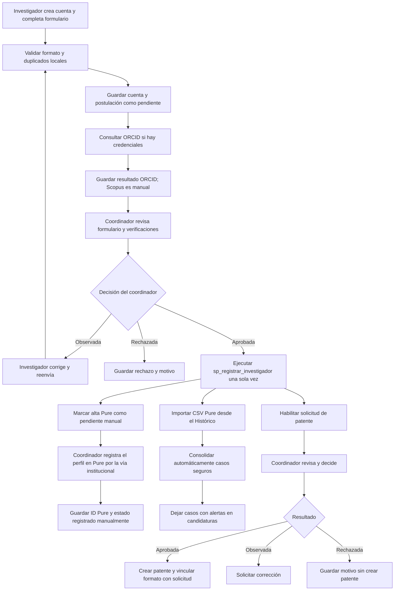

# Guía de flujos operativos y alcance actual del portal CRIS

> Este documento describe el flujo funcional y la primera versión. Para el diseño
> físico objetivo, las nuevas tablas, el SQL de referencia y el plan de migración por
> etapas, consultar [diseno-tecnico-esquema-y-migracion-cris.md](diseno-tecnico-esquema-y-migracion-cris.md).
> Ese documento amplía el modelo mínimo descrito aquí y no cambia la regla de los dos
> roles del portal.

## Resumen ejecutivo: funcionamiento implementado

**La primera versión implementa el portal UCSM, no una copia de Pure ni una
integración automática con Pure.** El investigador presenta su formulario en el
portal. El coordinador revisa las verificaciones automáticas disponibles, completa
las comprobaciones manuales y toma la decisión dentro del portal. Si aprueba, el
sistema crea el perfil local y el coordinador crea o vincula manualmente el perfil
en Pure desde la interfaz institucional. Luego guarda en el portal el identificador
de Pure. Para el investigador, **Mi solicitud** y **Mis patentes** son pantallas
separadas; la segunda solo está disponible después de aprobarse el perfil.

El enlace de Swagger que compartieron es [documentación de la Pure Web Services
API](https://api.elsevierpure.com/ws/api/api-docs/index.html?url=/ws/api/openapi.yaml).
Sirve para conocer las operaciones y formatos de la API; **no es una conexión ya
configurada con Pure UCSM, no entrega una clave ni confirma permisos**. Tampoco es una
herramienta que depure por sí sola el formulario o elimine duplicados. La especificación
publicada declara autenticación `api-key`, pero el enlace no contiene una clave de UCSM.
Para la primera versión no hay que implementar ni reemplazar esa API: el alta manual
permite completar el flujo sin ella. La automatización objetivo es independiente:
ORCID y Scopus pueden comprobar identificadores y sugerir artículos; sus resultados
no aprueban al investigador, el coordinador toma esa decisión.

El portal es el canal de postulación y seguimiento. ORCID tiene una consulta de
existencia disponible cuando se configuran `ORCID_CLIENT_ID` y
`ORCID_CLIENT_SECRET`; sin ellos, la verificación queda como `no_disponible`.
Scopus API y Pure API no están integradas. El CSV de Pure sí se importa desde el
portal y los registros con UUID exacto de autor, campos obligatorios válidos y sin
DOI duplicado se consolidan automáticamente. Los demás quedan para revisión manual.
El correo puede usarse para notificar o intercambiar información, pero la solicitud
no depende de una decisión externa: el coordinador la revisa y la resuelve en el portal.

## 1. Para qué sirve este documento

Este documento convierte la información de las entrevistas, los audios y el estado
actual del proyecto en una propuesta funcional que el equipo pueda usar para corregir
sus diagramas, diccionario de datos, MER, modelo relacional, modelo físico e informes.
La intención es **evolucionar el trabajo existente**, no desecharlo ni reemplazar sin
motivo sus procedimientos, restricciones o capa de acceso a PostgreSQL.

Separa expresamente:

1. Lo que ya existe en el repositorio y se conserva.
2. El proceso de negocio actualizado a partir de la nueva información.
3. Las ampliaciones de datos e integraciones necesarias para automatizarlo.
4. Los puntos técnicos que se deben cerrar con los responsables institucionales,
   sus permisos y formatos oficiales. No se cuenta con API UCSM para verificar el
   código o afiliación ni con API Key/acceso a la instancia UCSM de Pure.

> **Regla de alcance:** hay únicamente dos roles de usuario: **investigador** y
> **coordinador de repositorios**. El investigador postula en el portal; el coordinador
> verifica y aprueba, observa o rechaza la solicitud en el mismo sistema. No existe
> actor ni decisión de Dirección en este flujo. Las APIs de ORCID y Scopus solo aportan
> resultados de verificación; el coordinador conserva la decisión final.

---

## 2. Estado actual: qué se conserva y qué falta

### 2.1 Base existente que no se debe tirar

El proyecto ya tiene una base PostgreSQL modelada e implementada con, entre otros
componentes:

- `persona`, `investigador`, `coordinador_repositorios` y `formato_investigador`.
- `patente`, `formato_patente` y sus relaciones de inventores y clasificación OCDE.
- `historico` y sus tablas auxiliares para contribuyentes, identificadores, enlaces,
  versiones electrónicas, palabras clave y estados.
- `reporte` y sus tablas de resultados históricos.
- Procedimientos para registrar, modificar y eliminar investigadores y patentes,
  cargar/eliminar publicaciones y generar reportes.
- Triggers, restricciones, claves foráneas e índices que hacen cumplir reglas de
  integridad.

La aplicación de escritorio existente y los repositorios Python que usan
`psycopg2` son el punto de partida. La migración a web reutiliza esa lógica: no se
debe duplicar el CRUD en otra capa ni cambiar procedimientos solo para cambiar la
presentación.

### 2.2 Qué significa `historico` en el esquema actual

En la base implementada, `historico` representa **publicaciones o resultados de
investigación**: contiene `uuid`, `title`, `publication_year`, `synced_at` y otros
metadatos bibliográficos, con tablas hijas para autores, enlaces, identificadores,
palabras clave y estados.

No es una tabla de accesos de estudiantes a repositorios. El archivo crudo de
actividad que entrega Biblioteca es un flujo de datos diferente y **no debe
insertarse en `historico` ni confundirse con el CSV de Pure**.

### 2.3 Funcionalidades presentes frente a las propuestas

| Componente                             | Existe en el proyecto                                       | Se conserva                          | Falta para el proceso actualizado                                                                                              |
| -------------------------------------- | ----------------------------------------------------------- | ------------------------------------ | ------------------------------------------------------------------------------------------------------------------------------ |
| Aplicación web                         | Portal React + Vite y API FastAPI implementados             | Se conserva; accede a PostgreSQL solo mediante repositorios Python | Validar flujos y configuración de despliegue; Scopus y Pure API siguen fuera de alcance |
| Login del coordinador                  | Repositorio de autenticación y hash PBKDF2                  | Sí                                   | Mantener sus permisos y su cuenta                                                                                              |
| Gestión de investigadores                       | Formato, tablas normalizadas y procedimientos               | Sí                                   | En el portal web, el módulo Investigadores es de consulta; altas y correcciones pasan por la postulación y su revisión |
| Gestión de patentes                       | Tablas y procedimientos existentes                          | Sí                                   | En el portal web, Patentes consulta registros definitivos; nuevas altas solo ocurren al aprobar una solicitud de patente |
| Histórico de publicaciones             | `historico`, tablas hijas, `sp_cargar_historico` y tablas de candidaturas | Sí                         | El CSV de Pure pasa por `publicacion_candidata`; los casos con autoría exacta y metadatos válidos se pueden consolidar en lote, los demás requieren revisión |
| Reportes actuales                      | 15 consultas y `sp_generar_reporte`                         | Sí                                   | Distinguir producción científica de estadísticas de accesos de Biblioteca                                                      |
| Registro de investigadores             | No estaba en el esquema original                            | —                                    | Cuenta/formulario, verificaciones y decisión directa del coordinador en el portal                                               |
| Verificación por servicios externos    | Consulta de existencia ORCID con API pública configurable; sin credenciales queda `no_disponible` | Se guarda el resultado y su referencia, no el registro bibliográfico | Scopus API no se integró; el coordinador puede registrar una verificación manual y tomar la decisión |
| Crear perfil en CRIS/Pure              | No hay conector Pure ni acceso confirmado a la instancia UCSM | —                                  | Alta manual en Pure y guardar su ID; no hay API Key/acceso UCSM para automatizarlo                                                |
| Sincronización diaria de publicaciones | No hay proceso programado                                   | —                                    | Etapa posterior con Scopus/ORCID; generar candidatos para revisión manual, no publicaciones aprobadas                            |
| Importación de actividad de Biblioteca | No hay archivo de muestra ni diccionario confirmado         | —                                    | Posponer importador y tablas hasta conocer el formato y los indicadores requeridos                                             |

Un borrador exploratorio anterior de cuenta/solicitud no conservaba las verificaciones
ni el historial completo de las decisiones del coordinador. No forma parte del esquema
objetivo; la instalación actual usa el SQL principal completo desde una base vacía.

### 2.3.1 Navegación del portal del coordinador

El portal React organiza las áreas de trabajo así:

- **Inicio:** indicadores existentes de investigadores, escuelas, publicaciones,
  patentes y ODS, además del ranking de ODS, las escuelas con más investigadores y
  los pendientes de revisión.
- **Bandeja de revisión:** una sola sección con las colas de postulaciones,
  solicitudes de patente y altas manuales de perfiles en Pure.
- **Investigadores / Patentes:** directorios de solo lectura para no eludir la
  aprobación de postulaciones ni la aprobación de solicitudes de patente.
- **Histórico de publicaciones:** catálogo oficial de solo lectura y una sección
  separada **Importar y depurar Pure** para preparar candidaturas antes de consolidarlas.
- **Reportes:** las 15 consultas existentes y la generación/consulta de cortes.

El histórico de accesos de Biblioteca es un conjunto de datos separado de las
publicaciones y no se muestra como módulo operativo mientras falten el CSV de muestra
y sus reglas de minimización y retención.

### 2.3.2 Importación y depuración de publicaciones de Pure

El coordinador puede subir una exportación CSV de Pure desde **Histórico >
Importar y depurar Pure**. La selección y carga del archivo son manuales; el portal no
usa la API de Pure, Scopus ni ORCID. El flujo separa validación, almacenamiento como
candidaturas y consolidación de los casos seguros:

1. **Previsualizar:** se validan columnas, UUID, JSON, título y año sin escribir en la
   base de datos. Se muestran las filas válidas y los errores encontrados.
2. **Guardar como candidaturas:** las filas válidas se almacenan en
   `publicacion_candidata` con fuente `pure` y sus metadatos de origen. La carga es
   idempotente por UUID Pure; no crea ni modifica registros de `historico`.
3. **Curación de campos:** los valores opcionales que exceden el catálogo se omiten
   sin truncarse y se registra el motivo; el JSON íntegro de Pure permanece en la
   candidatura. Los campos obligatorios no se inventan ni se recortan.
4. **Consolidación automática en lote:** después de guardar, el sistema procesa las
   candidaturas aptas sin una confirmación publicación por publicación. Solo pasan al
   Histórico candidaturas con al menos un autor vinculado por UUID exacto a un
   investigador local aprobado, campos obligatorios válidos y UUID/DOI sin duplicidad.
   Se aprueban únicamente los vínculos exactos, nunca por coincidencia de nombre; toda
   la acción se ejecuta en una transacción. Al guardar la depuración de una candidatura
   pendiente se vuelven a buscar los UUID exactos en los perfiles y se procesa
   automáticamente el lote, incluidos los perfiles cuyo ID Pure se registró después
   de la importación.

En la lista de candidaturas, el coordinador puede corregir los metadatos o descartar
una candidatura indicando el motivo. DOI coincidentes no se fusionan: quedan fuera de
la consolidación automática para revisión manual. Los UUID que no coinciden con un ID
Pure local único tampoco se vinculan ni aprueban automáticamente. Los casos excluidos
muestran el motivo y siguen disponibles para curación individual. La acción masiva
reutiliza `sp_cargar_historico` y registra relaciones con los investigadores en la
misma transacción. Las candidaturas descartadas conservan motivo y auditoría.

El catálogo heredado almacena el volumen como entero. Si Pure exporta en ese campo
un rango de páginas u otro texto, el valor original permanece en los metadatos de
origen y el coordinador debe decidir si lo omite del campo numérico antes de aprobar;
no se convierte ni descarta silenciosamente. La revisión también alerta sobre otros
valores que superen los límites de longitud del esquema (por ejemplo, nota
bibliográfica, número de revista, palabras clave, resumen o URL de un enlace); se
deben corregir explícitamente antes de consolidar la publicación.

El campo `fuente` de la restricción de `publicacion_candidata` admite `pure` en el SQL
de instalación desde cero. Como el proyecto no usa migraciones, una base ya instalada
no recibe este cambio automáticamente: el instalador no debe ejecutarse sobre una
base con datos que se quieran conservar sin respaldo y autorización.

### 2.4 Ruta sencilla para avanzar sin la conexión de Pure

No necesitamos detener el portal esperando una API de Pure. El flujo tendrá un paso
manual claro: después de que el coordinador apruebe la postulación dentro del portal,
el sistema crea el investigador en la base UCSM con el procedimiento existente. Luego
el coordinador busca o crea a esa persona en Pure desde la interfaz
institucional y copia al portal el identificador que Pure muestre. El estado queda
como **registrado manualmente**. Si no puede completar ese paso, queda **pendiente de
alta en Pure**; no se pierde la solicitud ni se vuelve a crear el investigador local.

Esto permite terminar el flujo sin inventar la dirección, los campos ni las
credenciales de Pure. El [Swagger que compartieron](https://api.elsevierpure.com/ws/api/api-docs/index.html?url=/ws/api/openapi.yaml)
documenta la Pure Web Services API, pero no confirma acceso a la instancia UCSM ni
proporciona su API Key o permisos. No se incluye la API de Pure en la automatización
de esta propuesta. No hace falta crear una API sustituta, una tabla de parámetros,
una cola automática ni una tabla de respuestas de API para Pure.

El código UCSM se valida localmente por formato y duplicados; la afiliación, CTI Vitae
y RENACYT se revisan según las fuentes institucionales acordadas. ORCID se consulta por
API cuando se configuran sus credenciales; si no está disponible, se indica claramente
y el coordinador puede revisar la evidencia manualmente. Scopus API queda para una
etapa posterior; el coordinador puede registrar una verificación manual. La consulta de
identificadores no es una aprobación automática. La búsqueda programada de publicaciones
y la generación recurrente de candidatos quedan para una etapa posterior.

---

## 3. Stack web, acceso a PostgreSQL y significado de “API”

### 3.1 Aclaración para no confundir frameworks web con acceso a datos

La aclaración de alcance recibida para esta propuesta es: **la restricción que se
quiere cumplir es no esconder ni reemplazar la conexión y las operaciones directas
con PostgreSQL**. Eso no equivale automáticamente a prohibir React, FastAPI o un
framework de estilos. Son capas diferentes:

| Tecnología                            | Capa                                                          | ¿Oculta la conexión PostgreSQL?                                                    |
| ------------------------------------- | ------------------------------------------------------------- | ---------------------------------------------------------------------------------- |
| React                                 | Componentes de interfaz en el navegador                       | No. No debe conectarse directamente a PostgreSQL                                   |
| npm                                   | Instalación/ejecución de paquetes de JavaScript               | No es un framework ni una capa de base de datos                                    |
| Vite                                  | Servidor de desarrollo y compilación del frontend             | No                                                                                 |
| Tailwind CSS                          | Utilidades/estilos de la interfaz                             | No                                                                                 |
| FastAPI                               | Rutas HTTP y validación de solicitudes de la aplicación       | No por sí solo; puede llamar explícitamente a los repositorios existentes          |
| `psycopg2`                            | Controlador PostgreSQL de Python ya utilizado por el proyecto | Es la conexión directa que se desea conservar                                      |
| ORM (por ejemplo SQLAlchemy o Prisma) | Mapeo de objetos a tablas y generación de SQL                 | Sí es la abstracción que se evita si el requisito es SQL/procedimientos explícitos |

#### Arquitectura web implementada

```text
Navegador: React
    │ HTTP/JSON (fetch)
    ▼
Backend: FastAPI (rutas de la aplicación; no es la API de Pure)
    │
    ▼
Servicios/reglas de negocio
    │
    ▼
Repositorios Python existentes
    │ SQL parametrizado / CALL sp_...
    ▼
backend/src/db/conexion.py → psycopg2 → PostgreSQL
```

- React no contiene credenciales de PostgreSQL y no se conecta a la base.
- FastAPI recibe y valida HTTP; el endpoint llama a un servicio/repositorio con nombre
  reconocible. No se debe poner SQL opaco generado por ORM dentro del endpoint.
- El repositorio conserva `conexion.py`, el controlador `psycopg2`, las consultas
  SQL explícitas y las llamadas a procedimientos almacenados existentes.
- `SELECT` se ejecuta mediante las funciones existentes de consultas/repositorios;
  altas, modificaciones y bajas continúan usando los procedimientos (`CALL sp_...`)
  cuando así lo exige la implementación actual.
- Tailwind y React cambian presentación/experiencia, no las reglas de la base ni su
  esquema.
- El portal puede tener una API propia FastAPI para que React consuma; las APIs de
  ORCID, Scopus, Pure y el sistema UCSM son integraciones **externas distintas**.

El portal implementado ya usa esta arquitectura: FastAPI llama a los repositorios
existentes y React consume `/api`. La consulta de existencia ORCID está preparada para
credenciales configuradas; Scopus API y Pure API no están integradas.

Ejemplo de una escritura visible, manteniendo el patrón actual del repositorio:

```python
from backend.src.db.conexion import ejecutar_procedimiento

def eliminar_investigador(codigo_ucsm):
    ejecutar_procedimiento(
        "sp_eliminar_investigador",
        [codigo_ucsm],
    )
```

La ruta FastAPI invocaría ese caso de uso y devolvería una respuesta HTTP; no se
conecta desde React a PostgreSQL ni se reemplaza el procedimiento por una escritura
ORM. Las API externas REST pueden consumirse desde adaptadores Python identificables
con HTTP/JSON, URL base configurable, credenciales fuera del código, timeout,
tratamiento de límites de uso y registro de resultados sin guardar secretos.

El stack web se implementó por decisión del equipo. La arquitectura conserva la
restricción de acceso a datos: **sin ORM y con acceso PostgreSQL explícito a través de
`psycopg2`, SQL parametrizado y procedimientos almacenados**.

### 3.2 Cada fuente tiene un propósito diferente

| Fuente                                              | Para qué sirve                                                                                                                                                          | Qué no se debe asumir                                                                                                                                                         |
| --------------------------------------------------- | ----------------------------------------------------------------------------------------------------------------------------------------------------------------------- | ----------------------------------------------------------------------------------------------------------------------------------------------------------------------------- |
| Sistema institucional de personal/matrícula de UCSM | No hay API disponible para validar existencia del código o afiliación. | Validar formato y duplicados locales únicamente; no marcar el código como institucionalmente verificado. |
| ORCID                                               | Implementado: consulta pública de existencia desde la revisión de la postulación cuando hay credenciales de cliente. | Sin `ORCID_CLIENT_ID`/`ORCID_CLIENT_SECRET` queda `no_disponible`; no verifica afiliación ni aprueba. |
| Scopus / Elsevier                                   | No integrado. La verificación se registra manualmente mientras no se habilite una API Key y permisos institucionales. | No hay consulta automática ni importación de publicaciones Scopus en esta versión. |
| CTI Vitae / RENACYT                                 | El coordinador consulta manualmente los portales oficiales y registra resultado/evidencia. | No se incorpora scraping ni se presenta la consulta como automática. |
| Pure / CRIS institucional UCSM                      | El coordinador crea o vincula manualmente el perfil y registra su ID. | No hay API Key/acceso UCSM. El Swagger compartido documenta Pure, pero no habilita conexión ni alta automática. |
| Archivo de Pure `research_outputs.csv`              | Importar una exportación de publicaciones y metadatos, incluida la columna JSON `data`                                                                                  | No es una API, ni el archivo crudo de accesos de Biblioteca                                                                                                                   |
| Archivo TXT/CSV de Biblioteca                       | Fuente de eventos de uso de repositorios por estudiantes                                                                                                                | No contiene por definición los metadatos de producción científica de Pure                                                                                                     |
| CRIS institucional → CONCYTEC                       | Mantener el flujo oficial de cosecha/exportación operado desde CRIS; la aplicación de esta fase no llamará directamente una API de CONCYTEC                             | El formato XML mencionado en el audio debe confirmarse con el responsable del CRIS; no inventar endpoint ni formato de envío                                                  |

#### Opciones para tratar el código UCSM sin una API

La aplicación no debe simular una consulta ni presentar un código como institucionalmente
verificado solo porque cumple diez dígitos. El flujo será:

1. Validar que el código tenga diez dígitos y que no esté duplicado localmente.
   Guardarlo como `declarado_no_verificado`; no existe API UCSM para comprobarlo.
2. Consultar ORCID mediante la API cuando estén configuradas sus credenciales.
   Scopus se verifica manualmente en esta versión. Guardar resultados como
   `confirmado`, `no_confirmado`, `no_disponible` o `error_consulta`.
3. Si una API no está disponible, el coordinador puede revisar manualmente el dato y
   registrar la fuente y evidencia; no se simula una respuesta automática.
4. El coordinador consulta CTI Vitae y RENACYT manualmente: [Directorio CTI Vitae](https://ctivitae.concytec.gob.pe/appDirectorioCTI/) y [Búsqueda de investigadores RENACYT](https://servicio-renacyt.concytec.gob.pe/busqueda-de-investigadores/).
5. El coordinador toma la decisión final desde el portal. Que ORCID/Scopus encuentre
   un perfil no basta para aprobar una solicitud ni para atribuirle todos sus artículos.

La integración ORCID usa [ORCID Public API](https://info.orcid.org/what-is-orcid/services/public-api/);
para vincular la identidad puede utilizar OAuth, una vez configurado el cliente.
Scopus emplea [Author Search](https://dev.elsevier.com/documentation/AuthorSearchAPI.wadl),
[Author Retrieval](https://dev.elsevier.com/documentation/AuthorRetrievalAPI.wadl),
[Scopus Search](https://dev.elsevier.com/documentation/ScopusSearchAPI.wadl) y
[Abstract Retrieval](https://dev.elsevier.com/documentation/AbstractRetrievalAPI.wadl);
requiere API Key/permisos de Elsevier. Las claves se guardan fuera del código, en la
configuración segura del backend.

---

## 4. Roles del portal y participantes externos

### 4.1 Únicos roles de usuario de la aplicación

| Rol de usuario              | Responsabilidad en el portal                                                                                                                                                         | Permisos principales                                                                          |
| --------------------------- | ------------------------------------------------------------------------------------------------------------------------------------------------------------------------------------ | --------------------------------------------------------------------------------------------- |
| Investigador                | Crear cuenta, completar/enviar su postulación, consultar el estado y corregirla cuando se le solicite                                                                             | Ver y modificar únicamente su postulación; no puede aprobarla ni consultar la de otra persona |
| Coordinador de repositorios | Revisar las verificaciones, aprobar/observar/rechazar solicitudes, gestionar Pure manualmente, curar artículos, resolver solicitudes de patente y generar reportes              | Solo puede decidir como coordinador con base en los resultados y reglas definidos para el proceso |

No se crea usuario, tabla, FK, rol ni bandeja de Dirección. El coordinador es quien
revisa y decide dentro del portal. El sistema guarda por separado las verificaciones
que sustentan esa decisión y el registro de aprobación, observación o rechazo con su
autor y fecha.

### 4.2 Participantes y sistemas que no son roles de usuario

Biblioteca, Pure/CRIS, ORCID, Scopus y CONCYTEC pueden aparecer en diagramas como
fuentes o sistemas externos, no como cuentas/roles. La automatización del backend
tampoco es un usuario humano. Mostrar solo Investigador y Coordinador como actores
del portal.

---

## 5. Flujo A: postulación, evaluación y alta del perfil de investigador

### A.1 Entrada al portal

La portada ofrece únicamente dos caminos claramente separados:

1. **Investigador:** crear cuenta o ingresar a una cuenta existente.
2. **Coordinador de repositorios:** iniciar sesión institucional.

El coordinador revisa y resuelve las solicitudes dentro del portal. El correo puede
servir para notificaciones o comunicación, pero la decisión se toma y queda registrada
en el portal. Quitar de la portada controles técnicos como “Probar conexión a
PostgreSQL”; los errores de conexión se muestran en el lugar de uso o en diagnóstico
interno.

### A.2 Formulario de cuenta y postulación

La creación de cuenta y el envío inicial de la postulación son un mismo flujo: la
persona se registra, completa el formulario y envía la solicitud. En la primera
versión se valida el formato del correo, pero no se depende de una integración de
correo para confirmar su propiedad. Guardar la contraseña únicamente como hash PBKDF2
usando el módulo estándar existente; nunca guardar o registrar la contraseña original.

Campos del formato institucional que ya maneja el proyecto:

| Sección          | Campo                                        | Validación inicial                                                                                                                                                                                            |
| ---------------- | -------------------------------------------- | ------------------------------------------------------------------------------------------------------------------------------------------------------------------------------------------------------------- |
| Cuenta           | Correo electrónico y contraseña/confirmación | Correo normalizado y formato correcto; verificar coincidencia de contraseñas. No se envía correo de confirmación en la primera versión                                                                        |
| Identificación   | DNI                                          | Obligatorio, ocho dígitos; se registra como declarado y el coordinador lo revisa según las fuentes institucionales autorizadas                                                                                 |
| Identificación   | Código UCSM                                  | Obligatorio, diez dígitos según restricción actual; validar formato y duplicados locales. No hay API UCSM para verificar existencia o afiliación                                                                 |
| Datos personales | Nombres, apellido paterno, apellido materno  | Obligatorios; registrar los datos declarados. Sin una fuente institucional consultable, no afirmar que coinciden automáticamente con un registro oficial                                                      |
| Datos personales | Género, fecha de nacimiento                  | Catálogos/formato definidos por el modelo actual; fecha válida y anterior a hoy                                                                                                                               |
| Contacto         | Correo y celular                             | Correo válido; celular según restricción actual de nueve dígitos                                                                                                                                              |
| Adscripción      | Escuela profesional                          | Seleccionar del catálogo institucional que use la aplicación; no se propone una API externa separada para este dato                                                                                           |
| Identificadores  | ORCID                                        | Obligatorio en el esquema actual; validar formato y consultar ORCID API cuando sus credenciales estén configuradas. El coordinador decide con ese resultado como evidencia                                      |
| Identificadores  | Scopus Author ID                             | Obligatorio y numérico positivo en el esquema actual; consultar las APIs de Scopus cuando exista API Key/permisos Elsevier. El resultado no aprueba la solicitud                                                |
| Verificación     | Enlace CTI Vitae                             | Obligatorio y HTTPS en el esquema actual; el coordinador lo revisa manualmente en el portal oficial y registra el resultado/evidencia                                                                           |
| Perfil académico | Resumen académico                            | Obligatorio, máximo 2.000 caracteres según el esquema actual                                                                                                                                                  |
| Perfil académico | Intereses de investigación                   | Al menos uno; mantener como lista en el formulario pendiente y pasar a la relación existente al aprobar                                                                                                       |
| Perfil académico | ODS                                          | Al menos uno de los 17 ODS existentes; pasar a la relación existente al aprobar                                                                                                                               |
| Perfil académico | Foto                                         | Obligatoria por el esquema actual; JPG/JPEG/PNG. Guardar el archivo de forma controlada y solo su referencia en la BD                                                                                         |
| Consentimiento   | Aviso de privacidad y uso de datos           | Mostrar texto aprobado por UCSM y guardar versión/fecha de aceptación si la política lo requiere                                                                                                              |

Los nombres exactos que hoy consume el repositorio (`dni`, `nombres`,
`apellido_paterno`, `apellido_materno`, `genero`, `fecha_nacimiento`,
`codigo_ucsm`, `escuela`, `celular`, `correo`, `orcid`, `scopus_id`,
`link_cti`, `foto`, `resumen`, `ods`, `intereses`) se pueden mapear a una capa de
formulario/API sin cambiar las tablas actuales de perfil.

El procedimiento existente exige ORCID, Scopus ID, enlace CTI, resumen, foto, ODS e
intereses. Si la nueva política permite enviar alguno vacío, primero se debe acordar
esa regla y cambiar la restricción correspondiente en una migración aditiva; no se
debe enviar un valor falso para satisfacer la base.

### A.3 Envío de la postulación sin depender de APIs

Al pulsar **Enviar postulación**, el backend:

1. Revisa los formatos requeridos y los identificadores repetidos en la base local.
2. No llama a una API UCSM: el código se guarda como `declarado_no_verificado`.
   Solo comprueba el formato y que no esté duplicado localmente.
3. Guarda los datos del formulario y cambia el estado a `pendiente_revision`.
4. Si ORCID/Scopus están configurados, consulta las APIs y registra el resultado. Si
   faltan credenciales o falla una consulta, registra `no_disponible` o
   `error_consulta`; nunca simula un resultado correcto.
5. Deja claro qué datos fueron declarados, cuáles consultados por API y cuáles aún no
   se han verificado. La respuesta de una API no cambia por sí sola el estado de la
   solicitud.

El coordinador revisa las verificaciones, consulta manualmente CTI Vitae/RENACYT u
otras fuentes acordadas y resuelve la solicitud desde el portal. Un código con formato
correcto no prueba afiliación, y encontrar un ORCID/Scopus no prueba que cada artículo
pertenezca al investigador.

### A.4 Revisión y decisión del coordinador

La aplicación tiene solo dos usuarios: Investigador y Coordinador. No hay un paso de
aprobación de Dirección ni una decisión que el coordinador solo transcriba. El
coordinador revisa la solicitud y resuelve aprobado, observado o rechazado. La vista
de revisión muestra:

- Datos enviados por el investigador y el resultado de las revisiones manuales
  hechas por el coordinador.
- Resultados de ORCID y Scopus, con estado de consulta, fecha y fuente.
- Código UCSM como declarado/no verificado por API.
- Evidencia manual de CTI Vitae, RENACYT, afiliación u otros requisitos definidos.
- Historial de versiones y verificaciones ya realizadas.

| Decisión del coordinador | Estado | Requisitos al resolver |
|---|---|---|
| Aprobar | `aprobada`; crea el perfil local y deja Pure pendiente de alta manual | Verificaciones requeridas completadas; identificadores/API visibles y revisión final del coordinador |
| Solicitar correcciones | `observada`; investigador corrige y reenvía | Observación concreta que pueda mostrarse al investigador |
| Rechazar | `rechazada`; no crea el perfil local | Motivo obligatorio |

El sistema guarda resultado, fecha, motivo, versión evaluada y coordinador que
resolvió en `revision_solicitud`. La evidencia de cada comprobación se guarda en
`verificacion_solicitud`. Las reglas de afiliación e indexación deben acordarse y
documentarse para que el coordinador aplique criterios consistentes.

### A.5 Correcciones del postulante

Cuando el coordinador observa una solicitud:

1. El investigador ingresa y ve cada observación.
2. Puede corregir los campos permitidos. DNI y código UCSM no se cambian si la política
   no lo autoriza; un error en identidad se resuelve por un mecanismo de soporte.
3. El sistema actualiza el formulario vigente y lo devuelve a `pendiente_revision`.
4. La decisión anterior y la nueva quedan como filas separadas en
   `revision_solicitud`.
5. El portal devuelve la solicitud a `pendiente_revision` para una nueva revisión.

### A.6 Crear el perfil en Pure manualmente en la primera versión

Después de que el coordinador apruebe la solicitud:

1. El portal guarda la decisión en
   `revision_solicitud` y llama una sola vez al procedimiento existente
   `sp_registrar_investigador`, que crea el perfil en `persona`, `investigador` y
   `formato_investigador`. La aprobación del coordinador y la creación del perfil son
   una transacción.
2. La solicitud pasa a **Pendiente de alta en Pure**. El coordinador abre Pure por el
   acceso institucional, busca primero a la persona para evitar duplicados y crea o
   vincula el perfil con los datos aprobados.
3. El coordinador copia al portal el ID/UUID que Pure muestra y marca **Registrado
   manualmente en Pure**. Se guardan quién lo registró y la fecha.
4. Si Pure ya tenía el perfil, se vincula el perfil existente; no se crea otro.
   Si el coordinador no puede completar el alta, la solicitud queda pendiente de Pure
   y se puede retomar sin volver a crear al investigador en PostgreSQL.

En esta versión no hay botón que llame a Pure ni se envía un JSON. El Swagger
compartido es documentación, no acceso habilitado a Pure UCSM. La eventual integración
Pure no forma parte del modelo objetivo mientras no haya API Key y acceso institucional.

### A.7 Solicitud de registro de patente

Solo después de que su perfil local esté aprobado, el investigador puede enviar una
solicitud de registro de patente desde el portal. La solicitud reúne número, título,
editorial, fecha de registro, CIP, país, inventores que ya tengan perfil local y pares
de clasificación OCDE. El coordinador la revisa y la aprueba, observa o rechaza.

Al aprobar, el backend llama `sp_registrar_patente` con los datos validados y vincula
el `formato_patente` creado a la fila de `solicitud_patente`. Si se observa, el
investigador corrige y reenvía; si se rechaza, se conserva el motivo sin crear una
patente definitiva. No se admiten solicitudes de cuentas que aún no tengan perfil
aprobado.

---

## 6. Flujo B: verificación de identidad y revisión de publicaciones

El portal consulta ORCID para comprobar la existencia del identificador cuando cuenta
con credenciales configuradas. El coordinador ve el resultado, fecha y referencia, y
toma la decisión de la postulación. Si no hay credenciales o la consulta falla, el
resultado se muestra como no disponible/error y se permite una revisión manual; no se
presenta como verificación exitosa. Scopus API no está integrada y por ahora se puede
registrar únicamente una verificación manual.

La existencia de un identificador no comprueba por sí sola la afiliación UCSM,
identidad legal ni pertenencia/indexación de cada publicación. Para revisar artículos:

1. Para artículos que no pasaron por el lote CSV de Pure, compara título, autores,
   año, DOI y revista con las fuentes disponibles. La indexación se comprueba en la
   fuente acordada por la institución.
2. Trata una versión en español y otra en inglés como posible duplicado hasta
   compararlas. No registra dos veces el mismo artículo.
3. En el lote CSV de Pure, el portal consolida automáticamente solo las candidaturas
   con UUID de autor exacto, campos obligatorios válidos y DOI no duplicado. En los
   demás casos, el coordinador resuelve las alertas antes de que puedan consolidarse.
4. Si el artículo no corresponde o no se puede confirmar, no lo agrega al Histórico.
   Deja la aclaración en la revisión de la solicitud o la comunica por el canal
   establecido.
5. Si Pure permite editar el perfil desde su interfaz institucional, el coordinador
   actualiza allí los artículos aprobados según el procedimiento UCSM.

### Automatización posterior

Con credenciales de Elsevier se podrían usar **Author Search** y **Author
Retrieval** para localizar perfiles, **Scopus Search** (consulta por
`AU-ID(<Scopus Author ID>)`) para obtener publicaciones y **Abstract Retrieval** para
consultar sus detalles. ORCID Public API/OAuth y ORCID Record API podrían traer el
registro autorizado por el investigador. Esas respuestas serían sugerencias para el
coordinador, no aprobaciones.

Solo después de comprobar que se necesitan candidatos pendientes en la base se
podrían agregarse nuevas fuentes de candidatos y una tarea diaria. La tabla
`publicacion_candidata` y su vínculo con investigadores ya existen para el flujo
manual de Pure; no hay una tarea programada ni se importa automáticamente desde
Scopus u ORCID.

---

## 7. Flujo C: archivo CSV de Pure

### C.1 Archivo revisado

El archivo de contexto `Pure_research_outputs (1).csv` es una exportación de
publicaciones de Pure, no una API ni un registro de personas. Tiene estas columnas:

`uuid`, `title`, `publication_year`, `data`, `synced_at`.

La inspección previa encontró 2,519 filas y JSON objeto válido en la columna `data`;
contiene metadatos como `contributors`, `identifiers`, `links`, `keywordGroups`,
`publicationStatuses`, `pureId`, `type`, `title`, `portalUrl`, `abstract`,
`organizations` y otros. Es una exportación de resultados de investigación de Pure,
no una tabla de perfiles de investigador ni el TXT de Biblioteca.

### C.2 Uso en el portal

1. Conservar el CSV original; no modificarlo para “limpiar” los datos.
2. Desde **Histórico > Importar y depurar Pure**, el coordinador previsualiza el
   archivo; esa validación no escribe en la base.
3. Al confirmar, las filas válidas se cargan idempotentemente en
   `publicacion_candidata`, conservando el JSON original. No se crean filas en
   `historico` durante esta carga.
4. El sistema omite del catálogo campos opcionales fuera de límite y conserva sus
   valores originales en el JSON de Pure. El coordinador revisa el resumen de
   candidaturas aptas y pendientes.
5. El sistema consolida automáticamente en una transacción los casos con vínculo
   exacto de autor, campos obligatorios válidos y sin DOI duplicado. Al guardar la
   depuración de un caso pendiente, vuelve a buscar UUID exactos en los perfiles y
   reprocesa el lote. Los demás casos se corrigen o resuelven manualmente. No se
   adivinan autores ni se fusionan DOI.

El CSV y la Pure Web Services REST API son cosas distintas. El CSV es una exportación
que alguien ya descargó; la API es una conexión automática al servidor Pure de UCSM,
que aún no está configurada para este proyecto. El importador del portal lee el CSV,
no consulta la API.

---

## 8. Flujo D: datos de Biblioteca (etapa posterior)

Este flujo representa actividad de uso de repositorios, no publicaciones científicas.
No se construirá en la primera versión porque todavía no hay un archivo de muestra ni
un diccionario de campos confirmado. No insertar esos datos en `historico`.

### D.1 Campos esperados: confirmar con el diccionario real de Biblioteca

Los campos descritos en el informe inicial incluyen:

| Campo lógico propuesto             | Uso                                                                                                 |
| ---------------------------------- | --------------------------------------------------------------------------------------------------- |
| Fecha/hora del evento              | Tendencias por día, mes y franja horaria; conservar zona horaria o documentar la local              |
| Correo/identificador de usuario    | Deduplicación controlada y análisis autorizado; no mostrar datos personales en dashboards generales |
| Repositorio consultado             | Conteo por repositorio institucional                                                                |
| Escuela                            | Agrupación institucional                                                                            |
| Facultad                           | Agrupación institucional                                                                            |
| Identificador único del evento     | Idempotencia al importar; si no existe, generar huella documentada                                  |
| URL/recurso consultado (si existe) | Clasificar uso y detectar registros incompletos                                                     |

Esta tabla es un **mapa lógico provisional**, no afirmación de que el TXT ya contenga
esas columnas. Antes de programar, Biblioteca debe proporcionar un archivo de muestra
anonimizado, encoding, delimitador, encabezados, formato de fecha, zona horaria,
semántica de “acceso”, política de correcciones y período de retención.

### D.2 Qué se hará cuando Biblioteca entregue el archivo

Primero se identifican sus columnas y el significado de cada fila con una muestra
anonimizada. Después se decide qué indicadores requiere el dashboard y qué datos
personales se deben ocultar. Solo entonces se propone una tabla de eventos y, si el
proceso se repite, una tabla de lotes de importación. Hasta contar con esa información,
no se agregan tablas ni se promete un dashboard de actividad.

---

## 9. Flujo E: patentes y otros registros actuales

El trabajo ya dispone de tablas y procedimientos para registrar, modificar y eliminar
patentes, así como una relación N:M con investigadores validados. Se conserva ese
flujo coordinador:

1. El coordinador registra el formato de patente con número, título, editorial,
   fecha, CIP, país, inventores y clasificación OCDE.
2. El sistema valida número/fecha y exige que cada inventor exista como investigador
   aprobado.
3. La escritura usa los procedimientos existentes y triggers.
4. Las confirmaciones y errores quedan claros en el portal.

Un investigador solo puede solicitar el registro de una patente después de que su
perfil local haya sido aprobado. La solicitud se guarda aparte del registro definitivo;
el coordinador la revisa y la resuelve. Al aprobarla, se reutiliza `sp_registrar_patente`
y se vincula el formato creado con la solicitud original.

---

## 10. MER y cambios aditivos propuestos

### 10.1 Principio de evolución

No redefinir ni borrar las entidades actuales. Mantener el modelo físico existente
como línea base y agregar lo necesario para cuenta, postulaciones, verificaciones,
decisiones del coordinador, publicaciones candidatas y solicitudes de patente. El
diseño físico completo y el DDL de referencia están en
[diseno-tecnico-esquema-y-migracion-cris.md](diseno-tecnico-esquema-y-migracion-cris.md).
En el MER y los informes, corregir la ambigüedad entre:

- **Publicación/resultado de investigación** (actual tabla física `historico`).
- **Histórico de accesos a repositorios** (datos nuevos de Biblioteca).

Si el informe ya nombra ambas como “Histórico”, asignar nombres conceptuales
distintos y explicar que el nombre físico heredado `historico` se mantiene por
compatibilidad.

### 10.2 Tablas del modelo objetivo

Usar el diseño de esquema detallado en el documento técnico vinculado arriba. Como
resumen, el núcleo separado es `cuenta_investigador`,
`solicitud_investigador`, sus listas de ODS/intereses, versiones, verificaciones y
`revision_solicitud`. El JSONB se limita a instantáneas de auditoría, no reemplaza los
campos estructurados del formulario.

La automatización ORCID/Scopus usa `integracion_ejecucion` y las tablas de candidatos.
Pure permanece manual y sus identificadores/estado se registran en `investigador`.
Después de aprobar el perfil, las solicitudes de patente se guardan en sus tablas
propias y, al aprobarlas, se materializan en las tablas existentes de patente.

### 10.3 Relaciones y cardinalidades para actualizar en el MER

El MER objetivo completo —incluidas las relaciones de publicaciones y patentes— está
en la sección 5 de
[diseno-tecnico-esquema-y-migracion-cris.md](diseno-tecnico-esquema-y-migracion-cris.md).
La cuenta se vincula físicamente al perfil aprobado; una postulación no crea un
registro operativo de `investigador`.

---

## 11. Estados y transiciones

No mezclar el estado de la decisión institucional con el estado técnico de Pure ni
con el estado de cada publicación.

### 11.1 Estado de la postulación

| Estado               | Quién puede provocarlo                              | Transición permitida                                                                  |
| -------------------- | --------------------------------------------------- | ------------------------------------------------------------------------------------ |
| `pendiente_revision` | Sistema al recibir la postulación                  | El coordinador revisa los datos y resultados ORCID/Scopus                             |
| `observada`          | Coordinador                                         | Investigador corrige y reenvía; vuelve a `pendiente_revision`                         |
| `aprobada`           | Coordinador, después de revisar la evidencia        | El sistema crea el perfil local una sola vez; el alta manual en Pure queda pendiente  |
| `rechazada`          | Coordinador                                         | Cierra la solicitud; una nueva postulación depende de la política institucional       |

No añadir estados `borrador`, `en_revision` o `cancelada` si el formulario se envía
completo. Los resultados de las APIs son evidencia y no cambian por sí solos el estado
de la solicitud ni reemplazan la decisión del coordinador.

### 11.2 Estado técnico del perfil Pure

Pure se registra manualmente: `pendiente_manual` → `registrado_manual`. El ID/UUID que
Pure muestra se guarda en la fila del investigador. Este estado es independiente de la
aprobación del perfil.

### 11.3 Estado de artículo candidato

La importación Pure reutiliza `publicacion_candidata` y
`publicacion_candidata_investigador`; no agrega tablas. Las candidaturas aptas se
consolidan automáticamente con `sp_cargar_historico` dentro de una transacción. Los
casos ambiguos, con duplicados o sin campos obligatorios quedan pendientes para
revisión del coordinador. Scopus API y la ingesta programada de ORCID/Scopus siguen
siendo etapas futuras.

---

## 12. Reglas funcionales que deben permanecer consistentes

Al actualizar diagramas, diccionarios, modelo relacional o informes, conservar estas
reglas implementadas:

1. **Actores y decisión:** mantener dos usuarios del portal, Investigador y
   Coordinador. El coordinador revisa las verificaciones y toma la decisión dentro
   del portal.
2. **Postulación:** guardar la solicitud y su historial de decisiones. Después de
   aprobarla, reutilizar `sp_registrar_investigador` y las tablas normalizadas
   existentes. Registrar el ID/estado de Pure en `investigador`.
3. **ORCID/Scopus:** la consulta de existencia ORCID usa la API pública si hay
   credenciales; Scopus API no está integrada y admite registro manual de evidencia.
   Registrar resultado y fecha; ante falta de acceso o error, mostrarlo explícitamente.
   La verificación no aprueba automáticamente.
4. **Pure:** crear el perfil manualmente en la interfaz institucional y guardar su ID.
   El Swagger compartido documenta la API, pero no habilita acceso a UCSM; no
   programar llamadas a Pure sin credenciales y autorización institucional.
5. **Publicaciones Pure:** las filas se guardan primero como candidaturas. Se
   consolidan automáticamente solo con autor UUID exacto, metadatos obligatorios
   válidos y sin DOI duplicado; el resto permanece en revisión. Las APIs de Pure y
   Scopus y la programación periódica no están implementadas.
6. **Patentes:** habilitar la solicitud solo a investigadores con perfil aprobado.
   El coordinador revisa y resuelve; al aprobar, se crea el registro definitivo.
7. **Biblioteca:** no agregar tablas ni dashboard de accesos hasta recibir un archivo
   de muestra y acordar sus campos, privacidad e indicadores.
8. **Integridad:** mantener las tablas, procedimientos y reportes existentes. Hacer
   solo migraciones aditivas y probarlas sobre una copia.
9. **Seguridad:** nunca guardar contraseñas de API en PostgreSQL, JSON de postulación,
   archivos CSV, Git ni logs. Mantener el hash PBKDF2 de la cuenta del investigador.

---

## 13. Instalación de la base de datos desde cero

No hay migración para la importación Pure: se reutilizan las tablas existentes. En una
clonación nueva:

1. Instalar PostgreSQL y las dependencias de `backend/requirements.txt`.
2. Crear la base `repositorios_ucsm` y configurar `backend/config.ini` según
   `backend/config.ini.example`.
3. Ejecutar `python backend/database/instalar_bd.py`. El instalador solo continúa si
   `public` está vacío y valida al finalizar las 42 tablas y la restricción de fuente
   `pure`.

El instalador lee `backend/database/base_datos_repositorio.sql`, que contiene el
esquema y los datos demostrativos. No genera un archivo SQL nuevo ni debe ejecutarse
sobre una base cuyos datos se quieran conservar. 🟩 Para Pure, el único cambio SQL es
incluir `pure` en `ck_publicacion_candidata_fuente`; no se añaden tablas ni columnas.

---

## 14. Manejo sencillo de los pendientes de Pure

En la primera versión no hay solicitudes automáticas ni reintentos de API. Si el perfil
local está aprobado pero el coordinador todavía no lo creó en Pure, se mantiene
`pure_estado = pendiente_manual`. Cuando lo registra, guarda el ID/UUID y cambia a
`registrado_manual`. Si no puede encontrar el ID, primero busca la persona en Pure
para evitar crear duplicados. La aprobación institucional no se borra ni se repite.

No se ejecutan llamadas REST de Pure ni se presume que el Swagger otorgue acceso.
Una integración futura requerirá credenciales, permisos y documentación oficial de
UCSM; no forma parte del flujo actual.

---

## 15. Pruebas y criterios de aceptación

### Criterios de la primera versión

- Solo existen dos accesos: Investigador y Coordinador.
- Una postulación se guarda pendiente; no crea un perfil operativo hasta que el
  coordinador la aprueba.
- El código UCSM se valida solo por formato y duplicados locales; esto no prueba
  identidad ni afiliación.
- Cada decisión del coordinador queda registrada con resultado, fecha y motivo.
- Una aprobación crea como máximo una fila local de investigador usando
  `sp_registrar_investigador`.
- El alta en Pure se realiza manualmente. El portal conserva su estado y el ID/UUID
  de Pure; no necesita URL, credenciales ni JSON de API para completar la primera fase.
- Solo publicaciones ya revisadas se ingresan en `historico`. No hay tarea diaria ni
  aprobación automática de artículos.
- Las tablas originales, patentes y reportes continúan funcionando.
- ORCID y Scopus registran resultado, fecha y errores de consulta. Si falta acceso,
  el coordinador puede revisar manualmente y la solicitud no recibe una aprobación
  automática.
- Solo un investigador con perfil aprobado puede enviar una solicitud de patente.
- Una solicitud de patente aprobada crea un registro definitivo; las observadas o
  rechazadas no crean una patente.
- Probar en una base descartable; no usar una base real que contenga datos.

### Fuera de la primera versión

Integración con Pure API y dashboard de accesos de Biblioteca. Pure solo se podrá
automatizar cuando UCSM proporcione credenciales, permisos y especificaciones.

---

## 16. Datos necesarios solo para la segunda etapa

Estos datos no bloquean el registro manual en Pure. Se piden a UCSM antes de
automatizar:

1. **Pure:** URL de la instancia UCSM y su ambiente de pruebas; credenciales y permisos
   para consultar/crear personas; operaciones habilitadas y campos requeridos. El
   [Swagger compartido](https://api.elsevierpure.com/ws/api/api-docs/index.html?url=/ws/api/openapi.yaml)
   sirve como referencia general de la API, pero no reemplaza esos datos ni confirma
   acceso institucional.
2. **ORCID:** definir el método de consulta disponible (API pública o cliente
   ORCID Public API/OAuth) y, si aplica, registrar el cliente y redirect URI.
3. **Scopus:** confirmar API Key, permisos institucionales, cuotas y endpoints de
   consulta disponibles. Si no se cuenta con acceso, usar la revisión manual descrita.
4. **Artículos:** acordar qué fuentes prueban la indexación y qué evidencia se exige
   para confirmar autoría.
5. **Biblioteca:** recibir una muestra anonimizada y el significado de sus columnas
   antes de diseñar importación o dashboard.
6. **CONCYTEC:** confirmar con el responsable del CRIS el formato, periodicidad y
   responsable de la cosecha/exportación institucional.

Mientras esos datos no existan, se mantiene el procedimiento manual descrito arriba;
no se escriben endpoints, campos ni credenciales supuestos.

---

## 17. Resumen del flujo final propuesto



Si no están configuradas las credenciales ORCID, la consulta queda explícitamente
`no_disponible`; Scopus se revisa manualmente porque su API no está integrada. El
enlace de Swagger por sí solo no habilita conexión con Pure: el alta en Pure sigue
siendo manual hasta que UCSM proporcione credenciales y permisos. Biblioteca y la
sincronización diaria quedan fuera del flujo.
